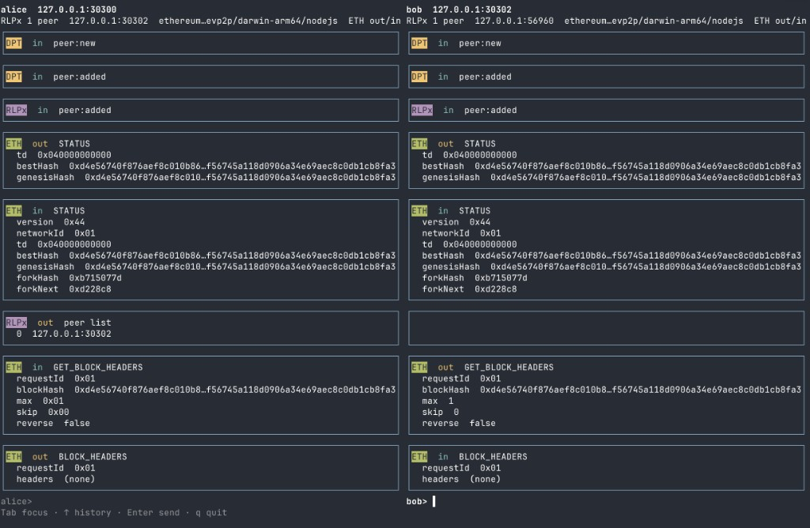

# @ethereumjs/devp2p `v10`

[![NPM Status][devp2p-npm-badge]][devp2p-npm-link]
[![GitHub Issues][devp2p-issues-badge]][devp2p-issues-link]
[![Actions Status][devp2p-actions-badge]][devp2p-actions-link]
[![Coverage Status][devp2p-coverage-badge]][devp2p-coverage-link]
[![Discord][discord-badge]][discord-link]

| Ethereum **devp2p** stack in TypeScript — discovery (DPT, DNS), **RLPx** transport, and **ETH** / **SNAP** wire subprotocols. |
| --- |

- 🔎 **DPT** node discovery (v4 UDP) and optional **EIP-1459** DNS ENR trees
- 🔐 **RLPx** encrypted sessions (ECIES handshake, capability negotiation)
- 📡 **ETH** wire (versions 62–68) and **SNAP** sync subprotocol
- 🧪 **`devp2p` CLI** — local lab, long-lived sessions, scripted wire verbs
- 📋 **JSON scenarios** for in-process regression tests (replaces legacy simulators)
- 🏄🏾‍♂️ Pure JS default · **Node.js ≥ 22**

Runnable examples: [`examples/`](./examples/). Generated API: [`docs/`](./docs).

## Table of Contents

- [Installation](#installation)
- [Choose a path](#choose-a-path)
- [CLI and lab](#cli-and-lab)
- [Library stack](#library-stack)
- [Examples](#examples)
- [JSON scenarios](#json-scenarios)
- [Debugging](#debugging)
- [API reference](#api-reference)
- [Developer](#developer)
- [Protocol references](#protocol-references)
- [EthereumJS](#ethereumjs)
- [License](#license)

## Installation

```shell
npm install @ethereumjs/devp2p
```

From this package directory (after `npm run build`) or any project that depends on `@ethereumjs/devp2p`, run the CLI with **`npx devp2p`** (see [CLI and lab](#cli-and-lab)).

Requires **`@ethereumjs/common`** on the same major version for chain config, bootstrap nodes, and fork IDs on ETH connections.

## Choose a path

| Goal | Start here |
| --- | --- |
| Step through discovery → handshake → ETH messages without a custom app | [CLI and lab](#cli-and-lab) (`init`, `node run`, `peer` / `eth` / `snap` verbs) |
| Minimal TypeScript that compiles in CI | [Examples](#examples) → `npm run examples` |
| Talk to mainnet bootnodes or live peers | [`examples/manual/`](./examples/manual/) (network access; use `DEBUG=ethjs,devp2p:*`) |
| Embed devp2p in your own node or tool | [Library stack](#library-stack) + [API reference](#api-reference) |
| Assert wire behaviour in tests | [JSON scenarios](#json-scenarios) |

## CLI and lab

The CLI is built for **one long-lived node process** and many short control commands. **`node run`** keeps a single DPT + RLPx stack (and negotiated subprotocols) until **`node stop`**. Every other command opens the node’s control socket, runs one request, and exits — the peer and handshake stay in the daemon.

**Lab layout** (default **`./lab`** under the current working directory; override with **`--dir`** / **`-l`**):

| Path | Purpose |
| --- | --- |
| `lab/network.json` | Chain / hardfork for the lab |
| `lab/<name>/node.json` | Listen ports, capabilities (`eth68`, `snap`, …) |
| `lab/<name>/key.json` | Node private key |
| `lab/<name>/enode.txt` | Enode URL |
| `lab/<name>/control.sock` | Unix socket while `node run` is active |
| `lab/.node` | Default node name (`devp2p use`) |

**Default node** when **`--node`** / **`-n`** is omitted: **`DEVP2P_NODE`** → **`lab/.node`** (from **`devp2p use <name>`** or updated when **`node run`** starts) → only node in the lab → only running daemon. Override anytime with **`--node bob`**.

### Session verbs

| Area | Commands |
| --- | --- |
| Peers | `peer add` (`--wait` for RLPx handshake), `peer list`, `peer disconnect` |
| Discovery | `dpt ping`, `dpt neighbours` (session DPT; prefer over ephemeral `discovery-v4 ping`) |
| Transport | `rlpx ping`, `wait --event rlpx.PONG` |
| ETH | `eth send`, `eth wait` (builders + `--json` / `--rlp`) |
| SNAP | `snap send`, `snap wait` |
| Any event | `wait --event peer.added \| eth.NAME \| snap.NAME \| rlpx.PONG` |
| REPL | `attach` (same verbs as one-shot CLI) |

NDJSON events: `npx devp2p node run --events ndjson`. Run **`npx devp2p --help`** for flags.

Session commands print one JSON object per line. To read a long result, pipe it through [jq](https://jqlang.org/) (`brew install jq` on macOS). The same program pretty-prints NDJSON from a daemon terminal.

```bash
npx devp2p peer list | jq .
```

Without jq, `python3 -m json.tool` formats one JSON object the same way.

### Two local nodes (STATUS + headers)

Use the **same working directory in all terminals** (typically **`packages/devp2p`**) — lab data is always **`./lab`** there. Run **`npm run build`**, then **restart every `node run`** after a rebuild (Ctrl+C, start again). **`devp2p use <name>`** in Terminal 3 picks the node for session commands (writes `lab/.node`); starting a daemon does **not** change that. JSON includes **`"node"`**. A current build answers `peer add --wait` with `data.rlpxPeers` and `data.connected`.

Default ports after `init --nodes alice,bob --base-port 30300`: **Alice 30300**, **Bob 30302** (see `lab/alice/node.json` and `lab/bob/node.json`).

**`use`** picks which lab node your one-shot commands talk to. **`node run`** must be running for that same node in another terminal. **`peer add`** is always “on the session node, dial this host/port (the other node).”

**Once — create the lab**

```bash
npx devp2p init --nodes alice,bob
```

**Terminal 1 — Bob’s daemon** (listen first so Alice can dial in)

```bash
npx devp2p use bob
npx devp2p node run --node bob --events ndjson
```

**Terminal 2 — Alice’s daemon**

```bash
npx devp2p use alice
npx devp2p node run --node alice --events ndjson
```

**Terminal 3 — on Alice’s session: dial Bob, STATUS, headers**

Commands below go to **Alice** (`use alice`). **30302** is **Bob’s** udp/tcp from `lab/bob/node.json`, not Alice’s 30300.

```bash
npx devp2p use alice
npx devp2p peer add 127.0.0.1 30302 --tcp 30302 --wait
npx devp2p peer list
```

(`--wait` until RLPx is up. Both daemons send a default mainnet genesis **STATUS** on connect so the link is not dropped after 5 seconds (`TIMEOUT`). A later `eth send STATUS` is a no-op if that already happened. **`peer list`** should still show index `0`. Redial after every daemon restart.)

```bash
npx devp2p eth send STATUS --json '{"td":"0x040000000000","bestHash":"0xd4e56740f876aef8c010b86a40d5f56745a118d0906a34e69aec8c0db1cb8fa3","genesisHash":"0xd4e56740f876aef8c010b86a40d5f56745a118d0906a34e69aec8c0db1cb8fa3"}'
npx devp2p eth send GET_BLOCK_HEADERS --json '{"requestId":"0x01","blockHash":"0xd4e56740f876aef8c010b86a40d5f56745a118d0906a34e69aec8c0db1cb8fa3","max":1,"skip":0,"reverse":false}'
npx devp2p eth wait BLOCK_HEADERS --timeout-ms 30000
```

Bob answers that get with **BLOCK_HEADERS** and the same request id. The list is empty: a lab node has no chain. The same empty answer is sent for the other ETH gets (bodies, receipts, pooled transactions) and for SNAP gets. Watch **`t: "event"`** lines on Terminals 1–2 (NDJSON). **`attach`** accepts the same verbs (`eth send GET_BLOCK_HEADERS blockHash=0x… max=1`, `wait eth.BLOCK_HEADERS`, …).

### Two-pane TUI

One terminal for two lab nodes. Each message is its own box, and the shorter box is padded so the two sides of a row stay aligned. A get lines up with the same get, then the answer lines up with the answer: **GET_BLOCK_HEADERS** beside **GET_BLOCK_HEADERS**, then **BLOCK_HEADERS** beside **BLOCK_HEADERS**. RLPx **PING** / **PONG** stay hidden unless you pass **`--pings`**. Protocol names (**ETH**, **SNAP**, **RLPx**, **DPT**) are inverted labels.



```bash
npx devp2p init --nodes alice,bob   # once
npx devp2p tui                      # alice | bob; starts both daemons
```

On startup the TUI dials the other lab node. Both sides send a mainnet genesis **STATUS** (Alice **30300**, Bob **30302**). The screenshot is that session continued: Alice's **`peer list`**, then Bob's **GET_BLOCK_HEADERS** and the empty **BLOCK_HEADERS** answer.

Each pane has its own prompt and its own command history (`lab/.tui-history.json`, 50 lines per node). **Tab** moves between them; a half-typed line stays put. **Up** / **Down** walk that pane's history. **Enter** sends that line to that node's control socket (same verbs as **`attach`**). A reply such as **`peer list`** is drawn as a box on that pane (each RLPx peer, or `(none)`). **`q`** on an empty prompt, or Ctrl+C, quits and stops only daemons this TUI started.

```text
alice> peer list
bob> eth send GET_BLOCK_HEADERS blockHash=0xd4e56740f876aef8c010b86a40d5f56745a118d0906a34e69aec8c0db1cb8fa3 max=1
```

Name the panes explicitly, or watch one local node beside a remote peer. The right side is that peer as seen from the left node, so only the left pane has a prompt:

```bash
npx devp2p tui --left alice --right bob
npx devp2p tui --left alice --remote 65.108.70.101:30303
npx devp2p tui --pings
```

The status line shows the listen address, RLPx peer count, client id when the hello carried one, and whether ETH **STATUS** has gone out and come in. If a daemon is already running, the TUI attaches and leaves it running on quit. A live message stream needs the daemon the TUI spawned (`node run --events ndjson`); stop a conflicting `node run` first.

### Toward a public peer

With **Alice** still running (`node run --node alice`). These are the **mainnet** bootnodes from `@ethereumjs/common` (`Common({ chain: Mainnet }).bootstrapNodes()`). Discovery pings to all four answered on 2026-10-22. The copy-paste target is the EU west node. If `neighbours` is empty, try the next row.

| Where | Address | UDP / TCP |
| --- | --- | --- |
| EU central | `157.90.35.166` | 30303 |
| EU west | `65.108.70.101` | 30303 |
| US east | `3.209.45.79` | 30303 |
| Asia southeast | `18.138.108.67` | 30303 |

```bash
npx devp2p use alice
npx devp2p dpt neighbours 65.108.70.101 30303 | jq .
```

The JSON `neighbours` list is what the bootnode returns: other nodes’ addresses, UDP/TCP ports, and ids. That is the useful public-network response. A bootnode answers only after a discovery ping and an ENR reply (the daemon sends both). If this node is quiet, try the next row in the table.

## Library stack

High-level layout ([diagram](./diagram/devp2p.svg)):

```text
  Your app                    @ethereumjs/common (chain, bootnodes, forkId)
      │                                    │
      ▼                                    ▼
    DPT ──peer table──► RLPx ──capabilities──► ETH / SNAP (per Peer)
   UDP v4              TCP + ECIES              RLP + optional Snappy
   optional DNS ENR
```

`DPT`, `RLPx`, and each negotiated subprotocol expose an **`events`** emitter ([EventEmitter3](https://github.com/primus/eventemitter3)). Register listeners before bootstrap or dial.

```ts
import type { ETH } from '@ethereumjs/devp2p'
import { EthMessageCodes } from '@ethereumjs/devp2p'
import { intToBytes, hexToBytes } from '@ethereumjs/util'

// Discovery peer table
dpt.events.on('peer:added', (peer) => {
  /* candidate enode */
})
dpt.events.on('error', (err) => {
  console.error(err)
})

// Encrypted sessions (typically share one DPT instance)
rlpx.events.on('peer:added', (peer) => {
  const eth = peer.getProtocols()[0] as ETH

  eth.sendStatus({
    td: intToBytes(17179869184),
    bestHash: hexToBytes('0xd4e56740f876aef8c010b86a40d5f56745a118d0906a34e69aec8c0db1cb8fa3'),
    genesisHash: hexToBytes('0xd4e56740f876aef8c010b86a40d5f56745a118d0906a34e69aec8c0db1cb8fa3'),
  })

  eth.events.once('status', () => {
    eth.sendMessage(EthMessageCodes.GET_BLOCK_HEADERS, [
      Uint8Array.from([1]),
      [intToBytes(1), Uint8Array.from([1]), Uint8Array.from([]), Uint8Array.from([])],
    ])
  })

  eth.events.on('message', (code, payload) => {
    /* BLOCK_HEADERS, NEW_BLOCK_HASHES, … */
  })
})
```

Construct `dpt` and `rlpx` with a secp256k1 private key, pass **`common`** and **`capabilities`** (e.g. `[ETH.eth68, SNAP.snap]` from `@ethereumjs/devp2p`) into `RLPx`, and optionally attach the same **`dpt`** instance so discovered peers feed RLPx dials.

### Layer guide

| Layer | Module | Typical use |
| --- | --- | --- |
| Discovery | `DPT` | Kademlia peer table, UDP `ping` / `findNeighbours`, ban list |
| DNS | `DNS` / `ENR` | EIP-1459 ENR tree lookup (`DPT` options `shouldGetDnsPeers`, …) |
| Transport | `RLPx`, `Peer` | Handshake, multiplex subprotocols, base `ping` / `pong` |
| Wire | `ETH`, `SNAP` | `sendStatus`, `sendMessage`, `EthMessageCodes`, `SnapMessageCodes` |

**Discovery** — see [`examples/dpt.ts`](./examples/dpt.ts) (CI) and [`examples/manual/dptDiscovery.ts`](./examples/manual/dptDiscovery.ts) (bootstrap loop). Bootstrap from `@ethereumjs/common`:

```ts
import { Common, Mainnet } from '@ethereumjs/common'

const bootnodes = new Common({ chain: Mainnet }).bootstrapNodes()
for (const node of bootnodes) {
  dpt
    .bootstrap({ address: node.ip, udpPort: node.port, tcpPort: node.port })
    .catch((err) => console.error(`DPT bootstrap error: ${err}`))
}
```

**Transport** — see [`examples/rlpx.ts`](./examples/rlpx.ts) for `RLPx` + `Common` + ETH capabilities.

**ETH / SNAP** — after RLPx negotiates a subprotocol, call `eth.sendStatus()` and wait for `status` before other ETH messages. Full mainnet-style flow: [`examples/manual/peerCommunication.ts`](./examples/manual/peerCommunication.ts).

### Events (summary)

| Emitter | Events |
| --- | --- |
| `dpt.events` | `peer:added`, `peer:removed`, `peer:new`, `listening`, `close`, `error` |
| `rlpx.events` | `peer:added`, `peer:removed`, `peer:error`, `listening`, `close`, `error` |
| `eth.events` | `status`, `message` |
| `peer.events` | `error`, `ping`, `pong` (base protocol) |

## Examples

| Example | Role |
| --- | --- |
| [`dpt.ts`](./examples/dpt.ts) | Minimal DPT setup and discovery events (CI) |
| [`rlpx.ts`](./examples/rlpx.ts) | RLPx with `Common` and ETH capabilities (CI) |
| [`manual/dptDiscovery.ts`](./examples/manual/dptDiscovery.ts) | Bootstrap against mainnet bootnodes |
| [`manual/peerCommunication.ts`](./examples/manual/peerCommunication.ts) | Full DPT + RLPx + ETH exchange against live peers |

```shell
npm run examples
```

Manual live acceptance (not CI; needs outbound UDP/TCP):

```shell
npm run accept:live -- eth68
```

Manual examples need network access:

```shell
DEBUG=ethjs,devp2p:* npx tsx ./examples/manual/peerCommunication.ts
```

## JSON scenarios

[`scenarios/`](./scenarios/) holds declarative specs (DPT, RLPx, ETH, SNAP) executed in-process by the lab **`ScenarioRunner`**. They replace the old dedicated simulator test files.

```shell
npm run test:scenarios
npx devp2p scenario list
npx devp2p scenario run scenarios/eth-status-success.json
```

## Debugging

Uses the [`debug`](https://github.com/visionmedia/debug) package. Include **`ethjs`** in **`DEBUG`** or no devp2p loggers run.

```shell
DEBUG=ethjs,devp2p:dpt:*,devp2p:rlpx:peer,devp2p:eth npx tsx ./examples/manual/peerCommunication.ts
```

| Logger | Focus |
| --- | --- |
| `devp2p:dpt` / `devp2p:dpt:server` | Discovery UDP |
| `devp2p:dns:dns` | DNS ENR discovery |
| `devp2p:rlpx` / `devp2p:rlpx:peer` | RLPx framing and HELLO / PING / DISCONNECT |
| `devp2p:eth` | ETH message names (e.g. `devp2p:eth:GET_BLOCK_HEADERS`) |
| `devp2p:FIRST_PEER` | Limit traffic to the first successful subprotocol peer |
| IP filter | e.g. `devp2p:3.209.45.79` |

Add **`verbose`** for full payload dumps. DNS integration tests: set **`DEVP2P_DNS_INTEGRATION=1`**.

## API reference

Full signatures and options: generated **[TypeDoc](./docs)**.

Main exports from `@ethereumjs/devp2p`:

| Export | Role |
| --- | --- |
| `DPT` | Discovery and peer table |
| `RLPx`, `Peer` | Transport |
| `ETH`, `EthMessageCodes` | Ethereum wire subprotocol |
| `SNAP`, `SnapMessageCodes` | Snap sync subprotocol |
| `DNS`, `ENR` | DNS discovery helpers |
| `genPrivateKey`, `pk2id`, `id2pk`, `devp2pDebug` | Keys and debug namespace |

Implementation entrypoints: [`src/dpt/`](./src/dpt/), [`src/rlpx/`](./src/rlpx/), [`src/protocol/`](./src/protocol/), [`src/dns/`](./src/dns/). Lab-only code under [`src/lab/`](./src/lab/) powers the CLI and scenarios (not required for library consumers).

## Developer

**CJS and ESM** — `dist/cjs` and `dist/esm`; see `package.json` `exports`.

```ts
import { DPT, RLPx, ETH } from '@ethereumjs/devp2p'
```

Local **`/lab/`** (CLI data) is gitignored; do not confuse with **`src/lab/`** sources.

**Diagram** — edit `devp2p.drawio`, export `diagram/devp2p.svg` / `.png` (border 20px, 300 DPI for PNG).

**Monorepo** — [`DEVELOPER.md`](../../DEVELOPER.md), package workflow **Devp2p** on CI.

## Protocol references

- [Ethereum networking layer (discovery overview)](https://ethereum.org/en/developers/docs/networking-layer/)
- [devp2p RLPx](https://github.com/ethereum/devp2p/blob/master/rlpx.md)
- [Ethereum wire protocol (ETH)](https://github.com/ethereum/devp2p/blob/master/caps/eth.md)
- [Snap protocol](https://github.com/ethereum/devp2p/blob/master/caps/snap.md)
- [EIP-1459 DNS discovery](https://eips.ethereum.org/EIPS/eip-1459)

Other implementations: [go-ethereum p2p](https://github.com/ethereum/go-ethereum/tree/master/p2p), [pydevp2p](https://github.com/ethereum/pydevp2p) (historical).

## EthereumJS

The `EthereumJS` GitHub organization and its repositories are managed by members of the former Ethereum Foundation JavaScript team and the broader Ethereum community. If you want to join for work or carry out improvements on the libraries see the [developer docs](../../DEVELOPER.md) for an overview of current standards and tools and review our [code of conduct](../../CODE_OF_CONDUCT.md).

## License

[MIT](https://opensource.org/licenses/MIT)

[discord-badge]: https://img.shields.io/static/v1?logo=discord&label=discord&message=Join&color=blue
[discord-link]: https://discord.gg/TNwARpR
[devp2p-npm-badge]: https://img.shields.io/npm/v/ethereumjs-devp2p.svg
[devp2p-npm-link]: https://www.npmjs.org/package/ethereumjs-devp2p
[devp2p-issues-badge]: https://img.shields.io/github/issues/ethereumjs/ethereumjs-monorepo/package:%20devp2p?label=issues
[devp2p-issues-link]: https://github.com/ethereumjs/ethereumjs-monorepo/issues?q=is%3Aopen+is%3Aissue+label%3A"package%3A+devp2p"
[devp2p-actions-badge]: https://github.com/ethereumjs/ethereumjs-monorepo/workflows/Devp2p/badge.svg
[devp2p-actions-link]: https://github.com/ethereumjs/ethereumjs-monorepo/actions?query=workflow%3A%22Devp2p%22
[devp2p-coverage-badge]: https://codecov.io/gh/ethereumjs/ethereumjs-monorepo/branch/master/graph/badge.svg?flag=devp2p
[devp2p-coverage-link]: https://codecov.io/gh/ethereumjs/ethereumjs-monorepo/tree/master/packages/devp2p
