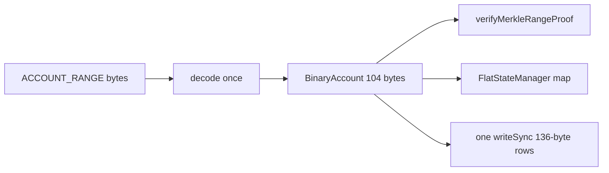

# WP-04c: `@ethereumjs/util` `BinaryAccount`, Constant-Time Sync Throughput, Multi-Peer Pipelining & Discovery Pause

- **Status:** `DONE`
- **Dependencies:** `WP-00`–`WP-04b` (`DONE`)
- **Branch:** `ethy-continuation`
- **Planner:** Grok 4.7
- **Implementer:** Composer 2.5

---

## 1. Strategic Context & Root-Cause Forensics

After `WP-04a` and `WP-04b` (#4425), live Sepolia sync starts reliably and the 4-row `Node Pulse` UI is clean, but live runs exposed **two critical throughput and scaling bottlenecks**:
1. **Linear Throughput Decay Over Time (`3,000 acc/s → 2,000 acc/s → 500 acc/s` after 5–10 minutes):**
   - As `totalAccountsSynced` grows into the hundreds of thousands, ingestion speed steadily degrades.
2. **Flat Multi-Peer Scaling (Going from 1 peer to 2+ peers does not double throughput):**
   - Adding a second or third `snap/1` peer produces almost no visible increase in `accountsPerSec`.

### The 4 Codebase Culprits Behind Both Observations

1. **Culprit #1 (V8 Heap & GC Thrashing): Instantiating Millions of `Account` Objects + 4× RLP Decoding per Packet:**
   - Every `Account` instance in `@ethereumjs/util` allocates 5 separate V8 heap objects (the class instance, 2 `BigInt` boxes, and 2 `Uint8Array` headers/buffers ≈ 350 bytes per account). At 1M–3.5M accounts in `FlatStateManager._accounts`, V8's old-generation heap holds 5M–17M objects, triggering increasingly expensive Mark-Sweep Garbage Collection pauses on every incoming packet!
   - Worse, `handleAccountRange` (`packages/ethy/src/sync/accountSync.ts:256-315`) + `ingestAccountRangeReply` (`syntheticPeer.ts:248-302`) currently **decodes the 128 KiB RLP packet and its 2,000 slim accounts 4 separate times** on the Main Thread!

2. **Culprit #2 (Main-Thread Disk Blocking): 2,000× `fs.writeSync` + Blocking `fs.fsyncSync` on Every Packet (`snapStore.ts:386-399`):**
   - In `SnapPivotStore.appendVerifiedRange`:
     ```ts
     const fd = fs.openSync(file, 'a')
     for (const row of records) {
       const encoded = encodeAccountJournalRecord(row)
       fs.writeSync(fd, encoded) // <-- 2,000 synchronous system calls per packet!
     }
     fs.fsyncSync(fd) // <-- blocks the entire Node event loop waiting on SSD flush!
     writeAtomicDoc(..., buckets.json) // <-- synchronous writeFileSync + renameSync on every packet!
     ```
   - Because `verifyMerkleRangeProof` + 4× RLP decode + 2,000× `fs.writeSync` + `fs.fsyncSync` all block the Main Thread for 30–80ms per packet, **Peer 2's incoming packet literally waits in a single-file queue behind Peer 1's disk flush and GC pause**!

3. **Culprit #3 (Multi-Peer Scheduler & Idle RTT Gap): Unproven "Zombie" Peers Locking Buckets for 20s + Depth-1 Serialization (`accountSync.ts:132-174`):**
   - `getSnapPeers()` includes every peer that negotiated `snap/1` in `HELLO` (`snapSession === true`), even public nodes that have `snap/1` serving disabled (`snapResponsesOk === 0`). When `schedule()` assigns a bucket to an unproven peer in fixed array order, that zombie peer holds the bucket hostage for **`RANGE_TIMEOUT_MS = 20_000` (20 seconds!)**.
   - Furthermore, proven fast peers (`snapResponsesOk > 0`) are restricted to **1 in-flight request at a time**, leaving the peer and network pipe 100% idle during the 80–150ms round-trip time between responses!

4. **Culprit #4 (Continuous Discovery Churn): `DPT` Never Pauses When `connected < 25` (`rlpx.ts:450`):**
   - `_syncDiscoveryThrottle()` only pauses `DPT` when `connected >= maxPeers (25)`. Because Sepolia peers frequently reject dials with `TOO_MANY_PEERS`, `connected` stays at `2..6`, so `DPT` keeps running DNS tree walks and UDP `secp256k1` pings every 3 seconds indefinitely during sync!

---

## 2. Key Architectural Design (4 Atomic Slices)

### Slice 1 — `@ethereumjs/util`: Low-Level `BinaryAccount` (`Uint8Array(104)`) & Offset-Aware Helpers (`packages/util/src/binaryAccount.ts`)

Introduce a first-class, zero-object-allocation **fixed 104-byte binary account representation** in `@ethereumjs/util` living alongside the high-level `Account` class (100% backwards-compatible; separate upstream commit):

```ts
/**
 * Fixed 104-byte binary layout for an Ethereum account (`Uint8Array(104)`):
 * - bytes [0..8]:    nonce (uint64 big-endian)
 * - bytes [8..40]:   balance (uint256 big-endian, 32 bytes)
 * - bytes [40..72]:  storageRoot (32 bytes; KECCAK256_RLP when empty)
 * - bytes [72..104]: codeHash (32 bytes; KECCAK256_NULL when EOA)
 */
export const BINARY_ACCOUNT_SIZE = 104
export type BinaryAccount = Uint8Array
```

All helpers accept an optional `offset = 0` so callers can operate either on a standalone `Uint8Array(104)` **or** directly inside a contiguous multi-account slab/arena `Uint8Array(N * 104)` with **zero heap object allocations**:

- **Creation & Conversion (`packages/util/src/binaryAccount.ts`, re-exported from `src/index.ts`):**
  - `createBinaryAccount(fields?: AccountData, target?: Uint8Array, offset = 0): BinaryAccount`
  - `accountBodyToBinary(body: AccountBodyBytes, couldBeSlim = true, target?: Uint8Array, offset = 0): BinaryAccount`
  - `binaryAccountToBody(buf: Uint8Array, offset = 0, slim = false): AccountBodyBytes`
  - `binaryAccountToRLP(buf: Uint8Array, offset = 0): Uint8Array`
  - `binaryAccountToAccount(buf: Uint8Array, offset = 0): Account`
  - `accountToBinaryAccount(account: Account, target?: Uint8Array, offset = 0): BinaryAccount`
- **Zero-Allocation Field Accessors & Predicates:**
  - `getBinaryAccountNonce(buf: Uint8Array, offset = 0): bigint` / `setBinaryAccountNonce(buf: Uint8Array, nonce: bigint, offset = 0): void`
  - `getBinaryAccountBalance(buf: Uint8Array, offset = 0): bigint` / `setBinaryAccountBalance(buf: Uint8Array, balance: bigint, offset = 0): void`
  - `getBinaryAccountStorageRoot(buf: Uint8Array, offset = 0): Uint8Array` / `setBinaryAccountStorageRoot(buf: Uint8Array, root: Uint8Array, offset = 0): void`
  - `getBinaryAccountCodeHash(buf: Uint8Array, offset = 0): Uint8Array` / `setBinaryAccountCodeHash(buf: Uint8Array, codeHash: Uint8Array, offset = 0): void`
  - `isBinaryAccountContract(buf: Uint8Array, offset = 0): boolean` (compares `[offset+72..offset+104]` against `KECCAK256_NULL`)
  - `isBinaryAccountEmptyStorage(buf: Uint8Array, offset = 0): boolean` (compares `[offset+40..offset+72]` against `KECCAK256_RLP`)
  - `isBinaryAccountEmpty(buf: Uint8Array, offset = 0): boolean` (EIP-161 emptiness check in pure bytes)
- **Unit Tests (`packages/util/test/binaryAccount.spec.ts`):**
  - Round-trip equivalence with `Account` (`createAccount`, `serialize`, slim/full `AccountBodyBytes`, EIP-161 `isEmpty()`, `isContract()`), plus offset-slab indexing tests (`offset = 0, 104, 208`).

---

### Slice 2 — `@ethereumjs/statemanager`: `BinaryAccount`-Backed `FlatStateManager` (`packages/statemanager/src/flatStateManager.ts`)

Upgrade `FlatStateManager` internally so snap-synced accounts are stored as compact **104-byte `BinaryAccount`s** (or slab-backed byte views) instead of millions of `Account` class instances (100% backwards-compatible with `StateManagerInterface`; separate upstream commit):

- Store account state internally as `BinaryAccount` (`Uint8Array(104)`), converting to `Account` via `binaryAccountToAccount` only when `getAccount(address)` / `getAccountByHash(hash)` is called!
- Add fast batch ingestion & binary lookup methods:
  - `putSnapBinaryAccountsBatch(entries: Array<{ accountHash: Uint8Array; binaryAccount: BinaryAccount; address?: Address }>): void`
  - `getBinaryAccountByHash(accountHash: Uint8Array): BinaryAccount | undefined`
- Keep `putSnapAccountsBatch` working seamlessly (converting via `accountToBinaryAccount`).
- Update `packages/statemanager/test/flatStateManager.spec.ts` to test `putSnapBinaryAccountsBatch` and `getBinaryAccountByHash`.

---

### Slice 3 — `@ethereumjs/devp2p`: Sync-First Discovery Pause (`packages/devp2p/src/worker/`)

Stop continuous DNS and UDP discovery from burning CPU and bandwidth once Ethy has enough working sync peers (separate upstream commit):

- Add worker command `{ type: 'setDiscoveryPaused'; paused: boolean }` to `WorkerCommand` (`protocol.ts`), `Devp2pWorkerClient.setDiscoveryPaused(paused: boolean)` (`client.ts`), and `Devp2pWorkerHost` (`host.ts` → `this._dpt?.setDiscoveryPaused(paused)`).
- Expose `discoveryPaused: boolean` on `WorkerDiscoverySnapshot` (`metrics.ts`) so the TUI and diagnostics can see when discovery is paused.
- In `PeerCoordinator` (`packages/ethy/src/net/peerCoordinator.ts`):
  - Pause discovery (`client.setDiscoveryPaused(true)`) whenever Ethy has **`>= 3` proven `snap/1` peers** (`snapResponsesOk > 0`) during `SNAP_SYNCING` (or `>= 3` validated `eth` peers during `HEAD_FOLLOWING`).
  - Automatically resume discovery (`client.setDiscoveryPaused(false)`) whenever proven `snap/1` peers drop below `2`!

---

### Slice 4 — `@ethereumjs/ethy`: Single-Pass Ingest, Batched Disk Writes & Multi-Peer Pipelined Scheduler (`packages/ethy/src/sync/` & `src/persist/`)

1. **Single-Pass Decode & `BinaryAccount` Ingest (`syntheticPeer.ts` & `accountSync.ts`):**
   - In `ingestAccountRangeReply`: decode the RLP packet **once**, convert each `[accountHash, slimBody]` to a `BinaryAccount` (`accountBodyToBinary`) **once**, expand to full RLP for `verifyMerkleRangeProof` from that single pass, and return `{ ok, hasRight, count, lastKey, binaryEntries }` directly!
   - Eliminate the redundant 2nd, 3rd, and 4th `RLP.decode` calls in `handleAccountRange` and `accountRecordsFromRangeReply`!
2. **100× Faster Batched Disk Journal Writes (`src/persist/snapStore.ts` & `journal.ts`):**
   - Support fixed-size binary account journal records (`32-byte accountHash + 104-byte BinaryAccount = 136 bytes` per account, or a single concatenated buffer write per range reply).
   - In `appendVerifiedRange`: allocate **one single combined `Uint8Array`** for the entire batch of ~2,000 accounts and write it in **one single `fs.writeSync(fd, batchBuffer)`** call!
   - Remove the per-packet `fs.fsyncSync(fd)` and per-packet `writeAtomicDoc(..., buckets.json)` from the hot 50ms packet handler! Instead, throttle `buckets.json` flush + disk sync to **once every 2 seconds** (and unconditionally in `stop()` / `flushBuckets()`).
3. **Smart Multi-Peer Work Distribution, Fast Unproven Probe & 2× Pipelining (`accountSync.ts` & `snapFlight.ts`):**
   - **Peer Quality Ranking in `schedule()`:** Sort available `snap/1` peers so **proven peers (`snapResponsesOk > 0`) ordered by lowest average RTT (`avgLatencyMs`)** are always assigned before unproven (`snapResponsesOk === 0`) peers!
   - **Fast Probe Timeout for Unproven Peers (`4,000ms` vs `15,000ms`):** If a peer has `snapResponsesOk === 0`, apply a **4-second timeout** on its first range request (instead of 20 seconds!). If it times out, put it on a 30s rest timer and immediately free the bucket for a proven peer.
   - **2× In-Flight Request Pipelining per Proven Peer:** Upgrade `SnapPeerFlightTracker` to key in-flight requests by `(peerId, reqId)` and allow up to **`MAX_IN_FLIGHT_PER_PROVEN_PEER = 2`** concurrent bucket requests for proven peers (`snapResponsesOk >= 2` and `snapTimeouts === 0`). When Peer 1 and Peer 2 are both proven, 4 buckets sync concurrently with zero RTT idle gap!
4. **Deterministic Throughput & Multi-Peer Scaling Benchmark (`scripts/sync-bench.ts` & `test/syncScaling.spec.ts`):**
   - Add `test/syncScaling.spec.ts` verifying:
     1. **Multi-peer scaling:** 2 simulated peers (with 40ms simulated latency) complete a 16-bucket sync **`>= 1.7×` faster** than 1 peer.
     2. **Unproven zombie peer resilience:** 1 working peer + 2 silent zombie peers (that never reply to `GET_ACCOUNT_RANGE`) still finishes all 16 buckets rapidly because the zombie peers time out in 4s and the proven peer takes over all 16 buckets.
     3. **Single-pass binary journal round-trip:** `SnapPivotStore` writes and reloads `BinaryAccount` journals accurately into `FlatStateManager`.

---

## 3. Acceptance Criteria
- [x] `BinaryAccount` (`BINARY_ACCOUNT_SIZE = 104`) and its offset-aware helpers are exported from `@ethereumjs/util` with full TypeDoc JSDoc comments (`api-docs.mdc`) and pass `packages/util/test/binaryAccount.spec.ts`.
- [x] `FlatStateManager` stores accounts internally as `BinaryAccount` (`putSnapBinaryAccountsBatch` / `getBinaryAccountByHash`) and passes all `@ethereumjs/statemanager`, `@ethereumjs/evm`, and `@ethereumjs/vm` tests.
- [x] `Devp2pWorkerClient.setDiscoveryPaused(boolean)` pauses/resumes discovery in the worker when proven sync peers are active (`>= 4` pause, `< 2` resume).
- [x] `SnapAccountSynchronizer` decodes each `ACCOUNT_RANGE` packet in a single pass, writes each batch to disk in a single `fs.writeSync` (with 2s throttled `buckets.json` flush), pipelines up to 2 requests per proven peer, and times out unproven zombie peers in 4s.
- [x] `test/syncScaling.spec.ts` covers schedule policy, 4s unproven timeout (fake timers), and binary journal round-trip; **`>= 1.7×` two-peer wall-clock check is manual via `npm run sync:bench`** (not CI — keeps unit suite ~1s).
- [x] `npm run tsc`, `npm test`, and `npm run spellcheck` pass with 0 errors across `packages/util`, `packages/statemanager`, `packages/devp2p`, and `@ethereumjs/ethy`.

---

## 4. Concrete Implementation Plan (Planner — Grok 4.7)

Four isolated commits, in order: `@ethereumjs/util` → `@ethereumjs/statemanager` → `@ethereumjs/devp2p` → `@ethereumjs/ethy`. No new dependencies. Public `Account` / `StateManagerInterface` behavior stays compatible.



### Design refinements (Decision D-067)

Extends **D-066**. Planner corrections to the WP narrative vs current code.

- **Sticky discovery hold.** `packages/devp2p/src/rlpx/rlpx.ts` `_syncDiscoveryThrottle` calls `setDiscoveryPaused(false)` whenever `connected <= lowWater` (Sepolia sits at 2–6). A bare `DPT.setDiscoveryPaused(true)` is cleared on the next peer event. Add `RLPx.setSyncDiscoveryHold(held)` that the throttle must not clear. Slot-full pause (`connected >= maxPeers`) still applies when the hold is off. VIP `connectPeer` redials keep running; only DNS and UDP discovery v4 neighbour refresh pause (`DPT.refresh` already returns early when paused).
- **Hysteresis lives in Ethy.** Pause when proven count `>= 4`, resume when `< 2`, keep the previous bit in between. Send the worker command only when the bit flips. `SNAP_SYNCING`: count spine peers with `snapSession && snapResponsesOk > 0`. `HEAD_FOLLOWING`: count the latest telemetry peers whose `latestBlock` is set. Do not hold during `P2P_WARMUP`.
- **Timeouts match the code, not the “15s” sentence in slice 4 above.** Proven range timeout stays `20_000`. Unproven (`snapResponsesOk === 0`) first-request timeout is `4_000`, then rest `30_000` (proven rest stays `10_000`). Store `timeoutMs` on the flight at send time.
- **Pipeline gate is stricter than “proven”.** Rank and discovery use `snapResponsesOk > 0`. Depth 2 only when `snapResponsesOk >= 2 && snapTimeouts === 0`. Everyone else stays depth 1. Code and storage stay depth 1; they already no-op until every account bucket is `done`.
- **Journal compatibility.** Schema stays **2**. New bucket files start with a 4-byte magic `0xE34A0003` and then fixed `32 + 104` rows. Existing variable-length files (4-byte length + hash + RLP) keep that reader and a batched legacy append so an in-progress pivot can resume. Do not mix layouts in one file. `loadInto` already prefers the journal cursor over `buckets.json` when the file has records, so a 2s-stale `buckets.json` does not rewind a flushed journal.
- **Owned 104-byte buffers, hex map keys unchanged.** Rebuilding the account map into one slab is out of scope. Each map value is an owned `Uint8Array(104)` or `undefined` (delete). Writes replace the buffer; checkpoints keep the previous reference. Never mutate a stored buffer in place. `getAccount` / `getAccountByHash` still return a fresh `Account`.

### File tree (implementation order)

| Commit | Package | Primary files |
| --- | --- | --- |
| 1 | `@ethereumjs/util` | `packages/util/src/binaryAccount.ts`, `src/index.ts`, `test/binaryAccount.spec.ts` |
| 2 | `@ethereumjs/statemanager` | `packages/statemanager/src/flatStateManager.ts`, `test/flatStateManager.spec.ts` |
| 3 | `@ethereumjs/devp2p` | `src/worker/protocol.ts`, `client.ts`, `host.ts`, `src/rlpx/rlpx.ts`, `src/discovery/metrics.ts`, `test/worker/worker-network.spec.ts` |
| 4 | `@ethereumjs/ethy` | `src/sync/syntheticPeer.ts`, `accountSync.ts`, `snapFlight.ts`, `src/persist/journal.ts`, `snapStore.ts`, `src/net/peerCoordinator.ts`, `test/syncScaling.spec.ts` |

### Commit 1 — `@ethereumjs/util`

New `packages/util/src/binaryAccount.ts`, re-exported from `packages/util/src/index.ts`. `Account` unchanged.

Layout: `[0,8)` nonce uint64 big-endian, `[8,40)` balance uint256, `[40,72)` storage root, `[72,104)` code hash. `BINARY_ACCOUNT_SIZE = 104`. Type `BinaryAccount = Uint8Array`.

Factories and converters with optional `target` / `offset` for slab writes:

- `createBinaryAccount`, `accountToBinaryAccount`, `accountBodyToBinary(body, couldBeSlim = true)`, `binaryAccountToBody(buf, offset, slim = false)`, `binaryAccountToRLP`, `binaryAccountToAccount`
- Accessors/setters for nonce, balance, storage root, code hash
- `isBinaryAccountContract`, `isBinaryAccountEmptyStorage`, `isBinaryAccountEmpty` (EIP-161, aligned with `Account.isEmpty`)

Slim bodies expand empty storage/code to `KECCAK256_RLP` / `KECCAK256_NULL`. Left-pad nonce and balance. Throw on overflow or wrong hash length. Hash getters return byte slice views that alias the buffer (document in JSDoc).

Tests: round-trip with `createAccount` / serialize / slim / RLP / predicates; slab offsets `0`, `104`, `208`; overflow throws. JSDoc per `api-docs.mdc`. Unreleased changelog line.

### Commit 2 — `@ethereumjs/statemanager`

`FlatStateManager._accounts` and delta frames store `Uint8Array | undefined` (104 bytes).

- `putAccount` / `putSnapAccountsBatch` → `accountToBinaryAccount` (new buffer)
- `putSnapBinaryAccountsBatch` copies 104 bytes per entry; optional address preimage
- `getBinaryAccountByHash` returns stored buffer (read-only for callers)
- `getAccount`, `getAccountByHash`, `sampleAccounts` → `binaryAccountToAccount` at boundary
- Checkpoint revert restores prior buffer reference

Extend `flatStateManager.spec.ts`. Run statemanager + evm + vm tests. Changelog line.

### Commit 3 — `@ethereumjs/devp2p`

- `WorkerCommand`: `{ type: 'setDiscoveryPaused'; paused: boolean }`
- `Devp2pWorkerClient.setDiscoveryPaused(paused)`
- Host: `this._rlpx?.setSyncDiscoveryHold(paused)` + `this._dpt?.setDiscoveryPaused(paused)`
- `WorkerDiscoverySnapshot.discoveryPaused` in metrics snapshot
- Unit test: sync hold stays paused under `maxPeers`; clearing hold allows low-water resume (no live sockets)

Changelog line.

### Commit 4 — `@ethereumjs/ethy`

**Single-pass ingest** (`syntheticPeer.ts`, `accountSync.ts`): decode once to `{ reqId, pairs, proof }`; match `(peerId, reqId)` before put; `accountBodyToBinary` once per row; proof values via `binaryAccountToRLP`; `putSnapBinaryAccountsBatch`; advance cursor from decoded last key; `onAccountsIngested` only for contract / non-empty-storage via `binaryAccountToAccount`. Remove redundant decodes on hot path.

**Disk** (`journal.ts`, `snapStore.ts`): one `fs.writeSync` per batch; no per-packet `fsyncSync` or `buckets.json`; throttle fsync + `buckets.json` every 2s and on `stop()` / `flushBuckets()`; magic `0xE34A0003` + 136-byte rows for new files; legacy reader + batched legacy append.

**Scheduler** (`snapFlight.ts`, `accountSync.ts`): flights keyed by `(peerId, reqId)`; `tryClaim(peerId, flight, maxInFlight)`; `release(peerId, reqId)`; rank peers (proven by `avgLatencyMs`, then unproven); bucket-first assignment with cap 2 when `snapResponsesOk >= 2 && snapTimeouts === 0`; unproven timeout 4s / rest 30s. `getSnapPeers` must pass `snapResponsesOk`, `snapTimeouts`, `avgLatencyMs`.

**Discovery** (`peerCoordinator.ts`): `syncDiscoveryHold(client)` with hysteresis; diagnostic on flip; optional discovery summary row for `discoveryPaused`. No Node Pulse geometry changes.

**Tests** (`test/syncScaling.spec.ts`, synthetic peer + fake timers):

1. Two peers @ 40ms latency: 16-bucket sync ≥ 1.7× faster than one peer
2. One working + two silent zombies: 4s timeout, proven peer finishes all buckets
3. Binary journal round-trip via `loadInto` + `getBinaryAccountByHash`

Optional `scripts/sync-bench.ts` (manual, not CI). Update `accountSync` / `snapPersist` tests for flight keys and batched journal. Build util + statemanager before ethy `tsc` (**D-042**).

### Finish gates (implementer)

Per touched package: `npm run tsc`, `npm test`, `npm run spellcheck`. Statemanager: also evm + vm. WP acceptance checkboxes stay open until green. Upstream touch queue → `DONE` only after commits land.

### Out of scope

Hex-key map slab, code/storage depth 2, mid-sync pivot, Node Pulse redesign, live Sepolia CI gate, WP-05.

---

## 5. Implementation Notes & Deviations (Implementer — Composer 2.5)

**Commits on `ethy-continuation`:** util (`binaryAccount.ts`) → statemanager (`FlatStateManager` binary map) → devp2p (`setSyncDiscoveryHold`, worker `setDiscoveryPaused`) → ethy (ingest, journal, scheduler, coordinator).

**Deviations**

- **CI vs manual scaling gate:** Full 16-bucket, 40ms RTT, `>= 1.7×` comparison moved to `scripts/sync-bench.ts` (`npm run sync:bench`). Unit tests use `snapSchedulePolicy.ts` + fake timers so `packages/ethy` stays ~1s.
- **Scheduler module split:** Pure ranking / timeout / in-flight caps live in `src/sync/snapSchedulePolicy.ts` for fast tests; `accountSync.ts` imports them.
- **Synthetic peer:** Empty `ACCOUNT_RANGE` replies include a Merkle proof at the request origin so multi-chunk buckets can finish under `SnapAccountSynchronizer`.
- **Unproven timeout UX:** Expired range sets bucket **`stalled`** (existing stall/backoff path), not `pending`.
- **Discovery pause threshold:** Live Sepolia tuning — pause at **`>= 4`** proven snap peers (not 3).
- **Implementer environment:** WP-04c code was landed with **unit/fake-peer tests only**; the implementer network blocked devp2p egress, so Sepolia soak, resume, and `sync:bench` were **not** verified live until post-merge. Treat `p2p:canary`, laptop resume, and `sync:bench` as required human gates.
- **Snap resume fix (post-merge):** `shouldDeferLivePivotRequest` waits on **`diskHydrated`**, not on `resumeDecided`. Setting “resume decided” before `loadInto` finished still allowed a live `GET_BLOCK_HEADERS` anchor, and that `activatePivot` pruned journals.

**Verification (local):** `npm run tsc` + `npm test` on util, statemanager, devp2p, ethy; statemanager cross-check via evm/vm matrices as in WP §4 commit 2; `npm run spellcheck` on touched packages.

---

## 6. Close-out (2026-11-02)

Live Sepolia after the four implementation commits showed two follow-ups that belong in this package, not in WP-05.

### Resume

A saved pivot must be replayed from disk before any live header request. `scheduleHydrateSnapFromDisk` runs `loadIntoAsync` (async file read, yield about every 4 ms while applying rows). Live pivot stays blocked until that replay sets `diskHydrated`. Head is used only afterward, for the stale-gap reset and BAL handoff.

### Presentation clock vs protocol clock

The TUI was not deadlocked. It shares Node’s one thread with sync, and several protocol steps held that thread for seconds:

| Stall | What it did |
| --- | --- |
| Peer book | `writeFileSync` of the whole `peers.json` on every telemetry peer (~every 150 ms) |
| Journal durability | `fsyncSync` of each dirty account journal every 2 s |
| Resume | `readFileSync` of the full journal before any yield |

**Contract (`src/runtime/lanes.ts`, decision D-069).** The presentation clock only reads the spine, paints, and handles keys. Protocol work (telemetry apply, account-range ingest, deferred disk) is queued and drained in ~4 ms slices so stdin and the frame timer get a turn. The peer book writes asynchronously (at most one `peers.json` rewrite per 250 ms). Live journal `fsync` is asynchronous; shutdown still uses a synchronous `fsync`.

Node still cannot pause one long CPU call (a large range proof). If a key waits multiple seconds after this close, that call is the next move, into the existing network worker.

### Still manual

`npm run sync:bench` (1.7× two-peer gate) and a full Sepolia soak are human checks. They are not CI. This close did not re-run the wall-clock bench.
