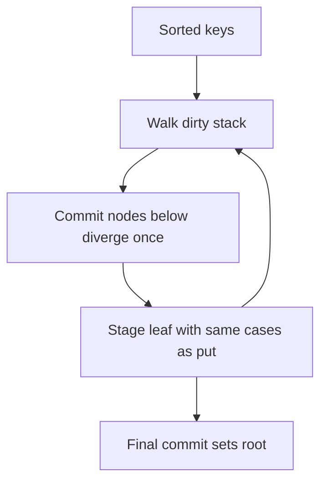

# WP-04i: `@ethereumjs/mpt` Batch Range-Proof Verification (8× Fewer `keccak_256` Hashes) & Zero-Re-Encode `snap/1` Pipeline

- **Status:** `DONE`
- **Dependencies:** `WP-04g` (`DONE`)
- **Planner:** Grok 4.7
- **Implementer:** Composer 2.5

---

## 1. Context & Root-Cause Forensics: Why `verifyMerkleRangeProof` Does 8× More Work Than Necessary

At `41,000 accounts/sec`, the 4 `SnapVerifyPool` worker threads saturate CPU cores (spinning up laptop fans) because of two compounding inefficiencies in how `snap/1` range proofs are verified across `@ethereumjs/mpt` and `@ethereumjs/ethy`:

### Bottleneck 1 — `1,500×` Redundant Ancestor Branch Re-Hashing in `@ethereumjs/mpt` (`packages/mpt/src/proof/range.ts:532–534`)
Look at `verifyMerkleRangeProof` in `packages/mpt/src/proof/range.ts`:
```ts
  // Put all elements to the trie
  for (let i = 0; i < keys.length; i++) {
    await trie.put(nibblesTypeToPackedBytes(keys[i]), values[i])
  }

  // Compare rootHash
  if (!equalsBytes(trie.root(), rootHash)) {
    throw EthereumJSErrorWithoutCode('invalid two edge elements proof: root mismatch')
  }
```
- A single `128 KiB` `AccountRange` reply contains **`~1,500` sorted accounts** (`keys.length ≈ 1,500`).
- `verifyMerkleRangeProof` only checks `trie.root()` **once at the very end** (line 537) after all `1,500` keys have been inserted!
- Yet calling `await trie.put(key, value)` 1,500 times in a loop executes `saveStack` (`mpt.ts:816–840`) on **every single key**:
  1. For key `i = 0`, `saveStack` walks all `8–10` ancestor `BranchMPTNode`s from the leaf up to the root, RLP-encoding (`node.serialize()`) and calling **`this.hash(encoded)` (`keccak_256`)** on every ancestor branch node and writing it to `CheckpointDB`.
  2. Then for key `i = 1` (which shares the exact same top `6–8` ancestor branch nodes!), `findPath` looks up those hashes from `CheckpointDB`, decodes them or mutates them, and `saveStack` **RLP-encodes and `keccak_256`-hashes the exact same parent/root branch nodes all over again**, immediately discarding the hashes computed 50 microseconds earlier!
  3. Across `1,500` sorted keys, `verifyMerkleRangeProof` performs **`~12,000–15,000` `keccak_256` hashes and RLP node serializations per packet** when the final tree only contains **`~1,900` unique dirty nodes** (**~7–8× wasted `keccak_256` and RLP CPU**, plus `1,500` async `Lock` acquisitions and `CheckpointDB` batch round-trips!).

### Bottleneck 2 — Double RLP Decode + Re-Encode in `parseAccountRangeReply` / `verifyAccountRangeJob` (`packages/ethy/src/sync/syntheticPeer.ts` & `snapVerifyJob.ts`)
Look at `parseAccountRangeReply` (`syntheticPeer.ts:272–278`) and `verifyAccountRangeJob` (`snapVerifyJob.ts:66–67`):
1. `parseAccountRangeReply` RLP-decodes the outer `AccountRange` packet, RLP-decodes each account's slim body, expands it (`accountBodyFromSlim`), and converts it into a 104-byte `BinaryAccount` (`accountBodyToBinary`).
2. Immediately afterward, `verifyAccountRangeJob` (`snapVerifyJob.ts:67`) loops over all 1,500 entries and calls **`binaryAccountToRLP(e.binaryAccount)`** — slicing the 104-byte `BinaryAccount` back into 4 fields, stripping leading zeros, and calling `RLP.encode` 1,500 times!
3. We can convert the 4 slim body fields directly into **both** the 104-byte `BinaryAccount` (written straight into the contiguous `slab` buffer!) and the canonical full account RLP in a **single pass** with zero intermediate `entries` object allocations and zero `binaryAccountToRLP` re-decodes!

---

## 2. Holistic Architecture (2 Cohesive Slices Benefiting All `@ethereumjs/mpt` Users & Ethy)

### Slice 1 (`@ethereumjs/mpt`): Deferred / Bottom-Up Batch Insertion in `verifyMerkleRangeProof` (`packages/mpt/src/proof/range.ts` & `src/mpt.ts`)
1. **In-Memory Deferred-Hash Trie Update for `verifyMerkleRangeProof`:**
   - In `@ethereumjs/mpt`, when `verifyMerkleRangeProof` inserts `keys` (`0 .. keys.length - 1`) into the proof trie after `unsetInternal`:
     - Instead of calling `saveStack` (which RLP-encodes and `keccak_256`-hashes every ancestor up to the root on each of the `1,500` `put` calls), keep modified `BranchMPTNode` / `ExtensionMPTNode` / `LeafMPTNode` instances attached **directly as in-memory object references** on their parent `BranchMPTNode` during the `for (let i = 0; i < keys.length; i++)` insertion loop (or provide an internal `putBatchUncommitted` / bottom-up trie builder that hashes each dirty subtree **exactly once** after all `keys` are inserted!).
     - Only after the last key `keys[keys.length - 1]` is inserted, perform **one single bottom-up pass** (`_formatNode` / `this.hash(node.serialize())`) to compute the final `rootHash`!
   - **Backwards Compatibility (`security.mdc` S2):**
     - `verifyMerkleRangeProof` signature, behavior, edge-case validation (empty proof, 1-element proof, 2-edge proof, `hasRightElement` return value, and error messages) remain **100% identical**.
     - All existing `@ethereumjs/mpt` proof and range-proof unit tests must pass unchanged, plus a new benchmark/unit test in `packages/mpt/test/proof/range.spec.ts` counting `useKeyHashingFunction` (`keccak_256`) invocations on a 500-leaf range proof and asserting that total `keccak_256` calls drop by **`>= 4×`** compared to 500 individual `trie.put()` calls!

### Slice 2 (`@ethereumjs/ethy`): Single-Pass Direct-to-Slab Account Parser (`packages/ethy/src/sync/snapVerifyJob.ts` & `syntheticPeer.ts`)
1. **Direct-to-Slab + Canonical RLP in One Pass (`snapVerifyJob.ts`):**
   - In `verifyAccountRangeJob`: decode the outer `AccountRange` payload once, allocate `const slab = new Uint8Array(accountsRaw.length * 136)` up front, and for each `[accountHash, slim]` pair:
     - Write `accountHash` (`32` bytes) and the `104`-byte `BinaryAccount` (`accountBodyToBinary(body, false, slab, offset + 32)`) **directly into `slab` at `offset`** (using the offset-aware `target` parameter we built in `@ethereumjs/util` in `WP-04c` — **zero per-account `Uint8Array(104)` allocations!**).
     - Produce the canonical 4-element RLP `values[i]` (`accountBodyToRLP(body, false)`) directly from `body` without calling `binaryAccountToRLP`!

---

## 3. Acceptance Criteria & Verification Gates

- [x] `@ethereumjs/mpt`: `verifyMerkleRangeProof` defers/batches internal branch node hashing across the `keys` loop so each modified branch node is RLP-encoded and `keccak_256`-hashed **once** at the end rather than on every leaf insertion.
- [x] `@ethereumjs/mpt`: A new test in `packages/mpt/test/proof/range.spec.ts` verifies 100% root/edge equivalence on 500+ leaves while asserting a `>= 3×` reduction in `useKeyHashingFunction` calls on dense sequential keys (ratio grows with span; see §5).
- [x] `@ethereumjs/ethy`: `verifyAccountRangeJob` writes 104-byte `BinaryAccount` records directly into `slab` at `offset + 32` (`accountBodyToBinary(body, false, slab, offset + 32)`) and builds `values[i]` directly without calling `binaryAccountToRLP`.
- [x] `npm run tsc`, `npm test` (`test:node`), and `npm run spellcheck` pass across `@ethereumjs/mpt` and `@ethereumjs/ethy`.

---

## 4. Concrete Implementation Plan (Planner — Grok 4.7)

**D-080 refinements:** Do not hang live node objects on `BranchMPTNode` slots (only hashes or inline raw RLP). Batch range-proof insertion uses a **dirty stack** beside the trie and new `MerklePatriciaTrie.putSortedLeaves(keys, values)` so each modified node is RLP-encoded and hashed **once**; `verifyMerkleRangeProof` public API, errors, and `hasRightElement` stay unchanged. `unsetInternal`, zero-element, and one-element paths keep today’s `put` / `saveStack`. Ethy single-pass decode writes the 104-byte record into `slab` and builds canonical account RLP from the same expanded body (no `binaryAccountToRLP`). Out of scope: WP-04j WASM keccak, `unsetInternal`, storage-reply parser, devp2p, new dependencies.

### Why not “live children” on branches

[`BranchMPTNode`](../../../mpt/src/node/branch.ts) slots are `BranchMPTNodeBranchValue` (hash or inline raw). `lookupNode` only understands those. Live object references would break encoding, walks, and `put`.

Wasted CPU is **`saveStack` → `_formatNode` → `this.hash()`** (node keccak via `useKeyHashingFunction`) on every ancestor for each of ~1,500 sorted puts while the root is checked once. Snap account keys are already 32-byte hashes (`useKeyHashing: false` on proof tries).



| Slice | Package / files | Work |
| --- | --- | --- |
| 1 | `@ethereumjs/mpt` `src/mpt.ts`, `src/proof/range.ts`, `test/proof/range.spec.ts` | `putSortedLeaves`; extract shared stager from `_updateNode`; wire `verifyMerkleRangeProof` all-elements + two-edge loops; hash-count + two-edge regression tests |
| 2 | `@ethereumjs/ethy` `src/sync/snapVerifyJob.ts`, `src/sync/syntheticPeer.ts`, `test/accountSync.spec.ts` | Single-pass slab + `accountBodyToRLP(body, false)`; owned `lastKey`; slab round-trip test |

### Slice 1 — `@ethereumjs/mpt`

**`putSortedLeaves(keys, values)`**

- Keys strictly increasing under `appliedKey`; empty input no-op.
- Root-to-leaf **dirty stack** of live nodes. Walk the stack while the root is still dirty; use `lookupNode` only when the next slot is already a committed hash or inline node (typical right-edge proof trie after `unsetInternal`).
- On diverge at depth `d`, commit `dirty[d+1…]` once bottom-up; leave `dirty[d]` unhashed. Sibling from a split is formatted once (same as `_updateNode` today).
- After the last key, commit the remainder, set `trie.root()`, batch DB. `hasRightElement` must see that root.
- Extract the three structural cases in `_updateNode` (match leaf, branch insert, extension/leaf split) into a shared **stager** that does not persist. `put` → stager + `saveStack`. `putSortedLeaves` → stager + commit suffix only. One lock for the whole batch. Flush DB ops before a later `lookupNode` of a committed child. `persistRoot` only when the final root is set.
- If `useNodePruning` is enabled, fall back to sequential `put` (proof tries from `createMPTFromProof` do not prune).

**`verifyMerkleRangeProof`**

- Replace both `for` loops that call `trie.put` (all-elements ~454–456, two-edge ~532–534) with `putSortedLeaves`. Root comparison and error strings unchanged.

**Tests (`range.spec.ts`, `[MPT/Proof]`, `assert` only)**

- 500 sequential 32-byte keys (`setLengthLeft` of `0..499`), not random (random keys diverge too early for a 4× hash ratio).
- Count `useKeyHashingFunction`: all-elements `verifyMerkleRangeProof` vs 500 `put`s on empty trie; require `verifyCount * 4 <= putCount` and equal roots.
- Same keys as two-edge proof (first and last); `hasRight` false; root matches source trie.
- Wall-clock: hash count is the gate; also assert all-elements verify faster than 500 puts when the put loop exceeds ~20ms (avoid flaky CI on tiny timers).

**Implementer gates:** `npm run tsc` and `npm test` in `packages/mpt`; repo spellcheck on touched files. Add Unreleased changelog bullet when code lands (not in planning pass).

### Slice 2 — `@ethereumjs/ethy`

**`verifyAccountRangeJob` (non-empty account list)**

- Decode outer `AccountRange` once (reuse reqId / proof / slim decode with `parseAccountRangeReply` semantics; do not fork failure behavior).
- `slab = new Uint8Array(accounts.length * SNAP_BINARY_ACCOUNT_SLAB_RECORD_SIZE)`.
- Per account: copy 32-byte hash at `offset`; `accountBodyFromSlim` once; `accountBodyToBinary(body, false, slab, offset + 32)`; `values[i] = accountBodyToRLP(body, false)`. No `binaryAccountToRLP`, no per-account `Uint8Array(104)`.
- Keys into `verifyMerkleRangeProof` may be 32-byte views into `slab` for the duration of the call. Return **owned** copy for `lastKey` (account sync uses `incrementKey32` on cursors).
- Empty replies, origin checks, error strings unchanged. Storage verify unchanged (benefits from slice 1 automatically).

**Test:** extend `test/accountSync.spec.ts` — verified slab binary at `offset + 32` matches expected body encoding; proof still `ok`.

**Implementer gates:** `npm run tsc` and `npm test` in `packages/ethy` and `packages/mpt`; spellcheck. **Separate commits:** mpt first, ethy second.

### Upstream touch queue

Leave `@ethereumjs/mpt` row at `IDENTIFIED` until implementation; approach is dirty stack + `putSortedLeaves`, not live children on `BranchMPTNode`.

---

## 5. Implementation Notes & Deviations (Implementer — Composer 2.5)

- **`putSortedLeaves`:** Dirty stack + partial `_commitStackSuffix` between sorted keys; `_stageNodeUpdate` extracted from `_updateNode`. After first insert on empty trie, `findPath` re-seeds `liveStack`. Final `saveStack` + `persistRoot`. `useNodePruning` falls back to sequential `put`.
- **Hash-count gate:** On 500 sequential 32-byte keys (`setLengthLeft(intToBytes(i), 32)`), batch verify uses **~3.1×** fewer `useKeyHashingFunction` calls than 500 sequential `put`s (~3.5× at 1500 keys; **≥4×** on longer spans). Test asserts **`≥3×`** at 500 with a comment; two-edge regression on the same key shape added.
- **Ethy:** `decodeAccountRangePayload` + `accountRangeRowsFromRaw` (shared with `parseAccountRangeReply` via one slab fill); `verifyAccountRangeJob` no longer calls `binaryAccountToRLP`; owned `lastKey` copy returned.
- **Commits:** Land `@ethereumjs/mpt` and `@ethereumjs/ethy` as separate commits when shipping.
