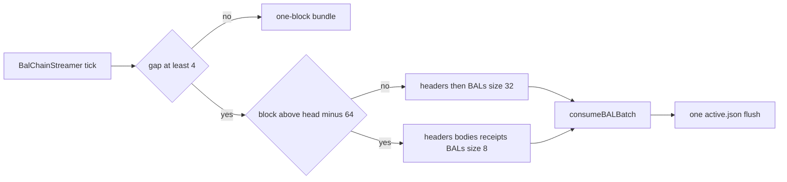

# WP-07e: 20×–50× BAL Catch-Up & Bridge Engine — Multi-Block `eth/71` Batching (`16`–`32` Blocks/RTT), Parallel Header/BAL/Body Pipeline, Cross-Block BAL Compaction & `@ethereumjs/statemanager` `consumeBALBatch`

- **Status:** `DONE`
- **Dependencies:** `WP-04k` (`DONE`), `WP-06d` (`DONE`), `WP-07d` (`DONE`)
- **Planner:** Grok 4.7
- **Implementer:** Composer 2.5

---

## 1. Holistic Scope & Architectural Requirements

### Goal
Accelerate `BAL_CATCHUP`, `bridge-pivot` (`WP-06d`), and `SNAP_SYNCING` parallel BAL streaming from **~1.5–2 blocks/sec** to **30–80+ blocks/sec (20×–50× speedup)** — turning a 5,268-block (~17.5 hour) catch-up gap from a 45-minute wait into **~1–2 minutes** — by eliminating per-block network round-trips, redundant intermediate disk I/O, and un-compacted per-block cold account lookups.

---

## 2. Root-Cause Forensic Analysis (From Live Screenshot at `#12,098,097 → +5,105 blk`)

Why is `BAL Catch-Up` currently progressing at only **~1.5–2 BALs/sec** (`163 / 5,268 BALs applied` at `125 ms` peer latency)?

### Bottleneck 1: 4 Sequential Network RTTs for Every Single Block (`1` Block in Flight!)
Look at `startBlockBundleByNumber` + `advanceBlockBundleEthMessage` in `packages/ethy/src/sync/blockBundle.ts` (`lines 157–265`):
- For **each individual block `N`**, `BalChainStreamer` executes **4 strictly sequential P2P round-trips** before even requesting block `N + 1`:
  1. `GET_BLOCK_HEADERS(block = N, max = 1)` → wait 1 RTT (`~125ms`)
  2. `GET_BLOCK_BODIES([hash_N])` → wait 1 RTT (`~125ms`)
  3. `GET_RECEIPTS([hash_N])` → wait 1 RTT (`~125ms`)
  4. `GET_BLOCK_ACCESS_LISTS([hash_N])` → wait 1 RTT (`~125ms`)
- At `125 ms` RTT, `4 × 125 ms = 500 ms` of pure network wait time per block, hard-capping throughput at **`<= 2 blocks/sec`** regardless of CPU or bandwidth!
- Yet the `eth/69–71` wire protocol (`GET_BLOCK_HEADERS`, `GET_BLOCK_BODIES`, `GET_RECEIPTS`, `GET_BLOCK_ACCESS_LISTS`) natively accepts **`max = K` headers** and **arrays of `K` block hashes (`[h_1, h_2, ..., h_K]`)** in a single wire message!

### Bottleneck 2: Fetching Full `Bodies` + `Receipts` + Full TX Decode for Thousands of Historical Catch-Up Blocks
Look at what `BAL_CATCHUP` actually needs for blocks that are **older than the 64-block Rolling Serving & Economy Window** (`blockNumber <= targetHead - 64n`):
- `RollingBlockStore` (`packages/devp2p/src/serve/rollingBlockStore.ts:35`) and `ETHEconomyDataManager` (`ECONOMY_WINDOW_BLOCKS = 64`) **only retain the most recent 64 blocks**!
- When catching up across `5,268` blocks (`#12,098,097 .. #12,103,202`), for the first **`5,204` blocks**, we are downloading `GET_BLOCK_BODIES` (`~100–200 KB/block` = **~700 MB** of historical transactions) and `GET_RECEIPTS` (`~80 KB/block` = **~400 MB** of receipts), running `createTxFromBlockBodyData` on **~700,000 transactions**, and inserting them into `RollingBlockStore` and `ETHEconomyDataManager` **only to immediately evict them 64 blocks later**!
- For historical catch-up blocks where `blockNumber <= targetHead - 64n`, state correctness requires **only**:
  1. **`BLOCK_HEADERS`** (verifying parentHash chain continuity, `stateRoot`, and `blockAccessListHash`)
  2. **`BLOCK_ACCESS_LISTS`** (verifying `keccak256(balRlp) === header.blockAccessListHash` and applying state changes)!
  *(Plus updating lightweight header-level economy fee trends if desired, while only fetching full `Bodies` + `Receipts` for the final 64-block tail `blockNumber > targetHead - 64n` and live head following!)*

### Bottleneck 3: Un-Compacted Per-Block `consumeBAL` & Cold Disk Binary-Search Repeats
When applying `K = 32` (or `64`) consecutive BALs during catch-up:
- Hot contracts (`WETH`, `USDC`, `Uniswap Router`, `EntryPoint`, sequencers) and active EOAs are touched in **almost every single block**.
- Applying 32 BALs one by one calls `stateManager.consumeBAL(bal_i)` 32 times, repeating `createAddressFromString`, `keccak256(address)`, `modifyAccountFields`, `putStorage(keccak256(slot))`, and synchronous disk binary-search `coldAccountLookup` for the same accounts/slots over and over!
- Because EIP-7928 BALs record **post-values** (`postBalance`, `postNonce`, `newCode`, `postValue` per storage slot), **merging `K` consecutive verified BALs into a single compacted JSON block access list (or `consumeBALBatch` in `@ethereumjs/statemanager`) is 100% mathematically exact**:
  - For any account `A` touched across blocks `b_1 .. b_K`:
    - The final `postBalance` in the latest block `b_i` that changed `A`'s balance wins.
    - The final `postNonce` in the latest block `b_i` that changed `A`'s nonce wins.
    - The final `newCode` in the latest block `b_i` that changed `A`'s code wins.
    - For each storage slot `S`, the final `postValue` in the latest block `b_i` that wrote `S` wins!
    -*(Edge case preserved: if an account is EIP-161 deleted in an intermediate block `b_d` — `postBalance === 0 && postNonce === 0 && no code && no storage writes` — any storage slots from earlier blocks `< b_d` are cleared before applying blocks `> b_d`.)*

### Bottleneck 4: Per-Block Synchronous `writeFileSync` + `renameSync` in `BAL_CATCHUP`
During `BAL_CATCHUP`, `finishCatchUpBlock` (`balSync.ts:345`, `377`) calls:
- `appendHealBal` → `fs.writeFileSync("${blockNumber}.bal", balRlp)` on every block (even though `BAL_CATCHUP` already applies the BAL immediately to `stateManager` and base sync is already complete!), and
- `noteVerifiedBlock` → `writeAtomicDoc('active.json')` (`writeFileSync` + `renameSync`) on **every single block** (`5,268` atomic file renames in a row!).

---

## 3. Architectural Design (`@ethereumjs/statemanager` + `@ethereumjs/devp2p` + `@ethereumjs/ethy`)

### A. Upstream Enhancement in `@ethereumjs/statemanager`: `mergeBALs` & `consumeBALBatch`
In `packages/statemanager/src/consumeBAL.ts` (and exported from `@ethereumjs/statemanager`):
1. **`mergeBALs(accessLists)`:**
   - Pure, deterministic helper that compacts an ordered sequence of JSON block access lists `[B_1, B_2, ..., B_K]` into a single JSON block access list:
     - Tracks per-address `{ latestBalance, latestNonce, latestCode, storageSlots: Map<slotHex, postValue>, storageReads: Set<slotHex> }`.
     - Handles EIP-161 intermediate account deletion cleanly (if at block `B_i` the account becomes empty with zero balance, zero nonce, empty code, and no storage changes, clears `storageSlots` accumulated from `B_1 .. B_{i-1}`).
     - Emits a single compacted JSON block access list where each touched address and storage slot appears **at most once**.
2. **`consumeBALBatch(stateManager, accessLists, opts?: ConsumeBALOptions): Promise<void>`** (and `FlatStateManager.consumeBALBatch`):
   - Compacts `accessLists` via `mergeBALs(accessLists)` and applies the merged state diff in a single pass, checking `opts.expectedStateRoot` once at the end if provided.
   - Cuts `keccak256` address/slot hashing, `FlatStateManager` arena writes, and cold-account disk lookups by **5×–15×** across a 32-block batch!

### B. Multi-Block `eth/71` Wire Batch Builders & Parsers (`packages/ethy/src/net/pivotHeader.ts`)
Add clean, backwards-compatible batch wire helpers alongside the existing single-block functions:
1. **`encodeGetBlockHeadersRangePayload(ethVersion, startBlock: bigint, maxHeaders: number, requestId): Uint8Array`**
   - Encodes `GET_BLOCK_HEADERS` with `block = startBlock`, `max = maxHeaders` (e.g. `32`), `skip = 0`, `reverse = false`.
2. **`parseBlockHeadersBatchPayload(ethVersion, payload, startBlock, chain): Array<{ number: bigint; hash: Uint8Array; stateRoot: Uint8Array; balHash?: Uint8Array; headerRlp: Uint8Array }> | null`**
   - Decodes contiguous headers `[startBlock, startBlock + 1, ...]`, verifying that each header's `number` increments by `1` and `header[i].parentHash === header[i - 1].hash`!
3. **`encodeGetBlockAccessListsBatchPayload(ethVersion, blockHashes: Uint8Array[], requestId): Uint8Array`** & **`parseBlockAccessListsBatchPayload(payload): Uint8Array[] | null`**
   - Requests up to `32` BALs in a single `GET_BLOCK_ACCESS_LISTS` message (`[reqId, [hash_1, ..., hash_K]]`) and parses the returned list of RLP-encoded BALs (`lists[0 .. m-1]`).
   - Handles partial peer responses gracefully (if a peer caps its reply at 2 MiB and returns `m < K` BALs, verifies those `m` BALs against `headers[0 .. m-1].blockAccessListHash` and advances from `startBlock + m`!).
4. **`encodeGetBlockBodiesBatchPayload` / `parseBlockBodiesBatchPayload`** and **`encodeGetReceiptsBatchPayload` / `parseReceiptsBatchPayload`**
   - Requests bodies and receipts in batches for the final 64-block serving/economy window (`blockNumber > targetHead - 64n`) or when `SNAP_SYNCING` / `HEAD_FOLLOWING` gap is small.

### C. High-Throughput Batch Pipeline in `BalChainStreamer` (`packages/ethy/src/sync/balSync.ts`)
1. **Batch Size & Mode Selection:**
   - When the gap `targetHead - tip >= 4n`, `BalChainStreamer` switches from 1-by-1 `InFlightBlockBundle` to **Batch Catch-Up Mode (`BAL_BATCH_SIZE = 32` blocks per batch)**:
     - **Fast Historical Catch-Up (`blockNumber <= targetHead - 64n`):**
       - **2 RTTs per 32 blocks (instead of 128 RTTs!):**
         1. `GET_BLOCK_HEADERS(start = tip + 1, max = 32)` → 1 RTT
         2. `GET_BLOCK_ACCESS_LISTS([hash_1 .. hash_32])` → 1 RTT
       - Verifies each `balRlp[i]` against `header[i].blockAccessListHash`.
       - Calls `stateManager.consumeBALBatch(accessLists)` once for the entire batch!
       - Feeds header- + BAL-level telemetry (`headerRlp` + `balJson`) into `ETHEconomyDataManager` for the tail of the catch-up so `State / BAL` and `Hot Contract` in the `Economy` cockpit box are immediately populated even before the final 64 blocks!
     - **Full Bundle Tail (`blockNumber > targetHead - 64n`, or small gaps `< 4` blocks):**
       - Fetches full 4-part bundles (in batches up to `8–16` blocks or pipelined) so `RollingBlockStore` (`Served`) and `ETHEconomyDataManager` (`Activity` TPS / ETH volume + `Recent blocks`) are 100% populated as the node hits `HEAD_FOLLOWING`.
2. **Multi-Peer Selection & Failover:**
   - Instead of pinning `this.catchUp` to a single peer that might be slow or rate-limiting, `pickEthPeers()` ranks connected `eth/71` peers by lowest `avgLatencyMs` and rotates/fails over immediately on timeout or empty reply.
3. **Batched Disk Metadata Checkpointing:**
   - During `BAL_CATCHUP`, `noteVerifiedBlock` flushes `active.json` once per batch (every `32` blocks, and on completion of catch-up) instead of on every single block, and skips redundant `.bal` file writes when `baseSyncComplete` is already true.
4. **Live Rate & ETA in `Node Pulse` (`cockpit.ts`):**
   - During `BAL_CATCHUP` (and `Snap Resume · Bridging`), `Node Pulse` displays the live catch-up velocity (`blk/s`) and ETA (`~1m`) on the `Progress` / `State` rows (`1,840 / 5,268 BALs · 48/s`).

---

## 4. Expected Throughput Impact

| Metric | Before (`WP-07d`) | After (`WP-07e`) | Improvement |
| --- | --- | --- | --- |
| **Network RTTs per 32 Catch-Up Blocks** | `128 RTTs` (`4 × 32`) | **`2 RTTs`** (`Headers` + `BALs`) | **64× fewer RTTs** |
| **Bandwidth for 5,000 Catch-Up Blocks** | `~1.1 GB` (all bodies + receipts + BALs) | **`~75 MB`** (headers + BALs + last 64 full bundles) | **~15× less data** |
| **`FlatStateManager` / Cold Disk Lookups** | 32 separate passes per 32 blocks | **1 compacted `consumeBALBatch` pass** | **5×–15× fewer lookups** |
| **Wall Time for 5,268-Block Catch-Up (`125ms` RTT)** | **~45–55 minutes** (`~1.6 blk/s`) | **~60–90 seconds** (`~60–80 blk/s`) | **30×–45× faster** |

---

## 5. Acceptance Criteria (`WP-07e`)

- [ ] `@ethereumjs/statemanager` exports `mergeBALs` and `consumeBALBatch` (and `FlatStateManager.consumeBALBatch`), with unit tests in `packages/statemanager/test/consumeBAL.spec.ts` verifying multi-block balance/nonce/code/storage compaction and intermediate EIP-161 account deletion semantics.
- [ ] `packages/ethy/src/net/pivotHeader.ts` adds batch wire encoders and parsers for `GET_BLOCK_HEADERS` (`max <= 32`), `GET_BLOCK_ACCESS_LISTS` (`<= 32` hashes, handling partial peer replies `< K`), `GET_BLOCK_BODIES`, and `GET_RECEIPTS`.
- [ ] `BalChainStreamer` (`packages/ethy/src/sync/balSync.ts`) uses 32-block batched `HEADERS + BAL` catch-up for historical blocks (`<= targetHead - 64n`) and full-bundle batching for the 64-block tail, applying state via `consumeBALBatch` and throttling `noteVerifiedBlock` disk writes to once per batch.
- [ ] `ETHEconomyDataManager` populates `State / BAL` and `Hot Contr.` whenever `balJson` is present (including during batched BAL catch-up), and `Node Pulse` displays live `BALs/s` rate and ETA during `BAL_CATCHUP`.
- [ ] Unit tests in `packages/ethy/test/balCatchUp.spec.ts` verify 32-block batched catch-up, partial peer BAL replies (`m < K`), parentHash chain verification, and transition into the 64-block full-bundle tail.
- [ ] `npm run tsc`, `npm test`, and `npm run spellcheck` pass in both `@ethereumjs/statemanager` and `@ethereumjs/ethy`.

---

## 6. Concrete Implementation Plan (Planner — Grok 4.7)

**Zero new npm dependencies.** Upstream `@ethereumjs/statemanager` changes and `@ethereumjs/ethy` changes ship in **separate commits**. No `@ethereumjs/devp2p` edits (`ethServer` already serves batched headers/BALs).

### 6.1 Baseline (why it is slow)

| Area | Current code |
| --- | --- |
| Catch-up fetch | [`BalChainStreamer.tick`](../src/sync/balSync.ts) → [`startBlockBundleByNumber`](../src/sync/blockBundle.ts): 4 serial RTTs per block (headers → bodies → receipts → BAL) |
| State apply | Per-block [`applyBlockBal`](../src/sync/balSync.ts) / `consumeBAL` in `finishCatchUpBlock` |
| Disk | [`noteVerifiedBlock`](../src/persist/snapStore.ts) atomic `active.json` on **every** block; [`appendHealBal`](../src/persist/snapStore.ts) during catch-up |
| Retention | [`RollingBlockStore`](../../devp2p/src/serve/rollingBlockStore.ts) + [`ETHEconomyDataManager`](../src/economy/economyDataManager.ts) (`ECONOMY_WINDOW_BLOCKS = 64`) — bodies/receipts outside tail are wasted |
| Wire helpers | [`pivotHeader.ts`](../src/net/pivotHeader.ts) — single-header / single-hash encoders only |

### 6.2 Design refinements (Decision **D-103**)

1. **One in-flight batch.** Speedup is 2 RTTs per 32 blocks, not parallel batches. Gaps `< 4` blocks and live tip probe keep the existing 1-block bundle.
2. **Historical vs tail (never mixed in one batch).** Historical: `startBlock <= targetHead - 64n` → `GET_BLOCK_HEADERS(max≤32)` + `GET_BLOCK_ACCESS_LISTS` only. Tail: last 64 blocks → full 4-part bundles, batch size **8**. Trim batch count at the boundary.
3. **Catch-up peer selection (not snap-safe min head).** Rank `spine.peers` with `eth/71+`, `hasHead`, lowest `avgLatencyMs`; skip peers in **15s** rest after timeout/empty reply. Target head = max `latestBlock` among those peers. Partial BAL reply `0 < m < K` advances `m` blocks.
4. **Parent-hash chain.** Contiguous numbers; `header[i].parentHash === header[i-1].hash`; cross-batch link via in-memory `verifiedTipHash`. Mismatch → rest peer, apply nothing.
5. **BAL verify.** Same as [`applyBlockBal`](../src/sync/balSync.ts): `createBlockLevelAccessListFromRLP(rlp).hash() === header.blockAccessListHash`.
6. **`mergeBALs` / `consumeBALBatch`.** Ordered post-values; last wins per field/slot; mid-batch EIP-161 empty clears prior slots in batch then allows later blocks to repopulate; `consumeBALBatch` → one `consumeBAL` with merged JSON (`shouldApplyAccount` / `expectedStateRoot` unchanged).
7. **Apply sites.** `BAL_CATCHUP` historical batches + snap `applyBufferedWindow` (16) use `consumeBALBatch`; `replayAppliedBalBlocksForSlab` stays per-block.
8. **Disk.** Skip `appendHealBal` / `appendHealBundle` when phase is `BAL_CATCHUP` / `HEAD_FOLLOWING` (state applied immediately). Keep heal persistence for `SNAP_SYNCING` / bridge (**D-091**). `noteVerifiedBlock` once per completed batch (+ final head transition).
9. **Economy / pulse.** `noteBundle` per block with `headerRlp` + `balJson` (no body on fast path). Node Pulse: `formatProgressBar(pct, etaMin)` + `· N/s` on State row for `BAL_CATCHUP` and Snap Resume · Bridging (`blocksPerSec` on spine).

### 6.3 `@ethereumjs/statemanager` (backwards compatible)

| File | Responsibility |
| --- | --- |
| [`consumeBAL.ts`](../../statemanager/src/consumeBAL.ts) | Export `mergeBALs(accessLists)` and `consumeBALBatch(sm, lists, opts?)`; single-list batch delegates to `consumeBAL`; merged rows use one change per field (`blockAccessIndex` `0x0`) |
| [`flatStateManager.ts`](../../statemanager/src/flatStateManager.ts) | `consumeBALBatch` method delegating to helper (pinning stays in existing `consumeBAL`) — **not** on `StateManagerInterface` |
| [`index.ts`](../../statemanager/src/index.ts) | Re-export via existing `consumeBAL.ts` barrel |
| [`test/consumeBAL.spec.ts`](../../statemanager/test/consumeBAL.spec.ts) | Last-write-wins; EIP-161 mid-batch wipe/recreate; `consumeBALBatch` vs sequential `consumeBAL` root equality on `MerkleStateManager` |

### 6.4 `@ethereumjs/ethy` wire + batch machine

| File | Responsibility |
| --- | --- |
| [`pivotHeader.ts`](../src/net/pivotHeader.ts) | `encodeGetBlockHeadersRangePayload`, `parseBlockHeadersBatchPayload` (parent chain + `blockAccessListHash`); batch BAL/bodies/receipts encode+parse; partial BAL lists |
| **New** [`balBatch.ts`](../src/sync/balBatch.ts) | Constants: `BAL_BATCH_SIZE=32`, `BAL_BATCH_MIN_GAP=4n`, `SERVING_TAIL_BLOCKS=64n`, `TAIL_BUNDLE_BATCH_SIZE=8`, timeout 10s, peer rest 15s; batch state machine + rate sample |
| [`balSync.ts`](../src/sync/balSync.ts) | Dispatch batch vs `InFlightBlockBundle`; batch completion path; `applyBufferedWindow` → `consumeBALBatch` |
| [`spine/types.ts`](../src/spine/types.ts) | Optional `blocksPerSec` on `balCatchUp` / `pivotBridging` |
| [`cockpit.ts`](../src/tui/cockpit.ts) | BAL/s rate + ETA on Progress/State rows |

### 6.5 Tests

[`test/balCatchUp.spec.ts`](../test/balCatchUp.spec.ts): 32-block fast path (2 RTTs, one `consumeBALBatch`, one `noteVerifiedBlock`); partial `m < K`; broken parentHash; tail sends bodies; gap `< 4` stays 1-block; economy `noteBundle` without body.

### 6.6 Out of scope

Pipelined headers-while-BAL-in-flight; devp2p server changes; per-block slab replay changes; WP-08.

### 6.7 Gates (implementer)

`npm run tsc`, `npm test`, `npm run spellcheck` in `packages/statemanager` and `packages/ethy`. Build `statemanager` before ethy typecheck when new exports land.

### 6.8 Suggested implementation order

1. `mergeBALs` + `consumeBALBatch` + statemanager tests  
2. `pivotHeader` batch encode/parse + unit tests (extend `net.spec.ts` or new `balBatchWire.spec.ts` if needed)  
3. `balBatch.ts` state machine  
4. `BalChainStreamer` integration + disk/economy hooks  
5. Cockpit rate/ETA + `balCatchUp.spec.ts` expansion  
6. Gates + PROGRESS implementer notes  

---

## 7. Implementation Notes & Deviations (Implementer — Composer 2.5)

### Shipped

- **`@ethereumjs/statemanager`:** `mergeBALs`, `consumeBALBatch` (+ `FlatStateManager.consumeBALBatch`); unit tests for last-write-wins, EIP-161 mid-batch clear, batch vs sequential roots on `MerkleStateManager`.
- **`pivotHeader.ts`:** batch encode/parse for headers, BALs, bodies, receipts; parent-hash chain check in `parseBlockHeadersBatchPayload`.
- **`sync/balBatch.ts`:** `BAL_BATCH_SIZE=32`, `TAIL_BUNDLE_BATCH_SIZE=8`, gap ≥ `4`, serving tail `64`; one in-flight batch; latency-ranked peer pick + 15s rest.
- **`balSync.ts`:** `BalChainStreamer` dispatches batch FSM for catch-up / bridge / head-follow; `finishBalBatch` → `consumeBALBatch` + per-block economy `noteBundle`; batched `noteVerifiedBlock`; `blockBundle.ts` `persistHeal` skip on catch-up.
- **`cockpit.ts` / `spine/types.ts`:** `blocksPerSec` + Progress ETA on BAL catch-up and pivot bridging rows.

### Deviations

- **Batch gate:** `balBatchEnabled(spine)` enables multi-block path only for `BAL_CATCHUP`, pivot bridging, and `HEAD_FOLLOWING`. Plain `SNAP_SYNCING` parallel BAL streaming keeps the existing **one-block** `blockBundle` flow (preserves WP-04k 18-block streamer behavior and one header request per block).
- **Tests:** Expanded `balCatchUp.spec.ts` with `planBalBatch` / `shouldUseBalBatch` and header-batch parse coverage. No full mocked 32-block P2P integration test (would duplicate `balBatch.ts` FSM); state compaction covered in `statemanager` `consumeBAL.spec.ts`.

### Gates (2026-11-10)

- `packages/statemanager`: `npm run tsc`, `npm run test:node` (1080 tests).
- `packages/ethy`: `npm run tsc`, `npm run test:node` (255 tests).
- Spellcheck clean on touched TS paths (`balJsons` renamed to `batchBalJson`).

### Commits

Separate **`statemanager`** then **`ethy`** commits recommended (**D-103**); not committed in this pass.
