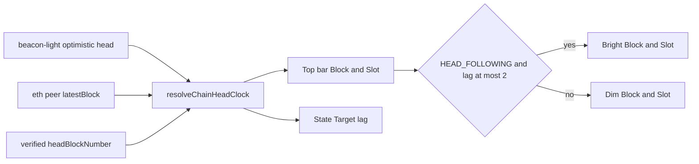

# WP-07g: Holistic Head Stability, Synchronized Chain-Head Clock, Dual-Protocol Serving (`eth/69–71` + `ETHY/0`) & System-Wide Capability UX

- **Status:** `DONE`
- **Dependencies:** `WP-03c`, `WP-04k`, `WP-05b`, `WP-06c`, `WP-07e`, `WP-07f` (`DONE`)
- **Primary Goal:** Close the "Head & Serving" chapter of Ethy by ensuring:
  1. **Synchronized Chain-Head Clock & Honest `State` Telemetry:** The top header bar (`Block <N>        Slot <S>`) always represents a **synchronized view of the canonical chain head**, visually dimmed (`DIM`) while Ethy is still syncing toward it and bright once Ethy is live on the head; the `State` cockpit box and post-restart contract/bytecode lookups (`coldCodeLookup`) stay 100% accurate.
  2. **Rock-Solid `HEAD_FOLLOWING` Stability:** Eliminate false peer rest penalties on unmined 4s tip probes, stop clamping `HEAD_FOLLOWING` to the slowest `snap` peer, wire Consensus Light Client (`@ethereumjs/beacon-light`) head updates directly into `BalChainStreamer`, and add 16-block hysteresis so normal 1–3 block network jitter never yanks the node out of `★ Head Following · Live`.
  3. **Verified Dual-Protocol Serving (`eth/69–71` Rolling Tail + `ETHY/0` Swarm State):** Fix the worker `BLOCK_RANGE_UPDATE` advertisement race in `@ethereumjs/devp2p`, keep `ETHY/0` `STATUS` range fields live at the head, and surface both serving engines (`eth` 64-block window + `ethy` 16-bucket state) directly in the `P2P` cockpit `Served` row.
  4. **System-Wide Capability & Command Availability Transparency:** Introduce a canonical `CommandAvailability` oracle that greys out unavailable/inapplicable commands inline in `DomainHelpUIComponent` (`Tab` / `/help`), replaces legacy developer stubs with a friendly uniform `CommandUnavailableUIComponent`, and ensures `/account`, `/contract`, `/range`, and `/sample` read seamlessly from on-disk `SnapPivotStore` journals after a restart.

---

## 1. Holistic Scope & Architectural Requirements (Coordinator — Gemini 4 Argon)

### 1.1 Forensic Diagnosis of the Live Head Screenshot (`#12,111,702`)

 Inspecting the live Sepolia run at `★ Head Following · Live` (`#12,111,702`) alongside the sync/serve codebase revealed five interconnected gaps:

1. **Header `Block` vs `Slot` Desynchronization & Backward `bestPeerHead` Overwrite (`headerClock.ts:6`, `peerCoordinator.ts:1538`):**
   - In the screenshot, the top bar displayed `Block 12,111,694        Slot 11,555,498` while the `State` box already showed `Target: #12,111,702 (live · +0 blk)` (`8` blocks ahead of the top bar!).
   - *Root cause:* Geth and Nethermind only broadcast `BLOCK_RANGE_UPDATE` every **32 blocks** (~6.4 minutes). While `BalChainStreamer` actively probes `tip + 1n` every 4s and advances `spine.headBlockNumber` to `#12,111,702`, `peerCoordinator.ts:1538` overwrites `spine.bestPeerHead = BigInt(bestPeer.latestBlock)` (`12,111,694`) on every 150ms telemetry tick, and `headerClock.ts` reads `spine.bestPeerHead` for `Block` while reading `spine.clOptimisticSlot` for `Slot`.
   - Furthermore, every Beacon `LightClientOptimisticUpdate` (`@ethereumjs/beacon-light`) already carries the exact paired `(execution.blockNumber, header.slot)` for the canonical chain head, yet `headerClock.ts` ignored `spine.clOptimisticBlockNumber` and had no visual distinction between *"chain head while we are still syncing"* vs *"chain head that we are actively following"*.

2. **`HEAD_FOLLOWING` Instability: `safeSnapHead` Clamping, Unmined Probe Penalties & 2-Block Flip Jitter (`peerCoordinator.ts:368, 1542`, `balSync.ts:352, 744`):**
   - **`safeSnapHead` minimum clamp (`peerCoordinator.ts:368–383`):** `pickEthPeer` computes `safeSnapHead = min(p.latestBlock)` across all connected `snap` peers and clamps `best.latestBlock` down to the **slowest** peer. While intended for `SNAP_SYNCING` pivot safety, `pickEthPeer` is also used in `BAL_CATCHUP` and `HEAD_FOLLOWING` — so a single lagging peer freezes head following! Moreover, `pickEthPeer` never filters out peers in `this.peerRestUntil`.
   - **4s unmined-block probe penalty (`balSync.ts:352, 744`):** In `HEAD_FOLLOWING`, `BalChainStreamer` probes `tip + 1n` every 4s (`TIP_POLL_MS`). Because Ethereum blocks are 12s apart, ~2 out of 3 probes ask for a block not mined yet. The peer replies `BLOCK_HEADERS: []`, which `advanceBlockBundleEthMessage` flags as `'failed'`, putting our best peer into a **15s penalty rest (`restBalCatchUpPeer`)** and scheduling `queueMicrotask(() => this.tick())` while `this.catchUp.targetHead` is still `tip + 1n`.
   - **2-block wake threshold (`LAPTOP_WAKE_BLOCK_GAP = 2n`, `peerCoordinator.ts:1542`):** Whenever a peer's `BLOCK_RANGE_UPDATE` jumps 3 blocks ahead of `headBlockNumber`, `seedBalCatchUp` yanks `spine.phase` out of `HEAD_FOLLOWING` back into `BAL_CATCHUP`, flickering the UI and resetting `applied = 0`.

3. **Post-Restart Missing `coldCodeLookup` & Zeroed Contract Counters (`createEthyNode.ts:80`, `snapStore.ts:1503`, `cockpit.ts:201`):**
   - After restarting on a completed disk sync (`baseSyncComplete: true`), `FlatStateManager` has `coldAccountLookup` wired to `snapStore.lookupBinaryAccountByHash`, **but has no `coldCodeLookup` wired to `snapStore`'s `code/shard-*.bin` files!**
   - As a result, after restart:
     - `stateManager.getCodeByHash(codeHash)` returns `undefined` for all 65,535 synced contracts on disk.
     - `Hot Contr.` in `Economy` and `AI` shows raw addresses (`contract 0xbe22…e054`) instead of bytecode-fingerprinted archetypes (`DEX Router`, `ERC-20`, `EIP-1967 Proxy`).
     - `/account` reports `Code size: 0` and `/contract` reports `Bytecode: 0 B`.
     - `finishDiskHydrate` skips `snapStore.takeContractProgress()` when `baseSyncComplete: true`, leaving `spine.codesSynced = 0` and `spine.storageSlotsSynced = 0`, while `cockpit.ts:201` renders `pivot #0` (`pivotStepsCompleted = 0`).

4. **Dormant `eth/69–71` `BLOCK_RANGE_UPDATE` Broadcast & `ETHY/0` Head Range (`host.ts:224, 656`, `ethyAdvertise.ts:13`):**
   - Ethy has **two** serving engines implemented in `@ethereumjs/devp2p`:
     1. **`eth/69–71` Rolling-Window Block & BAL Server (`ethServer.ts` + `RollingBlockStore`):** Serves complete 4-part blocks (`BlockHeaders`, `BlockBodies`, `Receipts` `eth/69–70`, `BlockAccessLists` `eth/71`) for the contiguous **64-block tail window** (`[earliestBlock .. latestBlock]`).
     2. **`ethy/0` Swarm State & BAL Server (`ethyServer.ts` + `EthyChunkStore`):** Serves self-proving 136-byte `BinaryAccount` chunks + MPT boundary proofs for all `16/16` buckets (`0x0..0xf`) from disk (`accounts/<nibble>.bin` + `.proof.idx`), plus `GET_BAL_RANGE` (`0x07` → `0x08`) and `GET_ETHY_PEERS` (`0x09` → `0x0a`).
   - *Why `Served` stayed at `0 replies (ready)`:*
     - When `putServableBlock` first runs during the 64-block tail of `BAL_CATCHUP`, `_advertiseBlockRangeInStatus` in `Devp2pWorkerHost` is still `false`. `_syncBlockRangeFromStore(true)` updates `_lastBroadcastLatest = range.latestBlock` **before** `_broadcastBlockRange()` checks `if (!this._advertiseBlockRangeInStatus) return`! When `setAdvertiseBlockRange(true)` arrives 150ms later (`host.ts:224`), it sets the boolean **without calling `_broadcastBlockRange()`**, and `_syncBlockRangeFromStore` suppresses future broadcasts for the next 32 blocks (~6.4 minutes)!
     - Meanwhile, `refreshEthyWorkerAdvertisement` (`ethyAdvertise.ts:13`) hardcoded `balEarliestBlock: spine.pivotBlockNumber` instead of the actual contiguous range in `RollingBlockStore`, and was never called during `BAL_CATCHUP` or `HEAD_FOLLOWING`.

5. **Opaque Command Availability & Resident-Only `/range` / `/sample` After Restart (`help.ts`, `gated.ts`, `range.ts`):**
   - `DomainHelpUIComponent` renders all commands identically even when a command is locked (e.g. `/economy` before the first block) or no longer applicable (e.g. `/pause`, `/resume`, `/reassign` after `SNAP_SYNCING` is 100% finished in `HEAD_FOLLOWING`).
   - `gated.ts` still uses internal function names (`inspectAccount (locked)`, `inspectLatestBAL (locked)`, `simulateTxOnHead (stub)`).
   - `/range [hex]` and `/sample` (`range.ts`) only scan the 256-row tail-warmed resident shards in `FlatStateManager` after a restart instead of reading on-disk bucket journals in `SnapPivotStore`.

---

### 1.2 Concrete Architectural Specifications

#### Part A: Synchronized Chain-Head Header Clock (`Block` + `Slot`) & Visual Sync State (`src/tui/headerClock.ts`, `src/tui/renderFrame.ts`)

1. **Canonical Definition of the Header Numbers:**
   - The top bar `Block <N>        Slot <S>` **always displays the best known Canonical Chain Head** on the network (independently of Ethy's local sync progress).
   - **Unified Chain-Head Resolver (`resolveChainHeadClock(spine)` in `src/tui/headerClock.ts`):**
     - Compute `chainHeadBlock`: the maximum of `spine.clOptimisticBlockNumber`, `spine.bestPeerHead`, `spine.headBlockNumber`, and `spine.lastVerifiedBlockNumber` (ignoring `0n` / `undefined`, falling back to `spine.pivotBlockNumber` only before any head is known).
     - Compute `chainHeadSlot`:
       - When `spine.clOptimisticSlot !== undefined && spine.clOptimisticSlot > 0`:
         - If `spine.clOptimisticBlockNumber !== undefined && spine.clOptimisticBlockNumber > 0n && chainHeadBlock !== undefined && chainHeadBlock > spine.clOptimisticBlockNumber`, advance the displayed slot in lockstep by `Number(chainHeadBlock - spine.clOptimisticBlockNumber)` (bounded to `<= 32` slots) so `Block` and `Slot` never drift apart between 12s CL polls.
         - Otherwise use `spine.clOptimisticSlot`.
       - When `spine.demoClock === true`: use `spine.currentSlot`.
   - **Monotonic `bestPeerHead` (`peerCoordinator.ts` & `balSync.ts`):**
     - Whenever `BalChainStreamer` verifies a header `N` or `consensusTracker` verifies `clOptimisticBlockNumber`, update `spine.bestPeerHead = max(spine.bestPeerHead ?? 0n, N)`.
     - In `peerCoordinator.ts:1538`, update `spine.bestPeerHead` monotonically (`if ( spine.bestPeerHead === undefined || peerBlock > spine.bestPeerHead) spine.bestPeerHead = peerBlock`) so a peer's 32-block-delayed `BLOCK_RANGE_UPDATE` never rewinds `bestPeerHead` below blocks we have already verified!

2. **Visual Sync Indication (Bright at Head vs Dimmed While Syncing):**
   - Define `isNodeAtChainHead(spine): boolean`:
     - Returns `true` iff `spine.phase === 'HEAD_FOLLOWING'` and `localVerifiedBlock` (`spine.headBlockNumber ?? spine.lastVerifiedBlockNumber`) is within `<= 2n` blocks of `chainHeadBlock`.
   - **Formatting in `capabilityBarClockLabel(spine)`:**
     - **When `isNodeAtChainHead(spine) === false` (still syncing / catching up):**
       - Render both `Block <N>` and `Slot <S>` **dimmed (`${DIM}Block 12,104,916        Slot 11,548,641${RESET}`)** so the user sees the live network head target while immediately recognizing that local state has not reached it yet.
     - **When `isNodeAtChainHead(spine) === true` (live on the head):**
       - Render `Block <N>` in full bright contrast (`${BOLD}Block${RESET} 12,111,702`), and render `Slot <S>` in full bright contrast (`${BOLD}Slot${RESET} 11,555,498`) when `spine.clStatus === 'verified'` or `demoClock === true` (or `${DIM}Slot ...${RESET}` if CL is degraded).

#### Part B: Rock-Solid `HEAD_FOLLOWING` & `State` Cockpit Polish (`src/sync/balSync.ts`, `src/net/peerCoordinator.ts`, `src/cl/consensusTracker.ts`, `src/tui/cockpit.ts`)

1. **Decouple `pickEthPeer` from `safeSnapHead` Outside `SNAP_SYNCING` (`peerCoordinator.ts:365`):**
   - Only apply the `safeSnapHead` minimum clamp when `spine.phase === 'SNAP_SYNCING' && spine.pivotBridging === undefined`.
   - In `BAL_CATCHUP` and `HEAD_FOLLOWING`, select the best available peer whose `id` is not resting/blocked, using the highest known `latestBlock` across peers and `spine.clOptimisticBlockNumber`.

2. **Speculative Tip Probe Without Peer Penalty or Microtask Spin (`balSync.ts`):**
   - Add `probingNextTip?: boolean` to `HeadCatchUp`.
   - When `tick()` probes `next = tip + 1n` in `HEAD_FOLLOWING` (or `SNAP_SYNCING`) while `peerHead <= tip`:
     - Pick a non-resting peer via `pickBalCatchUpPeer(spine, this.peerRestUntil) ?? peer`.
     - Mark `probingNextTip: true`.
     - If `advanceBlockBundleEthMessage` returns `'failed'` on `stage === 'headers'` while `probingNextTip === true` (meaning block `tip + 1n` has not been mined/propagated to that peer yet):
       - Clear `this.catchUp = undefined`.
       - **Do NOT** call `restBalCatchUpPeer` (no 15s penalty for an unmined block!).
       - **Do NOT** call `queueMicrotask(() => this.tick())` (wait calmly for the next timer tick or CL head notification).
   - When a non-probe request fails (`probingNextTip !== true`), rest that `peerId` and ensure `tick()` selects a **different** non-resting peer; if all peers are resting, clear `this.catchUp = undefined` and wait for the next timer tick rather than spinning in `queueMicrotask`.

3. **Consensus Light Client Head Wakeup (`consensusTracker.ts` & `peerCoordinator.ts`):**
   - Add an optional `onOptimisticHead?: (blockNumber: bigint, slot: number) => void` callback to `ConsensusTrackerOpts`.
   - When `syncSpineFromClient` observes a new `clOptimisticBlockNumber > (spine.bestPeerHead ?? 0n)`, update `spine.bestPeerHead = clOptimisticBlockNumber` and trigger `headFollower?.noteChainHead(clOptimisticBlockNumber)` so `BalChainStreamer` immediately fetches the new block(s) without waiting up to 4–5s for `TIP_POLL_MS` or 32 blocks for `BLOCK_RANGE_UPDATE`.

4. **16-Block Hysteresis for `HEAD_FOLLOWING` (`balSync.ts:45`, `peerCoordinator.ts:1542`):**
   - Raise `LAPTOP_WAKE_BLOCK_GAP` from `2n` to **`16n`**.
   - When `spine.phase === 'HEAD_FOLLOWING'` and the gap `chainHead - headBlockNumber` is `1..16` blocks, stay in `HEAD_FOLLOWING` while `BalChainStreamer` catches up those blocks (using single-bundle or 8-block full-bundle batch fetch) and display `#12,111,700 (live · -2 blk)` in `State -> Target`. Only flip back to `BAL_CATCHUP` when the node falls `> 16n` blocks behind (e.g. laptop sleep or long network drop).

5. **Honest `State` Box & Non-Intrusive Head-Flip Celebration (`cockpit.ts:190`, `session.ts:164`):**
   - In `cockpit.ts` (`phase === 'HEAD_FOLLOWING'`):
     - `Target`: show `${formatBlockNum(head)} (live)` when within 0–1 blocks of `chainHead`, or `${formatBlockNum(head)} (live · -${lag} blk)` when `2..16` blocks behind.
     - `State` (row 4): replace `pivot #${pivSteps}` (which shows `pivot #0` after disk resume) with `${acc} acc · ${formatCompactCount(codeCount)} code · ${balCount.toLocaleString('en-US')} BALs` (or `${acc} acc · ${balCount.toLocaleString('en-US')} BALs · CL ${clLabel}` when `codeCount === 0`).
   - In `session.ts:164`: only auto-open `spine.headFlipSummary` into the Interaction View if the user is still on the `Welcome` start page (`view.activeWidget === null || view.activeWidget.kind === 'start_page'`) — and never overwrite an active command table or domain help view!

#### Part C: On-Disk `coldCodeLookup` & Post-Restart Contract Totals (`@ethereumjs/statemanager`, `src/persist/snapStore.ts`, `src/core/createEthyNode.ts`)

1. **`coldCodeLookup` in `@ethereumjs/statemanager` (`packages/statemanager/src/types.ts`, `flatStateManager.ts`):**
   - Add optional `coldCodeLookup?: (codeHash: Uint8Array) => Uint8Array | undefined` to `FlatStateManagerOpts`.
   - In `FlatStateManager.getCodeByHash(codeHash)` (and `getCode(address)`), if `_codeByHash` misses in memory and `_coldCodeLookup` is configured, invoke `_coldCodeLookup(codeHash)`, cache the returned `Uint8Array` in `_codeByHash` (bounded or on-demand), and return it.
2. **`SnapPivotStore.lookupCodeByHash(codeHash)` & Contract Totals on Resume (`src/persist/snapStore.ts`, `src/net/peerCoordinator.ts`):**
   - Add `lookupCodeByHash(codeHash: Uint8Array): Uint8Array | undefined` to `SnapPivotStore` that reads `pivots/<activeRoot>/code/shard-<xx>.bin` (using a lazy per-shard offset `Map<string, { offset: number; length: number }>` built on first access to that shard so lookups are `O(1)` `fs.readSync` slices).
   - Wire `coldCodeLookup: (codeHash) => snapStore.lookupCodeByHash(codeHash)` in `createEthyNode.ts`.
   - In `SnapPivotStore.loadContractScanCursor` and `finishDiskHydrate` (`peerCoordinator.ts:836`), always restore `spine.codesSynced`, `spine.codesTotal`, `spine.storageAccountsSynced`, `spine.storageAccountsTotal`, and `spine.storageSlotsSynced` even when `peek.baseSyncComplete === true`!

#### Part D: Dual-Protocol Serving Verification & `P2P` Cockpit Display (`packages/devp2p/src/worker/host.ts`, `src/net/ethyAdvertise.ts`, `src/tui/cockpit.ts`, `src/tools/diagnose.ts`)

1. **Fix `eth/69–71` `BLOCK_RANGE_UPDATE` Broadcast in `@ethereumjs/devp2p` (`packages/devp2p/src/worker/host.ts`):**
   - In `case 'setAdvertiseBlockRange':` (`host.ts:224`), when `cmd.enabled === true`, immediately call `this._syncBlockRangeFromStore(true)` so any blocks already in `RollingBlockStore` are broadcast via `BLOCK_RANGE_UPDATE` right away.
   - In `_syncBlockRangeFromStore(force)` (`host.ts:648`), always update `this._blockRange`, but if `!this._advertiseBlockRangeInStatus`, return **before** updating `_lastBroadcastEarliest` / `_lastBroadcastLatest`!
   - In `_wirePeer` (`host.ts:474`), inside `eth.events.on('status', ...)`, if `this._advertiseBlockRangeInStatus && this._blockRange !== null && eth.getVersion() >= 69`, send `BLOCK_RANGE_UPDATE` (`[earliest, latest, latestHash]`) to that peer so peers that handshaked before our rolling store was ready immediately learn our servable range.
2. **Keep `ETHY/0` `STATUS` Updated at Head (`src/net/ethyAdvertise.ts`, `src/net/peerCoordinator.ts`):**
   - In `refreshEthyWorkerAdvertisement(client, spine)`, set `balEarliestBlock` to `spine.serving?.earliestBlock ?? spine.pivotBlockNumber.toString()` and `balLatestBlock` to `spine.serving?.latestBlock ?? spine.headBlockNumber?.toString()`.
   - Call `refreshEthyWorkerAdvertisement(client, spine)` when entering `HEAD_FOLLOWING` (`onSyncedToHead`) and whenever `spine.serving?.latestBlock` advances.
3. **Dual-Serving Display in `P2P` Cockpit Box (`src/tui/cockpit.ts:256`) & `/ethy` / `/peers`:**
   - Update `servedMetric(spine)` in `cockpit.ts` so the `P2P -> Served` row clearly shows **both** serving engines (`eth` rolling head window + `ethy` state buckets) and live request activity:
     - Compute `ethBlocks = spine.serving?.blocksStored ?? 0` and `ethyBuckets = countBits16(spine.ethyBucketsBitmask ?? 0)`.
     - When `totalRequestsServed === 0` and `(ethBlocks > 0 || ethyBuckets > 0)`:
       - Display `0 replies (eth ${ethBlocks}b · ethy ${ethyBuckets}/16)` (e.g. `0 replies (eth 64b · ethy 16/16)`).
     - When `totalRequestsServed > 0`:
       - Display `${totalRequestsServed} replies · ${formatServeBytes(totalBytesServed)} (eth ${ethBlocks}b · ethy ${ethyBuckets}/16)`.
   - In `/ethy` (`ethyOverviewWidget` in `diagnose.ts`), show both `ETHY/0` state serving (`Local seed buckets: 16/16`, `Chunks served`, `BAL ranges served`) and `eth/69–71` head window (`Servable head window: #earliest..#latest (64 blocks)`, `Headers / Bodies / Receipts / BALs served`).

#### Part E: System-Wide Capability & Command Availability UX (`src/domains/commandAvailability.ts`, `src/tui/components/DomainHelpUIComponent.ts`, `src/tui/components/CommandUnavailableUIComponent.ts`, `src/tools/range.ts`)

1. **Canonical `CommandAvailability` Oracle (`src/domains/commandAvailability.ts`):**
   - Export `getCommandAvailability(command: string, spine: EthySpine): CommandAvailability`:
     ```ts
     export type CommandAvailability = {
       status: 'ready' | 'partial' | 'locked'
       shortTag?: string       // e.g. 'awaiting blocks', 'snap done', 'partial state'
       title?: string          // e.g. '/economy · Awaiting First Block'
       reason?: string         // Clear, friendly 1-sentence explanation
       suggestion?: string     // Concrete alternative or when it unlocks
     }
     ```
   - Rules by command:
     - `/economy`: `ready` when `spine.economy?.hasBlocks === true && spine.economy.hasTxBody === true`; `partial` (`'headers only'`) when `hasBlocks === true && !hasTxBody`; `locked` (`'awaiting blocks'`) when `!hasBlocks`.
     - `/contract`: `ready` when `(spine.economy?.topContracts.length ?? 0) > 0` (or when called with an explicit `0x...` address and `totalAccountsSynced > 0`); `locked` (`'awaiting BAL activity'`) otherwise.
     - `/buckets` (`/snap`), `/cl`, `/peers`, `/ethy`, `/diag`: always `ready`.
     - `/range`, `/sample`: `ready` when `spine.phase === 'HEAD_FOLLOWING' || spine.phase === 'BAL_CATCHUP' || snapBucketsDoneCount(spine.snapBuckets) === 16`; `partial` (`'syncing'`) when `spine.totalAccountsSynced > 0`; `locked` (`'awaiting accounts'`) when `totalAccountsSynced === 0`.
     - `/account`: `ready` when `headInspectUnlocked(spine)` and `snapBucketsDoneCount === 16`; `partial` (`'partial state'`) when `headInspectUnlocked(spine)` or `totalAccountsSynced > 0`; `locked` (`'awaiting state'`) when `totalAccountsSynced === 0`.
     - `/bal`: `ready` when `spine.balWindow.some((w) => w.balJson !== undefined)`; `locked` (`'awaiting BALs'`) otherwise.
     - `/pause`, `/resume`: `ready` when `spine.phase === 'SNAP_SYNCING'`; `locked` (`'snap complete'`) when `spine.phase === 'BAL_CATCHUP' || spine.phase === 'HEAD_FOLLOWING'`, or (`'not syncing'`) during warmup.
     - `/reassign`: `ready` when `spine.phase === 'SNAP_SYNCING' && snapBucketsDoneCount(spine.snapBuckets) < 16`; `locked` (`'snap complete'`) when all 16 buckets are `'done'`.
     - `/drop`: `ready` when `spine.peers.size > 0`; `locked` (`'no peers'`) when `spine.peers.size === 0`.

2. **Visual Availability Styling in `DomainHelpUIComponent` (`src/tui/components/DomainHelpUIComponent.ts`):**
   - For each row in the left `Commands` column, query `getCommandAvailability(row.command, spine)`:
     - **`ready`:** `${BOLD}${FG.cyan}${cmd}${RESET}  ${detail}`
     - **`partial`:** `${BOLD}${FG.cyan}${cmd}${RESET}  ${detail} ${DIM}(${shortTag})${RESET}`
     - **`locked`:** **Greyed out** `${DIM}${cmd}  ${detail} (${shortTag})${RESET}` so unavailable or completed-phase commands are immediately distinguishable.

3. **Friendly `CommandUnavailableUIComponent` (`src/tui/components/CommandUnavailableUIComponent.ts`):**
   - Replace `gated.ts` developer stubs and ad-hoc error cards with a unified, friendly `renderCommandUnavailableWidget(command, avail, spine): WidgetSpec` that displays:
     - `Command`: e.g. `/bal` (never internal function names like `inspectLatestBAL`)
     - `Status`: e.g. `Waiting for first EIP-7928 Block Access List`
     - `Current stage`: e.g. `Head Following (#12,111,702)` or `Connecting P2P`
     - `Next step`: e.g. `Unlocks automatically once an eth/71 block with a BAL is ingested. Try /economy or /peers in the meantime.`
   - Use this when a `locked` command is invoked (including `/pause` or `/reassign` when `SNAP_SYNCING` is already complete!).

4. **Disk-Backed `/range` and `/sample` Fallback (`src/persist/snapStore.ts`, `src/tools/range.ts`):**
   - Add `sampleAccountsFromDisk(opts: { prefixHex?: string; limit: number; sortByBalanceDesc?: boolean }): Array<{ accountHash: Uint8Array; account: Account }>` on `SnapPivotStore` so when `stateManager.sampleAccounts` returns fewer than `limit` rows (e.g. after a restart where only 256 tail rows per bucket are in RAM), `/range [hex]` and `/sample` read directly from the sorted `accounts/<nibble>.bin` journal on disk!

---

### 1.3 Acceptance Criteria

- [ ] `@ethereumjs/statemanager` supports `coldCodeLookup` in `FlatStateManagerOpts` and `FlatStateManager.getCodeByHash`, with unit test coverage (separate commit).
- [ ] `@ethereumjs/devp2p` broadcasts `BLOCK_RANGE_UPDATE` immediately when `setAdvertiseBlockRange(true)` is enabled on a populated `RollingBlockStore` and when new `eth/69+` peers complete `STATUS` (separate commit).
- [ ] Top bar `Block <N>        Slot <S>` always displays a synchronized view of the chain head (`chainHeadBlock` never lags behind `State -> Target`), rendered dimmed (`DIM`) when Ethy is not yet at the chain head and bright when `HEAD_FOLLOWING` is within `<= 2` blocks of the head.
- [ ] `BalChainStreamer` does not penalize peers (`restBalCatchUpPeer`) or spin in `queueMicrotask` when a speculative `tip + 1n` probe returns empty headers, does not clamp `HEAD_FOLLOWING` to `safeSnapHead`, wakes immediately on `consensusTracker` optimistic head updates, and uses a `16n`-block hysteresis (`LAPTOP_WAKE_BLOCK_GAP = 16n`).
- [ ] After disk restart (`baseSyncComplete: true`), `SnapPivotStore.lookupCodeByHash` provides on-disk contract bytecode to `/account`, `/contract`, and `ETHEconomyDataManager`, and `spine.codesSynced` / `spine.storageSlotsSynced` are restored.
- [ ] `P2P` cockpit `Served` row displays both serving engines (`eth <N>b · ethy <M>/16`) alongside reply/byte counters.
- [ ] `DomainHelpUIComponent` greys out `locked` commands inline with their short reason tag, and invoking a `locked` command renders the friendly `CommandUnavailableUIComponent`.
- [ ] `npm run tsc`, `npm test`, and `npm run spellcheck` pass across `@ethereumjs/statemanager`, `@ethereumjs/devp2p`, and `@ethereumjs/ethy`.

---

## 2. Concrete Implementation Plan (Planner — Grok 4.7)

**Zero new npm dependencies.** Upstream changes ship in **three separate commits**: `@ethereumjs/statemanager`, then `@ethereumjs/devp2p`, then `@ethereumjs/ethy`.

### 2.1 Baseline (from forensic audit #12,111,702)

| Area | Current code | Symptom |
| --- | --- | --- |
| Header clock | [`headerClock.ts`](../src/tui/headerClock.ts) reads `bestPeerHead`; Slot reads `clOptimisticSlot` only | Block **8** blocks behind `State -> Target`; no dim/bright sync state |
| `bestPeerHead` | [`peerCoordinator.ts`](../src/net/peerCoordinator.ts) telemetry (~1545) assigns `BigInt(bestPeer.latestBlock)` each 150ms tick | Slow `BLOCK_RANGE_UPDATE` **rewinds** chain head below verified blocks |
| Head peer pick | `pickEthPeer` clamps to `min(snap peers)` (`safeSnapHead`) in **all** phases | Lagging snap peer freezes `HEAD_FOLLOWING` |
| Tip probe | [`balSync.ts`](../src/sync/balSync.ts) `tip + 1n` every 4s; empty headers → `restBalCatchUpPeer` + tight re-`tick` loop | **15s** rest on best peer for a not-yet-mined tip block |
| Wake hysteresis | `LAPTOP_WAKE_BLOCK_GAP = 2n` | **3-block** jitter flips `HEAD_FOLLOWING` → `BAL_CATCHUP` |
| Code after restart | No `coldCodeLookup`; `finishDiskHydrate` skips `takeContractProgress()` when `baseSyncComplete` | `codesSynced = 0`, `/contract` fingerprints missing |
| `eth/69–71` advertise | [`host.ts`](../../devp2p/src/worker/host.ts) `setAdvertiseBlockRange` no broadcast; `_lastBroadcastLatest` updated while advertise off | `Served` stays `0 replies (ready)` |
| ETHY STATUS | [`ethyAdvertise.ts`](../src/net/ethyAdvertise.ts) `balEarliestBlock = pivot` only | Peers see stale BAL tail range at head |
| Commands | [`DomainHelpUIComponent.ts`](../src/tui/components/DomainHelpUIComponent.ts) all rows bold; [`gated.ts`](../src/tools/gated.ts) internal tool names | Opaque availability; `/pause` after snap done still mutates spine |
| `/range` `/sample` | [`range.ts`](../src/tools/range.ts) resident `sampleAccounts` only | Sparse rows after disk resume |



### 2.2 Design refinements (Decision **D-107**)

1. **Unified chain-head resolver** — `resolveChainHeadClock(spine)` exports `chainHeadBlock` and `chainHeadSlot`. Cockpit **Target** lag uses the same numbers as the top bar (`isNodeAtChainHead`: `HEAD_FOLLOWING` and local verified block within `<= 2n` of `chainHeadBlock`).
2. **`chainHeadBlock`** — `max(clOptimisticBlockNumber, bestPeerHead, headBlockNumber, lastVerifiedBlockNumber)` ignoring `0n`/missing; fallback `pivotBlockNumber` only before any head is known.
3. **`chainHeadSlot`** — use `clOptimisticSlot` when set; if `chainHeadBlock > clOptimisticBlockNumber` by `delta` in `1..32`, add `delta` slots (lockstep); if `delta > 32`, do not extrapolate slots; `demoClock` uses `currentSlot`.
4. **Monotonic `bestPeerHead`** — telemetry, verified headers, and CL only **raise** `bestPeerHead` (never assign a lower peer `latestBlock`).
5. **`safeSnapHead` clamp** — only when `phase === 'SNAP_SYNCING' && pivotBridging === undefined`. `BAL_CATCHUP` / `HEAD_FOLLOWING` use highest non-resting peer head (`pickBalCatchUpPeer` for `BalChainStreamer`).
6. **Speculative tip probe** — `HeadCatchUp.probingNextTip`; empty headers at `stage === 'headers'` while probing: clear `catchUp`, **no** `restBalCatchUpPeer`, **no** immediate re-`tick` spin; real failures still rest and rotate peers.
7. **CL head callback** — `ConsensusTrackerOpts.onOptimisticHead(blockNumber, slot)`; slot on coordinator handle filled after `startPeerCoordinator` resolves; `BalChainStreamer.noteChainHead` → monotonic `bestPeerHead` + `tick()`.
8. **`LAPTOP_WAKE_BLOCK_GAP = 16n`** — gaps `1..16` stay in `HEAD_FOLLOWING` (existing batch/bundle paths); only `> 16` calls `seedBalCatchUp`.
9. **Head-flip widget** — [`session.ts`](../src/tui/session.ts) auto-open only when `activeWidget === null || kind === 'start_page'`.
10. **`coldCodeLookup`** — invoked from `readCodeKey` on root miss (covers `getCode` / `getCodeByHash`); FIFO cap **256** cached blobs; miss → `undefined` / empty `getCode`.
11. **`lookupCodeByHash`** — lazy per-shard index (`36`-byte header stride) + single `readSync` body slice; rebuild index when file grows; **never** on ingest hot path.
12. **Disk resume totals** — `finishDiskHydrate`: always apply `takeContractProgress()` to spine when present, including `baseSyncComplete` (no `codeSync` start required).
13. **devp2p broadcast** — if `!_advertiseBlockRangeInStatus`, update `_blockRange` then **return before** touching `_lastBroadcast*`. `setAdvertiseBlockRange(true)` → `_syncBlockRangeFromStore(true)`. On new peer `eth` `status`, unicast `BLOCK_RANGE_UPDATE` when advertise on and store populated.
14. **ETHY STATUS refresh** — `balEarliest` / `balLatest` from `spine.serving` with pivot/head fallbacks; on `HEAD_FOLLOWING` entry and when `serving.latestBlock` advances (not every telemetry tick).
15. **CommandAvailability** — pure domain oracle; help rows dim `locked`/`partial`; invocation checks availability before `devActions` / head tools; friendly `CommandUnavailableUIComponent` replaces `headLockedWidget` titles; `/contract 0x…` may be `ready` while list row stays `locked`.
16. **Disk `/range` `/sample`** — after resident sample under `limit`, fill from sorted `accounts/<nibble>.bin` via existing binary search; balance sort caps **256** candidates; skip hashes already in resident rows.

### 2.3 `@ethereumjs/statemanager` (backwards compatible)

| File | Responsibility |
| --- | --- |
| [`types.ts`](../../statemanager/src/types.ts) | `coldCodeLookup?: (codeHash: Uint8Array) => Uint8Array \| undefined` on `FlatStateManagerOpts` |
| [`flatStateManager.ts`](../../statemanager/src/flatStateManager.ts) | Hook in `readCodeKey`; bounded FIFO code cache |
| [`test/flatStateManager.spec.ts`](../../statemanager/test/flatStateManager.spec.ts) | Hit/miss/cache/`getCode` after cold hydrate |

### 2.4 `@ethereumjs/devp2p`

| File | Responsibility |
| --- | --- |
| [`worker/host.ts`](../../devp2p/src/worker/host.ts) | Advertise race fix; `setAdvertiseBlockRange(true)` force broadcast; per-peer `BLOCK_RANGE_UPDATE` after `STATUS` |
| `test/worker/` (new or extend) | In-process: store populated while advertise off → no broadcast; enable → one broadcast; late peer `status` → unicast range |

### 2.5 `@ethereumjs/ethy`

| File | Responsibility |
| --- | --- |
| [`headerClock.ts`](../src/tui/headerClock.ts) | `resolveChainHeadClock`, `isNodeAtChainHead`, `capabilityBarClockLabel` dim/bright |
| [`balSync.ts`](../src/sync/balSync.ts) | `probingNextTip`, probe failure path, `noteChainHead`, `LAPTOP_WAKE_BLOCK_GAP = 16n` |
| [`peerCoordinator.ts`](../src/net/peerCoordinator.ts) | Phase-gated `safeSnapHead`; monotonic telemetry; ETHY refresh on head + serving; contract totals on hydrate; `noteChainHead` on return handle |
| [`consensusTracker.ts`](../src/cl/consensusTracker.ts) + [`main.ts`](../src/cli/main.ts) | `onOptimisticHead` wiring |
| [`snapStore.ts`](../src/persist/snapStore.ts) | `lookupCodeByHash`, `sampleAccountsFromDisk` |
| [`createEthyNode.ts`](../src/core/createEthyNode.ts) | `coldCodeLookup` → `snapStore.lookupCodeByHash` |
| [`cockpit.ts`](../src/tui/cockpit.ts) | Head-follow Target lag; State row `acc · code · BALs`; `servedMetric` `eth Nb · ethy M/16` |
| [`session.ts`](../src/tui/session.ts) | Head-flip guard |
| [`ethyAdvertise.ts`](../src/net/ethyAdvertise.ts) | Serving window fields |
| [`diagnose.ts`](../src/tools/diagnose.ts) | `/ethy` eth window + serve counters |
| **New** [`commandAvailability.ts`](../src/domains/commandAvailability.ts) | Rules per WP §1.2 Part E |
| **New** [`CommandUnavailableUIComponent.ts`](../src/tui/components/CommandUnavailableUIComponent.ts) | Friendly locked card |
| [`DomainHelpUIComponent.ts`](../src/tui/components/DomainHelpUIComponent.ts) | Availability styling on command rows |
| [`deterministicEngine.ts`](../src/ai/deterministicEngine.ts) | Availability gate before handlers |
| [`devActions.ts`](../src/tools/devActions.ts) | Phase checks or defer to availability layer |
| [`range.ts`](../src/tools/range.ts) | Optional disk sampler from `snapStore` |

### 2.6 Tests

| File | Coverage |
| --- | --- |
| [`tui.spec.ts`](../test/tui.spec.ts) | Resolver max head; dim vs bright; cockpit lag + Served parenthetical |
| [`balCatchUp.spec.ts`](../test/balCatchUp.spec.ts) | Probe no-rest; real failure rests; hysteresis 3 vs 17; `noteChainHead` wakes fetch |
| [`snapPersist.spec.ts`](../test/snapPersist.spec.ts) | `lookupCodeByHash`; disk sample limit/prefix |
| **New** `commandAvailability.spec.ts` | `/pause` locked after head; help grey; `/contract` arg override |
| devp2p worker | Advertise enable + late peer range (see §2.4) |

### 2.7 Out of scope

WP-08 `/simulate` execution, changing the 32-block throttle on forced `putServableBlock` sync, loading all bytecode into RAM, full-bucket balance ranking, new dependencies.

### 2.8 Gates (implementer)

`npm run tsc`, `npm test`, `npm run spellcheck` in `statemanager`, `devp2p`, and `ethy` (build `statemanager` before ethy typecheck when types change).

### 2.9 Suggested implementation order

1. `coldCodeLookup` + unit tests (`statemanager`)  
2. devp2p `BLOCK_RANGE_UPDATE` fixes + worker test  
3. `resolveChainHeadClock` + cockpit Target + `bestPeerHead` monotonic  
4. `BalChainStreamer` probe + hysteresis + `noteChainHead` + CL callback  
5. `lookupCodeByHash` + disk sample + hydrate contract totals + `createEthyNode` wire  
6. ETHY advertise + `servedMetric` + `/ethy`  
7. `CommandAvailability` + help + unavailable widget + slash gates  
8. Full gates + PROGRESS implementer notes  

---

## 3. Implementation Notes & Deviations (Implementer — Composer 2.5)

- Shipped in three logical commits: `@ethereumjs/statemanager` (`coldCodeLookup`), `@ethereumjs/devp2p` (advertise race), `@ethereumjs/ethy` (head clock, sync, serving, `CommandAvailability`).
- devp2p worker IT covers telemetry servable window after `setAdvertiseBlockRange(true)`; peer mesh `BLOCK_RANGE_UPDATE` unicast left to existing eth/71 serving specs.
- `/account` still requires `headInspectUnlocked` at dispatch even when availability is `partial` (microscope semantics unchanged).
- No deviations from **D-107** design locks.
