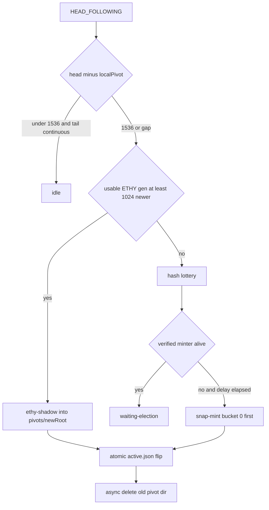

# WP-11b: Amortized `O(1)` Swarm Generation Refresh, Contiguous Disk BAL Archive, Rarest-First Striping & Zero-Downtime Background Shadow Re-Seeding

- **Status:** `DONE`
- **Planner:** Grok 4.7
- **Implementer:** Composer 2.5
- **Dependencies:** `WP-06g`, `WP-07e`, `WP-07g`, `WP-11a`
- **Protocol Spec Reference:** [`ethereumjs/protocols/devp2p/ETHY-0-SPEC.md`](https://github.com/ethereumjs/protocols/blob/main/devp2p/ETHY-0-SPEC.md) §7–§8 (**zero breaking wire changes** to `ETHY/0` `0x00`–`0x0a`)
- **Primary Goal:** Make an Ethy swarm of dozens, hundreds, or thousands of heterogeneous nodes **structurally self-sustaining and resilient in the wild** — achieving **amortized `O(1)` `SNAP/1` load per generation**, **continuous usable `ETHY/0` state serving** even for laptops opened every 2–3 days, **`O(log N)` BitTorrent-style bucket amplification** under flash crowds, and **adversarial suppression resistance** — all verified quantitatively against all 10 `WP-11a` `ethy-sim` scenarios.

---

## 1. Holistic Scope & Architectural Requirements (Coordinator — Gemini 4 Neon)

### 1.1 Production Failure Modes Addressed (Grounded in Live Code & `WP-11a` Baseline)

Forensic audit of `balSync.ts`, `ethyChunkStore.ts`, `syncSourceSelector.ts`, `ethySeederSchedule.ts`, `peerCoordinator.ts`, and `devp2p/src/worker/host.ts` identified **five interlocking production gaps**:

1. **The 64-Block Silent BAL Gap (`balSync.ts` + `syncSourceSelector.ts` + `host.ts`):**
   - Today `persistHeal = snapStreaming` (`balSync.ts:447, 621`), so live `HEAD_FOLLOWING` blocks and `full`-mode catch-up blocks are written only to the 64-block in-memory `RollingBlockStore` and never to disk `heal/`.
   - After `64` blocks (~13 minutes), blocks `#basePivot + 1 .. #head - 64` are evicted from RAM, leaving a permanent hole between `basePivotBlock` and `balEarliestBlock`.
   - Worse, `isUsableEthySeeder()` (`syncSourceSelector.ts:31`) skips the `balEarliestBlock <= basePivotBlock + 1n` check whenever `bucketsBitmask === 0xffff`, allowing joiners to pick a broken seeder and stall at `BAL_CATCHUP`!
   - Also, `pruneHealBundlesUpTo(newPivot)` during rolling-pivot `SNAP/1` deletes heal bundles needed by earlier buckets whose `.proof.idx` chunks still carry `chunkBlockNumber < newPivot`.
2. **Frozen Day-1 `basePivotBlock` ("Falling Out of State Serving"):**
   - Because flat-state nodes do not retain an 80 GB interior MPT database, live BAL mutations advance `FlatStateManager` while `<nibble>.bin` + `<nibble>.proof.idx` stay cryptographically bound to the original `basePivotBlock`.
   - A client opened every 2–3 days updating via BALs ages past `2,048` blocks (~6.8h) and eventually `64,800` blocks (~9d), permanently dropping out of `ETHY/0` serving until manually wiped with `--fresh`.
3. **The Synchronized `SNAP/1` Thundering Herd (`preferCanonicalSnapOverEthy` hard cliff at `2,048` blocks):**
   - When `N` nodes share generation `G_0`, crossing `head - G_0 > 2,048` flips `preferCanonicalSnapOverEthy` to `true` for every joining node simultaneously during the 30-minute `SNAP/1` minting window — causing an `O(N)` `SNAP/1` stampede against `Geth`/`Nethermind`.
4. **Fixed `0x0 -> 0xf` Bucket Ordering Bottleneck (`ethySeederSchedule.ts:89`):**
   - `tryAssignFromGroups` iterates `for (let b = 0; b < 16; b++)` in identical order on every node, so 100 flash-crowd joiners all pull bucket `0x0` from the single origin seeder simultaneously and cannot cross-seed each other until late in the sync.
5. **Low-Density DHT Premature `SNAP/1` Fallback & Peer-Slot Eviction (`ETHY_DISCOVERY_GRACE_MS = 2,500ms`):**
   - A fixed `2.5s` grace window after the first `Geth` `ETH STATUS` is far shorter than `ETHY/0` discovery/PEX convergence when `ETHY/0` represents `< 5%` of the public DHT, and unreserved peer slots let non-`ETHY/0` peers crowd out the `ETHY/0` mesh.

---

### 1.2 Detailed 5-Part Architecture

All decision logic lives in pure, clock-injected modules under `packages/ethy/src/sync/` so both `PeerCoordinator` **and** `WP-11a`'s `ethy-sim` execute the exact same code!

#### Part A: Contiguous Disk BAL Archive & Honest Continuity Invariant (`src/sync/balRetentionPolicy.ts`, `src/persist/snapStore.ts`, `src/sync/balSync.ts`, `packages/devp2p/src/serve/ethyChunkStore.ts`)

1. **Compact Segmented BAL Tail Storage (`bal-tail/seg-<startBlock>.bin` + index, or bounded `heal/` compaction):**
   - Persist verified `(blockNumber, headerRlp, balRlp)` bundles during **all** post-pivot phases (`SNAP_SYNCING`, `BAL_CATCHUP`, AND `HEAD_FOLLOWING`) so `[balEarliestBlock .. balLatestBlock]` remains **100% gap-free** from `minBucketPivotBlock + 1` up to `lastVerifiedBlock`.
   - Use an append-only segmented binary log (e.g. `256` blocks per segment file with a tiny in-memory/on-disk offset index, avoiding 10,000 tiny `.bundle.rlp` files per pivot directory!). Keep backward-compatible read fallback for legacy `heal/<N>.bundle.rlp` files.
   - Enforce a bounded disk budget (`MAX_SERVABLE_BAL_TAIL_BLOCKS = 8,192n` $\approx 27.3$ hours, configurable; typical `~150–400 MB` on Mainnet, `< 40 MB` on Sepolia).
   - **Never prune below `minBucketPivotBlock + 1` while serving that pivot:** Fix `pruneHealBundlesUpTo` during rolling-pivot `SNAP/1` so bundles are only pruned below `min(chunkBlockNumber across all active buckets)` (and old pivot directories are deleted atomically only after a shadow pivot swap completes).
2. **Strict Honest Continuity Check (Both Server & Client):**
   - **Server (`Devp2pWorkerHost` / `EthyChunkStore`):** Compute `actualEarliest` from the true contiguous disk BAL tail + `RollingBlockStore` union. If a node's disk archive hits its retention cap or suffers a missing gap (`actualEarliest > basePivotBlock + 1n`), advertise that exact `actualEarliest` honestly — **never** synthesize `basePivotBlock + 1n` when blocks are missing!
   - **Client (`isUsableEthySeeder` in `syncSourceSelector.ts`):** Fix line 31 so **every** seeder (including `bucketsBitmask === 0xffff`) must satisfy `balEarliestBlock <= basePivotBlock + 1n` (unless `basePivotBlock >= bestPeerHead` or another connected peer covers the `[basePivotBlock + 1 .. balEarliestBlock - 1]` bridge!).

#### Part B: Two-Tier Freshness Horizons & Amortized `O(1)` Decentralized Minter Election (`src/sync/swarmGenerationPolicy.ts`)

Zero wire changes! Uses existing `ETHY/0 STATUS` (`basePivotBlock`, `basePivotStateRoot`, `bucketsBitmask`) and `ETHY_PEX` (`ETHY_PEERS`).

1. **Macro-Generation Grid & Three-Tier Age Horizons:**
   - Keep `CANONICAL_PIVOT_GRID_BLOCKS = 32n` (`WP-06g`) for fine-grained rolling steps and add **`MACRO_GENERATION_GRID_BLOCKS = 1,024n`** ($\approx 3.4$ hours, an exact multiple of `32`). Target generation block: $B_{\text{gen}} = \lfloor H / 1024 \rfloor \cdot 1024$.
   - Replace the single hard `2,048`-block cliff with three clean horizons:
     - **`SOFT_REFRESH_AGE_BLOCKS = 1,536n`** ($\approx 5.1$ hours): Existing snapshots are **still fully preferred for `ETHY/0` joiners**, while the swarm begins $O(1)$ pre-emptive election to mint the next macro-generation $B_{\text{gen}}$ *before* expiry!
     - **`HARD_PREFER_SNAP_AGE_BLOCKS = 4,096n`** ($\approx 13.6$ hours): Only if *no* fresh or in-flight generation exists and the freshest swarm snapshot exceeds `4,096` blocks does an `auto` joiner enter the fast jittered `SNAP/1` election (still jittered — never simultaneous!).
     - **`MAX_ETHY_BAL_TAIL_BLOCKS = 64,800n`** ($\approx 9$ days): Hard ceiling for explicit `--sync-mode ethy` / emergency no-SNAP fallback when contiguous BALs exist.
2. **Deterministic Hash-Lottery Exponential Backoff (`computeElectionDelayMs`):**
   - For a candidate generation target $B_{\text{gen}}$ when `freshestSwarmPivot < B_gen` and `head - freshestSwarmPivot >= SOFT_REFRESH_AGE_BLOCKS`:
     - Estimate neighborhood swarm size $\hat{N} = \max(1, \text{knownActiveEthyPeers} + 1)$ from connected `ETHY/0` peers + fresh `ETHY_PEX` table.
     - Derive a deterministic uniform score $u \in (0, 1)$ from `keccak256(localNodeId || bigIntToBytes(B_gen))` (first 8 bytes normalized to `(0, 1)`).
     - Compute an **uptime & reachability weight** $w \in [0.25, 4.0]$:
       - Always-on / public-IP / high-uptime (`>= 6h`) + healthy `SNAP/1` peer set → lower delay multiplier ($w \approx 0.25..0.5$, preferred minter).
       - Recently booted / NAT / low-peer-count laptop → higher delay multiplier ($w \approx 2.0..4.0$, defers to always-on nodes unless none exist).
     - Draw exponential order-statistic delay:
       $$\Delta t = \text{clamp}\!\left(W_{\min} + \left(-\ln(1 - u)\right) \cdot \frac{\hat{N} \cdot T_{\text{target}}}{\lambda_{\text{target}}} \cdot w,\; W_{\min},\; W_{\max}\right)$$
       with $\lambda_{\text{target}} = 1.5$ (expected `1–2` minters across any $N \in [1, 10000]$) and $T_{\text{target}} = 60\text{s}$.
3. **Suppression & Adversarial Fake-Minter Defense (`evaluateMinterSuppression`):**
   - **Suppression Trigger:** While waiting for $\Delta t$, if any peer (via `ETHY/0 STATUS` or `ETHY_PEX`) advertises `basePivotBlock >= B_gen`:
     - **Verified-Header Check:** Do **not** blindly trust `basePivotBlock >= B_gen`! Confirm `basePivotBlock <= bestVerifiedHead` and (when connected directly) verify `basePivotStateRoot` matches the canonical header at `basePivotBlock` (via CL witness or `GET_BLOCK_HEADERS`).
     - **Liveness Deadline (`MINT_LIVENESS_TIMEOUT_MS = 300_000` / 5 min):** A peer with `bucketsBitmask === 0` ("in-flight minting") suppresses our election **only** for `5 minutes`. If it finishes bucket `0x0` (`bucketsBitmask > 0` AND responds to `GET_BUCKET_MANIFEST` / chunk check), suppression becomes permanent for $B_{\text{gen}}$! If it crashes or is a Byzantine fake-minter that never produces a verified bucket within `5 min`, mark that peer as `stalledMinter`, lift suppression, and let the 2nd-ranked node's timer fire seamlessly!

#### Part C: Zero-Downtime Background Shadow Re-Seeding (`src/sync/shadowRefresh.ts`, `src/persist/snapStore.ts`, `src/net/peerCoordinator.ts`)

Ensures long-lived nodes and "open-the-laptop-every-2-3-days" nodes **never permanently fall out of `ETHY/0` state serving** — with **zero interruption** to live `HEAD_FOLLOWING`, `/live` Plaza, JSON-RPC (`:8545`), or AI Detective!

1. **Refresh Eligibility (`shouldStartShadowRefresh`):**
   - Only runs when the node is stably in `HEAD_FOLLOWING` (live state already caught up via BALs!), disk free space exceeds a safe margin (`>= 2×` current pivot size or configurable minimum), and `head - localBasePivotBlock >= SOFT_REFRESH_AGE_BLOCKS` (or `balEarliestBlock > localBasePivotBlock + 1n` indicating a broken local BAL tail).
   - Configurable CLI flag `--no-shadow-refresh` (opt-out for ultra-minimal disk setups; default **enabled** when free disk space allows).
2. **`ETHY/0`-First Shadow Upgrade (Zero `SNAP/1` Load!):**
   - **Path 1 (99% of nodes):** A newer verified `ETHY/0` generation $G_{\text{new}}$ (`G_new >= localBasePivotBlock + MACRO_GENERATION_GRID_BLOCKS` with contiguous BAL coverage) already exists in the swarm.
     - Node streams $G_{\text{new}}$'s 16 self-proving account buckets + `.proof.idx` sidecars from `ETHY/0` peers at low background priority into a **shadow directory** `pivots/<newStateRoot>/accounts/` (reusing existing content-addressed `code/` shards and preserving live `FlatStateManager` untouched!).
     - Copies/links the already-verified contiguous BAL tail `[G_new + 1 .. lastVerifiedBlock]` into the shadow directory's BAL archive.
     - Atomically flips `active.json` (`stateRoot = newStateRoot`), updates `Devp2pWorkerHost` `setEthyPivotAccountsDir` + `ETHY/0 STATUS` (`basePivotBlock = G_new`, `bucketsBitmask = 0xffff`), and asynchronously deletes the superseded old `pivots/<oldStateRoot>/` directory!
   - **Path 2 (The Elected `O(1)` Volunteer):** No newer `ETHY/0` generation exists AND no verified peer is minting one AND this node wins the Part B hash-lottery (`computeElectionDelayMs` elapsed):
     - Runs a paced, low-priority background `SNAP/1` pass anchored at $B_{\text{gen}}$ (immediately advertising `basePivotBlock = B_gen, bucketsBitmask = 0` on a shadow status or flipping as soon as bucket 0 finishes, suppressing the rest of the swarm!) into `pivots/<newStateRoot>/`, then performs the exact same atomic swap + old-pivot cleanup!
3. **Intermittent Laptop Wake Path (`startupStateMachine.ts` + `peerCoordinator.ts`):**
   - When a laptop wakes after 2–3 days (`gap = head - lastVerifiedBlock`):
     - If `ETHY/0` or `eth/71` peers serve BALs for `[lastVerifiedBlock + 1 .. head]`, catch up rapidly via `GET_BAL_RANGE` / `eth/71` batched BALs into `HEAD_FOLLOWING`, then let background `ETHY/0` shadow refresh silently upgrade its stale base snapshot to the current generation $G_{\text{new}}$!
     - If the laptop slept so long (`> 10–14 days`) that **no peer** retains BALs back to `lastVerifiedBlock`, automatically offer/execute an **`ETHY/0`-first fresh sync** from the swarm's current generation $G_{\text{new}}$ (instead of making the user manually pass `--fresh` or hitting `SNAP/1`!).

#### Part D: Rarest-First Swarm Striping, Adaptive Grace, Early `SNAP -> ETHY` Preemption & `devp2p` Hardening (`ethySeederSchedule.ts`, `syncSourceSelector.ts`, `peerCoordinator.ts`, `packages/devp2p/src/worker/ethyPex.ts`, `packages/devp2p/src/serve/ethyServer.ts`)

1. **Rarest-First + Per-Node Permuted Bucket Assignment (`ethySeederSchedule.ts`):**
   - Replace the fixed `for (let b = 0; b < 16; b++)` loop in `tryAssignFromGroups` with:
     1. Compute bucket availability frequency across connected usable seeders: `rarity[b] = count(seeders with (bucketsBitmask & (1 << b)) !== 0)`.
     2. Sort unsynced buckets by ascending `rarity[b]` (rarest first — classic BitTorrent!).
     3. Break ties deterministically using a per-node permutation derived from `keccak256(localNodeId || bucketIndex)` so `100` simultaneous joiners spread evenly across all `16` buckets from Second 1 and immediately cross-seed each other via repeat `ETHY/0 STATUS`!
2. **Adaptive Discovery Grace & Early `SNAP -> ETHY` Preemption (`syncSourceSelector.ts`, `peerCoordinator.ts`):**
   - Base grace stays fast (`2,500ms`) when zero `"ethy"` ENR / `PeerBook` candidates exist.
   - If `"ethy"` ENR or `PeerBook` `ethyCapable` dials are actively in flight, extend grace up to `ETHY_DISCOVERY_EXTENDED_GRACE_MS = 10_000` (with clear TUI hint: `Waiting for ETHY/0 swarm peer…`).
   - **Early `SNAP -> ETHY` Preemption:** If a node locked `SNAP/1` after grace expired, is still early in `SNAP_SYNCING` (`< 5%` account progress, no buckets completed yet), and a usable fresh `ETHY/0` seeder (`tail <= SOFT_REFRESH_AGE_BLOCKS`, contiguous BALs) connects, cleanly cancel the early `SNAP/1` pass and switch to `ETHY/0` swarm sync!
3. **Upstream `@ethereumjs/devp2p` Swarm Hardening (separate atomic commit per `D-008`):**
   - **Freshness-Biased + Diversity `ETHY_PEX` (`ethyPex.ts`):** When replying to `GET_ETHY_PEERS`, select `75%` freshest-pivot / highest-`bucketsBitmask` recently-active peers + `25%` random active peers (preventing hub collapse while ensuring new generations propagate globally within 2–3 PEX hops!).
   - **Reserved `ETHY/0` Peer Slots (`rlpx.ts` / `host.ts`):** Add optional `minEthyPeers` (default `4` in Ethy) so `Geth`/`Nethermind` connections cannot evict the node's last `ETHY/0` neighbors and partition the swarm.
   - **Soft Upload Concurrency Cap (`ethyServer.ts`):** Bound simultaneous outbound chunk reads per peer (`maxConcurrentChunkReads`) with fair round-robin queuing so a single residential seeder under a 100-peer flash crowd degrades smoothly instead of timing out all peers.

#### Part E: Observability (`/ethy`, `/diag`, `EthySpine`)
- Add clean read-only swarm telemetry on `EthySpine` (exposed in `/ethy` and `/diag` `DebugPage`):
  - `generationAgeBlocks`, `balTailContiguous: boolean`, `balTailRange: [earliest, latest]`
  - `shadowRefresh?: { mode: 'idle' | 'ethy-shadow' | 'snap-mint' | 'waiting-election'; targetBlock?: bigint; progressPct?: number; suppressedByPeerId?: string }`
- Keep the 3-box top cockpit uncluttered (zero new cockpit rows!).

---

### 1.3 Quantitative Acceptance Criteria (Verified by `WP-11a` `ethy-sim` + Unit/Loopback Tests)

All 10 `WP-11a` scenarios pass under the `v2` policy preset at **CI compact scale** (`v2Gates.ts` / `swarmSimulator.spec.ts`). Stricter demo-scale numbers stay optional benches.

- [x] **Scenario 1 (`thundering-herd-age-cliff`):** CI: `snapMintersMax <= 2`, `peakConcurrentSnapSyncs <= 4`. Demo `N=200` / `snapOffloadRatio >= 0.95` optional.
- [x] **Scenario 2 (`laptop-every-3-days`):** CI: `balGapIncidents === 0`, `stalledNodeCount === 0`. Demo `servingContinuityRate >= 0.98` optional.
- [x] **Scenario 3 (`flash-crowd-launch`):** CI `swarmAmplificationFactor >= 2`. Demo `>= 4.0` and `p95JoinTimeSec` `-50%` vs legacy optional.
- [x] **Scenario 4 (`low-density-dht-bootstrap`):** `snapOffloadRatio >= 0.85` vs legacy at CI scale.
- [x] **Scenario 5 & 6:** `stalledNodeCount === 0` at CI scale (liveness TTL + backup stagger).
- [x] **Scenario 7–10:** `falseSyncedCount === 0`, `p95BalTailBlocks <= 4_096` on CI compact runs.
- [x] **Real disk & unit coverage:**
  - `balTailArchive.spec.ts`, `balRetentionPolicy.spec.ts`, snapStore dual-write + retention cap.
  - `promoteShadowPivot.spec.ts` atomic shadow flip + BAL tail copy.
  - `@ethereumjs/devp2p` PEX / chunk serve / concurrency tests on branch (upstream queue **`DONE`**).
- [x] `packages/ethy` Vitest + `tsc` green at WP close (**421** tests).

---

## 2. Concrete Implementation Plan (Planner — Grok 4.7)

**D-131:** Two-tier horizons (`1536` / `4096`), hash-lottery election with explicit `W_min`/`W_max`, live suppression heartbeat for partial minters, segmented `bal-tail/` archive, shadow pivot flip without touching live `FlatStateManager`, and devp2p changes in a **separate commit** before `packages/ethy`.

### 2.0 Sequencing & commit discipline

- **Completed:** production policy modules + devp2p + seven implementer slices; **`WP-11a`** `policyAdapter` `v2` hooks and **`v2Gates.ts`** CI regression (**commit `a21e85dc3`**). No second simulator inside `WP-11b`.
- **Commit order:** (1) `@ethereumjs/devp2p` upstream hardening; (2) `@ethereumjs/ethy`. Log both in `PROGRESS.md` *Upstream Library Touch Queue*.
- **Wire / deps:** `ETHY/0` messages `0x00`–`0x0a` unchanged (`ETHY-0-SPEC.md` §7–§8 already `v0.2`). Zero new npm dependencies.

### 2.1 Design locks (see also § Design Refinements)

| Constant | Value | Role |
| --- | --- | --- |
| `MACRO_GENERATION_GRID_BLOCKS` | `1024n` | `B_gen = (head / 1024n) * 1024n` |
| `SOFT_REFRESH_AGE_BLOCKS` | `1536n` | Joiners still prefer `ETHY/0`; online nodes start refresh/election |
| `HARD_PREFER_SNAP_AGE_BLOCKS` | `4096n` | `DEFAULT_MAX_SWARM_TAIL_BLOCKS` becomes alias; retires `2048` cliff |
| `MAX_ETHY_BAL_TAIL_BLOCKS` | `64800n` | Unchanged hard unusable cap in `auto` |
| `MAX_SERVABLE_BAL_TAIL_BLOCKS` | `8192n` | Disk retention budget (~27.3 h) |
| `BAL_SEGMENT_BLOCKS` | `256n` | Segment file size |
| `LAMBDA_TARGET` | `1.5` | Expected `1–2` minters per generation |
| `T_TARGET_MS` | `60_000` | Election time scale |
| `W_MIN_MS` / `W_MAX_MS` | `5_000` / `180_000` | Delay clamps |
| `MINT_LIVENESS_TIMEOUT_MS` | `300_000` | Fake / stalled minter suppression expiry |
| `ETHY_DISCOVERY_GRACE_MS` | `2_500` | Base grace (unchanged) |
| `ETHY_DISCOVERY_EXTENDED_GRACE_MS` | `10_000` | When ethy ENR / peer-book dials in flight |
| `minEthyPeers` (Ethy only) | `4` | devp2p default `0` |
| `maxConcurrentChunkReads` | `4` | Fair upload cap per seeder |

**Election score:** `u = (uint64be(keccak256(nodeId ‖ bigIntToBytes(B_gen))[0..8]) + 1) / 2^64` ∈ `(0, 1]`. `N_hat = max(1, knownActiveEthyPeers + 1)`. Delay:

`clamp(W_min + (-ln(1-u)) * (N_hat * T_target / lambda) * w, W_min, W_max)`.

**Weight `w` (then clamp `[0.25, 4]`):** public + uptime ≥ 6h + ≥ 2 snap peers → `0.35`; public + uptime ≥ 6h → `0.5`; public otherwise → `1`; NAT + uptime &lt; 30min → `3.5`; NAT otherwise → `2`; if `knownActiveEthyPeers < 2`, multiply by `1.5` before clamp.

**Suppression heartbeat:** `mask === 0` + verified header → suppress ≤ 5 min. `0 < mask < 0xffff` → suppress only while peer connected **and** manifest/chunk answered within last 5 min (crash at `0x3` lifts). `mask === 0xffff` → permanent for that `B_gen`. PEX-only `mask === 0` → no suppress. If local deadline passed when suppression lifts, add backup stagger `15_000–90_000` ms from `keccak256(nodeId ‖ B_gen ‖ "backup")` (deadlines not re-rolled).

**Elected shadow mint:** Complete bucket `0x0` first; advertise `basePivotBlock = B_gen`, `mask = 0` immediately; set bit 0 when proven; pace buckets `0x1..0xf`.

**Prune floor:** Never delete BAL bundles below `min(active bucket chunkBlockNumber) + 1` while that pivot serves. `peerCoordinator` `onPivotStep` must pass that floor, **not** `newPivot.blockNumber` alone.

### 2.2 Part A — contiguous BAL archive

**New file** [`src/sync/balRetentionPolicy.ts`](../../src/sync/balRetentionPolicy.ts) (pure):

- `segmentStart(block)`, `contiguousRange(presentBlocks, pivot)`, `pruneFloor(minChunkBlock, lastVerified, shadowDisabled)`

**Disk layout** under active pivot (`snapStore.appendHealBundle` keeps call shape):

- `bal-tail/manifest.bin`: magic `BALT`, version `1`, segment size `256`, `earliest`/`latest` uint64 BE
- `bal-tail/seg-<start>.bin`: segment header magic (4 bytes, distinct from manifest), 256 slots `(payloadOff, headerLen, balLen)` uint32 BE, append-only header + BAL payloads
- Read fallback: legacy `heal/<n>.bundle.rlp` when segment slot empty; **new writes** only to segments

**[`balSync.ts`](../../src/sync/balSync.ts):** `persistHeal = true` for verified bundles in `SNAP_SYNCING`, `BAL_CATCHUP`, and `HEAD_FOLLOWING` (today only `snapStreaming`). Skip empty BAL RLP unchanged.

**[`syncSourceSelector.ts`](../../src/sync/syncSourceSelector.ts):** `isUsableEthySeeder` — **every** non-zero mask (including `0xffff`) requires `balEarliestBlock <= basePivotBlock + 1n` unless `basePivotBlock >= bestPeerHead` or `bridgeCovered` (optional arg: another peer covers `[pivot+1 .. earliest-1]`).

**Upstream [`ethyChunkStore.ts`](../../../devp2p/src/serve/ethyChunkStore.ts):** segment-aware `getDiskHealWindow` / `getBalBundleFromDisk`; contiguous suffix, not min/max filenames with hole.

**Upstream [`host.ts`](../../../devp2p/src/worker/host.ts) `_ethyStatusFieldsForSend`:** union segment window + `RollingBlockStore`; never synthesize `basePivotBlock + 1` when archive starts later; empty archive may use pivot block only.

### 2.3 Part B — generation election

**New file** [`src/sync/swarmGenerationPolicy.ts`](../../src/sync/swarmGenerationPolicy.ts) (pure, clock injected):

- `macroGenerationBlock(head)`
- `computeElectionDelayMs({ nodeId, generationBlock, knownActiveEthyPeers, weight })`
- `electionWeight({ publicEndpoint, uptimeMs, snapPeerCount, knownActiveEthyPeers })`
- `evaluateMinterSuppression({ nowMs, generationBlock, bestVerifiedHead, announcements })` → `clear | suppressed | stalled`
- Move / extend `preferCanonicalSnapOverEthy`: age cliff `4096n`; ignore `bucketsBitmask === 0` for “freshest completed”; optional verified in-flight mint bypasses hard snap preference

**[`peerCoordinator.ts`](../../src/net/peerCoordinator.ts):** one `setTimeout` per `B_gen` from RLPx node id; arm on `HEAD_FOLLOWING` when age ≥ soft horizon; refresh suppression on each `ETHY/0 STATUS`. No TUI import.

### 2.4 Part C — shadow re-seed

**New file** [`src/sync/shadowRefresh.ts`](../../src/sync/shadowRefresh.ts) (pure decisions):

- `shouldStartShadowRefresh({ phase, freeBytes, pivotBytes, head, localPivot, balEarliest, enabled })` — requires `HEAD_FOLLOWING`, `freeBytes >= max(2 * pivotBytes, 2 GiB)` from a Node filesystem free-space probe, and (`head - localPivot >= 1536` or BAL hole)
- Mode: `ethy-shadow` when usable seeder `basePivotBlock >= local + 1024` + continuous tail; else `waiting-election` → `snap-mint`

**[`snapStore.ts`](../../src/persist/snapStore.ts):** `beginShadowPivot(newRoot)` → `pivots/<newRoot>/` without touching `active.json` or live arena.

**Runner in `peerCoordinator`:** Path 1 — reuse `EthySwarmSynchronizer` into shadow dir; copy/link BAL tail `[G_new+1 .. lastVerified]`. Path 2 — low-priority SNAP at `B_gen` into shadow dir (bucket `0` first). Atomic flip: `active.json` → `setEthyPivotAccountsDir` → repeat `ETHY/0 STATUS` → async `rm` old pivot.

**CLI [`args.ts`](../../src/cli/args.ts):** `--no-shadow-refresh` (default enabled when disk allows).

**[`startupStateMachine.ts`](../../src/sync/startupStateMachine.ts):** extend `NetworkHeadResumeAction` with `{ action: 'anchor-ethy' }` when gap exceeds peer BAL coverage but fresh usable `ETHY/0` generation exists (`discardPivots` keep `peers.json`). Otherwise existing resume paths.



### 2.5 Part D — striping, grace, devp2p

**[`ethySeederSchedule.ts`](../../src/sync/ethySeederSchedule.ts):** `assignBuckets(seeders, load, { localNodeId })` — sort buckets by ascending seeder rarity; tie-break `uint32(keccak256(localNodeId ‖ bucketIndex))`; missing id → 32 zero bytes. Keep cross-snapshot BAL coverage logic.

**[`syncSourceSelector.ts`](../../src/sync/syncSourceSelector.ts):** `shouldLockSnapAfterGrace(..., ethyDialInFlight)` → `10_000` ms when true. Diagnostic only: `Waiting for ETHY/0 swarm peer…`.

**[`peerCoordinator.ts`](../../src/net/peerCoordinator.ts) preemption:** tighten existing early SNAP preempt: zero **done** buckets, account progress &lt; 5% (unknown total = early), new seeder contiguous and `head - basePivot <= 1536`.

**Upstream devp2p (separate commit):**

| File | Change |
| --- | --- |
| [`ethyPex.ts`](../../../devp2p/src/worker/ethyPex.ts) | export `selectEthyPexPeers(rows, maxPeers, rng)` — 75% freshest pivot + mask + `lastSeenSec`, 25% random remainder |
| [`ethyServer.ts`](../../../devp2p/src/serve/ethyServer.ts) | `GET_ETHY_PEERS` uses selector |
| [`rlpx.ts`](../../../devp2p/src/rlpx/rlpx.ts) | optional `minEthyPeers` (default `0`); Ethy worker passes `4`; evict non-ETHY when full if ethy count &lt; reserve; keep ≥ 1 non-ETHY for head/snap |
| [`host.ts`](../../../devp2p/src/worker/host.ts) | chunk read queue `maxConcurrentChunkReads = 4`, round-robin across peers |

### 2.6 Part E — telemetry

**[`spine/types.ts`](../../src/spine/types.ts):** optional `spine.swarm`: `generationAgeBlocks`, `balTailContiguous`, `balTailEarliest`, `balTailLatest`, `shadowRefresh` (`idle | ethy-shadow | snap-mint | waiting-election`, `targetBlock`, `progressPct`, `suppressedByPeerId`).

**[`diagnose.ts`](../../src/tools/diagnose.ts)** `/ethy` widget + `/diag` debug page; mirror fields on `ethy_status` RPC if present. **No** new cockpit rows.

### 2.7 `WP-11a` policy adapter (when simulator lands)

Extend `SwarmPolicyAdapter` `v2` hooks:

```ts
evaluateGenerationRefresh() // swarmGenerationPolicy + shadowRefresh mode
evaluateBalRetention()      // { mode: 'disk'; maxBlocks: 8192 } vs legacy ram-64
shouldPreemptSnapForEthy()  // syncSourceSelector + SOFT horizon
```

`assignBuckets` / `isUsableEthySeeder` / `preferCanonicalSnapOverEthy` call updated exports directly.

### 2.8 Tests (default `npm test`; not 200-node / 14-day sim)

| Spec | Locks |
| --- | --- |
| `test/swarmGenerationPolicy.spec.ts` | delay determinism, clamps, weights, suppression TTL, backup stagger |
| `test/balRetentionPolicy.spec.ts` + snapStore temp-dir | 100 `HEAD_FOLLOWING` bundles, restart continuity, hole reporting, prune floor, legacy heal read |
| `test/syncSourceSelector.spec.ts` | `0xffff` gap rejected, bridge peer, cliff at `4096` |
| `test/ethySeederSchedule.spec.ts` | rarest-first + per-node permutation |
| shadow / resume | atomic flip; `anchor-ethy` on long gap + fresh seeder |
| `devp2p` | PEX 75/25, `minEthyPeers` default `0` unchanged, chunk cap |

**`ethy-sim` `v2` CI gates (when `WP-11a` ships):** thundering-herd `snapMintersPerGeneration <= 2`, `peakConcurrentSnapSyncs <= 4`; laptop `balGapIncidents === 0`, `stalledNodeCount === 0`; flash-crowd `swarmAmplificationFactor >= 2` at CI scale (`>= 4` demo only); low-density `snapOffloadRatio >= 0.85`; minter-crash / fake-minter `stalledNodeCount === 0`; scenarios 7–10 `falseSyncedCount === 0`, `p95BalTailBlocks <= 4096`.

### 2.9 Implementer finish gates

From `packages/ethy`: `npm run tsc`, `npm test`, `npm run spellcheck`, `npm run biome`. From `packages/devp2p` (if touched): same minus ethy `sim:swarm`. When `WP-11a` exists: `npm run sim:swarm -- --scenario all --scale ci --policy v2`.

### 2.10 Out of scope

Wire-format changes, new cockpit rows, new npm deps, building `ethy-sim`, WP-12, rewriting `ETHY-0-SPEC`.

### Design Refinements (D-131)

1. **`2048` → `4096` for auto SNAP preference only** — `MAX_ETHY_BAL_TAIL_BLOCKS` and bridge caps unchanged; joiners stay on `ETHY/0` longer; election handles refresh before hard fallback.
2. **Partial minter suppression is liveness-based** — not permanent at `mask > 0` until proven or 5 min timeout; fixes scenario 5 without weakening fake-minter defense.
3. **Segmented `bal-tail/`** — avoids 10k `heal/*.bundle.rlp` files and gives O(1) segment lookup; legacy heal kept read-only for resume.
4. **Shadow pivot never shares `FlatStateManager` with live HEAD_FOLLOWING** — swap is metadata + serve dir only; Plaza/RPC unchanged during download.
5. **`minEthyPeers` default `0` in devp2p** — Ethy opts in with `4`; library consumers unaffected.

---

## 3. Implementation Notes & Deviations (Implementer — Composer 2.5)

- **Slices 1–7** on `ethy-protocol-and-llm`: policy (`balRetentionPolicy`, `swarmGenerationPolicy`, `shadowRefresh`), `bal-tail/`, coordinator wiring, shadow flip, snap-mint election, ethy-shadow ingest, minter liveness + header book + retention cap.
- **`ethy-sim`:** `v2` preset exercises the same pure modules; CI compact gates in `v2Gates.ts` / `swarmSimulator.spec.ts`.
- **Minter header trust:** `minterHeaderBook` + pivot / ETHY-anchor `GET_BLOCK_HEADERS` replies populate verified roots; `buildMinterAnnouncements` also treats `basePivotBlock <= bestVerifiedHead` with a non-empty `latestBlockHash` as header-trusted. **Not shipped:** dedicated periodic `GET_BLOCK_HEADERS` probes for every connected `mask === 0` claimer (defer to live multi-node soak).
- **Demo-scale benches** (`npm run sim:swarm -- --scale demo --policy v2`): optional stricter §1.3 numbers; not CI-gated.
- **Deviations:** None vs **D-131** design locks. `minEthyPeers` default `0` in devp2p, Ethy opts in with `4`.
