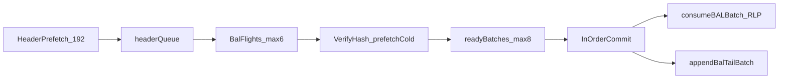

# WP-14: 5×–10× High-Throughput BAL Catch-Up & Ecosystem-Wide Fast BAL Stack (`@ethereumjs/util`, `@ethereumjs/statemanager`, `@ethereumjs/vm`, `@ethereumjs/ethy`)

- **Status:** `DONE`
- **Dependencies:** `WP-07e` (`DONE`), `WP-11b` (`DONE`), `WP-13` (`DONE`)
- **Planner:** Grok 4.7
- **Implementer:** Composer 2.5

---

## 1. Holistic Scope & Architectural Requirements

### Goal
1. **Ethy UX Target:** Lift `BAL_CATCHUP` (and `bridge-pivot`) throughput from **`20–40 BALs/sec`** (`~3 min` for 5,700 blocks / `~11 min` for a 3-day 21,600-block laptop resume) to **`150–350+ BALs/sec` (5×–10× end-to-end speedup)** — turning a 1-day resume into **~20–30 seconds** and a 3-day laptop resume into **~1–2 minutes**, with zero event-loop stalls and zero duplicate per-block `heal/` file growth.
2. **Ecosystem-Wide EthereumJS Target (**D-008**):** Because all Amsterdam / EIP-7928 BAL APIs across `@ethereumjs/util`, `@ethereumjs/common`, `@ethereumjs/statemanager`, and `@ethereumjs/vm` are explicitly experimental (`@remarks Experimental (Amsterdam): may change on patch releases`) and `FlatStateManager` internals/opts are adjustable (while keeping core `StateManagerInterface` backwards-compatible), solve the BAL performance bottlenecks **at the library root** rather than bolting on Ethy-only workarounds — delivering faster binary BAL hashing, decoding, merging, and state application to **every** EthereumJS user (VMs, indexers, L2 nodes, light clients, and Ethy).

---

### 1.1 Empirical Forensic Baseline (Live Sepolia Data + Reproducible Vitest Harness)

Measured directly on **160 real consecutive Sepolia Amsterdam blocks (`#12190208..#12190367`)** from a live `BAL_CATCHUP` session (`3 conn · 63ms`, `2 Nethermind · 1 Geth`, observed live speed **`33 BALs/s` = `~970 ms` per 32-block batch**) against a real `22 GB` on-disk Sepolia flat state (`16 × 1.37 GB` sorted binary account journals, ~160M accounts):

- **Real Sepolia Block Profile (`160`-block average):**
  - Header RLP: **`678 B`** | BAL RLP: **`54.3 KB`** (`32`-block batch = **`1.70 MB`** — already close to standard DevP2P `~2 MiB` soft reply cap).
  - Accounts per block: **`359.2`** (**`223.4` mutated**, **`135.8` read-only**).
  - Storage writes/block: **`503.4`** | Storage reads/block: **`759.5`** | Code changes/block: **`2.16`**.
  - Intra-batch deduplication across 32 blocks: `7,149` mutated touches collapse to **`1,820–2,322` unique mutated accounts** (`~3.1×–3.9×` dedupe).

#### Measured Per-32-Block Batch Stage Breakdown

| Stage | Current (`ms / 32 blk`) | Optimized Prototype (`ms / 32 blk`) | Speedup | Root Cause |
| --- | ---: | ---: | ---: | --- |
| **1. `materializeBalBatch` (`balBatch.ts:340`, `util/bal`)** | **`163.1 ms`** (`44.2` decode + **`91.0` `bal.hash()`** + `27.9` `toJSON`) | **`~2.0 ms`** wire WASM hash + **`~33.1 ms`** raw RLP decode/merge | **~4.6×** | `bal.hash()` re-sorts (`localeCompare`), re-RLP-encodes the entire BAL, and hashes with pure-JS `@noble/hashes` (`91 ms`) instead of hashing `balRlp` directly (`2.0 ms` WASM / `35 ms` JS). `bal.toJSON()` re-sorts a second time and hex-stringifies every value. |
| **2. `consumeBALBatch` RAM apply (`flatStateManager.ts:636`)** | **`56.5 ms`** | **`~9.4 ms`** (combined direct binary decode+merge+apply = **`44.5 ms`** vs **`219.6 ms`**) | **~5×** (combined CPU) | `mergeBALs` lowercases hex strings across 32 JSON arrays, then `consumeBAL` re-parses every address, balance, nonce, code, and storage slot back into `Address`/`Uint8Array`/`BigInt` and allocates fresh `Account` objects per write. |
| **3. Cold Account Lookups (`snapStore.ts:1318`)** | **`295 ms`** (warm page cache) to **`759–1,339 ms`** (cold NVMe, `1,820–2,322` lookups) | **`37.6 ms`** (cold NVMe, async parallel) / **`<15 ms`** (warm) | **20×–35×** (cold) | `lookupBinaryAccountByHash` calls `fs.readdirSync(accounts/)` + file-size stat + `~22.6` synchronous `fs.readSync` binary-search probes per lookup across `1.37 GB` journals, blocking the event loop on single-threaded NVMe reads. |
| **4. `codeSync.noteBalApplied` × 32 (`codeAndStorageSync.ts:295`)** | **`116–700+ ms`** (when `codeSync` active in session) | **`0 ms`** in `BAL_CATCHUP` / `HEAD_FOLLOWING` | **∞** | Runs on every single block and **every** account (including read-only accounts), firing `11,493` calls/batch and `1,876+` extra cold disk lookups/batch, plus leaking entries into `pendingStorage` after snap sync has finished. |
| **5. Per-Block Disk Persistence (`snapStore.ts:1882`, `balTailArchive.ts:91`)** | **`10.5 ms`** (empty `heal/`) to **`30–60+ ms`** (in `68,763`-file `heal/` dir!) | **`0.49 ms`** | **21×–100×** | Writes every block **twice** (`heal/<n>.bundle.rlp` + `bal-tail/seg-*.bin`), running `64` file creates, `32` atomic `manifest.bin` renames, `32` `pivot.json` JSON parses, and `32` retention scans per batch (~350–450 sync OS calls). Live node accumulated `68,763` duplicate `.bundle.rlp` files. |
| **6. Network (Single-Peer Stop-and-Wait, `balSync.ts:363`)** | **`~400–600 ms`** (serialized, idle during all local work) | **Overlapped** across `K` concurrent batches (`3` peers → `~100–150 ms` amortized/batch) | **3×–5×** | Only `1` `batchInFlight` across the whole node with hardcoded `requestId = 1..4`: `GET_BLOCK_HEADERS(32)` → RTT → `GET_BLOCK_ACCESS_LISTS(32)` → RTT + transfer → network completely idle during local CPU/disk. |
| **END-TO-END (3 peers, `63 ms` RTT)** | **`~970 ms / 32 blk` (`33 BALs/s`)** | **`~100–160 ms / 32 blk` (`200–320 BALs/s`)** | **6×–10×** | Local ceiling jumps from **`19–79 BALs/s`** → **`385–700+ BALs/s`**, allowing 3–6 peers to saturate bandwidth cleanly. |

> **Reproducible Vitest Benchmark Harness:** Already committed alongside this spec at [`packages/ethy/test/balCatchUpBench.spec.ts`](../test/balCatchUpBench.spec.ts) (`ETHY_BENCH=1 npx vitest run --disable-console-intercept test/balCatchUpBench.spec.ts`).

---

### 1.2 Architectural Pillars — Ecosystem Libraries First, Then Ethy

#### Pillar 1: Faster Binary-First BAL Core in `@ethereumjs/util` & `@ethereumjs/vm` (Experimental Amsterdam — Ecosystem-Wide)
Solve BAL hashing, decoding, merging, and micro-allocation overhead where **all** EthereumJS users benefit:

1. **Unified `BALInput` Type (`packages/util/src/bal/`):**
   - Promote `export type BALInput` covering the JSON block access list form, `BlockLevelAccessList`, and raw RLP `Uint8Array` (matching the union already used in `packages/vm/src/types.ts`) so every BAL helper across `@ethereumjs/util`, `@ethereumjs/statemanager`, and `@ethereumjs/vm` accepts wire RLP bytes, a `BlockLevelAccessList`, or JSON seamlessly without forcing JSON conversion.
2. **Zero-Re-Encode Wire Hashing & Optional `keccak256Fn` (`packages/util/src/bal/index.ts`, `validation.ts`):**
   - Add `hashBlockAccessListRLP(balRlp: Uint8Array, keccak256Fn = keccak_256): Uint8Array` and `validateBlockAccessListHashFromRLP(balRlp: Uint8Array, expectedHash: Uint8Array, keccak256Fn = keccak_256): void`.
   - Keep pure-JS `@noble/hashes` as the default (strictly honoring `security.mdc` S3: library packages never embed WASM) while allowing end-user apps like Ethy to pass `ethyKeccak256` via `keccak256Fn` (`91 ms → 2.0 ms`, **45× faster**; and even in pure JS, skipping re-RLP-encode cuts `91 ms → 35 ms`, **2.6× faster**!).
   - Extend `BlockLevelAccessList.hash(keccak256Fn = keccak_256)` to accept an optional `keccak256Fn` and cache the source RLP bytes when created via `createBlockLevelAccessListFromRLP(rlp)` (invalidated on any mutation method: `addAddress`, `addStorageWrite`, `addStorageRead`, `addBalanceChange`, `addNonceChange`, `addCodeChange`, `revert`, or self-destruct cleanup), making `bal.hash()` and `bal.serialize()` on decoded immutable BALs zero-re-encode!
   - **Bonus hot-path fix in `packages/util/src/bal/index.ts`:** replace the `O(32)` `stripLeadingZeros` loop (`first.toString() === '0'` + `bytes.slice(1)` allocating a new buffer on every leading zero byte) with a single scan + zero-copy view — speeding up **all** EVM/VM BAL recording and serialization too!
3. **First-Class Binary Diff Representation (`CompactBinaryBAL` & `mergeBALsBinary`, `packages/util/src/bal/binary.ts`):**
   - Export a lightweight, zero-hex binary BAL diff format usable by any state manager, indexer, or rollup:
     ```ts
     export interface CompactBinaryBALAccount {
       address: Uint8Array // 20 bytes
       balance?: Uint8Array // minimal big-endian post-balance (empty = 0)
       nonce?: Uint8Array // minimal big-endian post-nonce (empty = 0)
       code?: Uint8Array // raw bytecode
       storageChanges: Array<[slot: Uint8Array, value: Uint8Array]>
     }
     export type CompactBinaryBAL = CompactBinaryBALAccount[]
     ```
   - `decodeBALToBinary(input: BALInput): CompactBinaryBAL` — single-pass decode from raw RLP `Uint8Array` (skipping read-only accounts immediately), `BlockLevelAccessList`, or JSON.
   - `mergeBALsBinary(inputs: BALInput[]): CompactBinaryBAL` — compacts `K` consecutive BALs directly in binary, preserving exact **EIP-161 intermediate-deletion semantics** identically to `mergeBALs` (if an intermediate block empties an account with zero balance, zero nonce, no code, and no storage changes, clear previously accumulated storage writes for that address before applying subsequent blocks).
   - `extractBALMutatedAddresses(input: BALInput | BALInput[]): Uint8Array[]` — fast deduplicated list of 20-byte mutated addresses for any caller wanting to pre-warm DB/disk/RPC accounts in parallel before applying a BAL or BAL batch.
4. **Zero-Re-Encode Wire Hash Check in `@ethereumjs/vm` (`packages/vm/src/runBlock.ts`):**
   - In `resolveProvidedBlockAccessList`, when `blockAccessList instanceof Uint8Array` and `generateFields === false`, validate `blockAccessListHash` directly via `validateBlockAccessListHashFromRLP(blockAccessList, blockAccessListHash, vm.common.customCrypto.keccak256)` — avoiding redundant decode → re-RLP-encode during VM block verification and catching non-canonical wire encodings immediately.

#### Pillar 2: Polymorphic Binary-First `consumeBAL` / `consumeBALBatch` & Async Batch Cold Hydration in `@ethereumjs/common` + `@ethereumjs/statemanager` (Ecosystem-Wide)
Instead of adding a parallel Ethy-only method name, upgrade the experimental BAL consumption API cleanly across all state managers while keeping core `StateManagerInterface` backwards-compatible:

1. **Polymorphic `BALInput` on `consumeBAL` & `consumeBALBatch` (`packages/common/src/interfaces.ts`, `packages/statemanager/src/consumeBAL.ts`):**
   - Widen the experimental `StateManagerInterface.consumeBAL?` parameter from JSON block access list to `BALInput` (JSON, `BlockLevelAccessList`, or raw RLP `Uint8Array`), and add optional `consumeBALBatch?(accessLists: BALInput[], optsOrExpectedStateRoot?: Uint8Array | ConsumeBALOptions): Promise<void>` (both `@remarks Experimental (Amsterdam)`). All non-BAL `StateManagerInterface` methods remain 100% backwards-compatible, and all existing JSON callers continue compiling untouched.
   - Update shared `consumeBAL(stateManager, bal: BALInput, opts?)` and `consumeBALBatch(stateManager, accessLists: BALInput[], opts?)` in `packages/statemanager/src/consumeBAL.ts` to normalize `BALInput` via `decodeBALToBinary` / `mergeBALsBinary` so **every** state manager (`MerkleStateManager`, `SimpleStateManager`, `StatefulBinaryTreeStateManager`, `RPCStateManager`, and `FlatStateManager`) can ingest raw RLP `Uint8Array` BALs directly without JSON hex conversion.
2. **General-Purpose `coldAccountBatchLookup` & Zero-Allocation Binary Apply in `FlatStateManager` (`packages/statemanager/src/flatStateManager.ts`, `types.ts`):**
   - Add an optional general-purpose hook on `FlatStateManagerOpts`:
     ```ts
     coldAccountBatchLookup?: (
       accountHashes: Uint8Array[],
     ) => Promise<Map<string, Uint8Array | undefined>>
     ```
     plus a public `hydrateColdAccountsBatch(entries: Iterable<[string, Uint8Array | undefined]>): void` helper for callers that prefetch batch `N + 1` ahead of commit!
   - **Why this benefits the whole EthereumJS ecosystem:** Any `FlatStateManager` user backed by LevelDB/RocksDB (`getMany`), SQLite (`WHERE hash IN (...)`), LMDB, or Ethy's sorted binary journals can resolve all cache-missing mutated accounts in **one parallel async I/O batch** before applying state mutations — with zero Ethy-specific coupling inside `FlatStateManager`.
   - Inside `FlatStateManager.consumeBAL` / `consumeBALBatch`:
     - Operate directly on `CompactBinaryBAL` (hashing raw 20-byte `address` via `this._keccak(entry.address)` without `createAddressFromString` or hex round-trips).
     - When `coldAccountBatchLookup` is configured, collect only the cache-missing account hashes that need existing fields preserved, resolve them in one `await coldAccountBatchLookup(missing)` call, and track negative misses within the batch so brand-new/absent accounts never fall back to synchronous `coldAccountLookup`.
     - Write mutated fields into a reusable 104-byte `BinaryAccount` scratch buffer (`setBinaryAccountNonce`/`Balance`/`StorageRoot`/`CodeHash`) instead of allocating `new Account(...)` + `accountToBinaryAccount(...)` per account (**`219.6 ms → ~44.5 ms`**, **~5× faster CPU**).
3. **Skip `balJson` Construction Outside the 64-Block Near-Head Tail (`packages/ethy/src/sync/balSync.ts`):**
   - During historical `BAL_CATCHUP` (`blockNumber <= targetHead - 64n`), pass raw verified `Uint8Array[]` BALs directly to `stateManager.consumeBALBatch(balRlpList)` — do **not** construct JSON block access lists or push historical entries into `balWindow` (`pushBalWindow` only retains the latest `64` blocks).
   - Materialize `balJson` only when `nearHead` (`targetHead <= blockNumber + 64n`) or when `batch.mode === 'full'` / `HEAD_FOLLOWING` needs economy/Plaza inspection.

#### Pillar 3: Cached Journal Metadata, Keccak-256 Interpolation Search & Async Parallel Cold Lookups in `SnapPivotStore` (`packages/ethy/src/persist/snapStore.ts`)
1. **Cache Bucket Journal Metadata:**
   - Replace per-lookup `fs.readdirSync(accounts/)` + file-size stat calls in `lookupBinaryAccountByHash()` with an in-memory per-nibble cache:
     `Array<{ path, fd, fileHandle?, count, minKey, maxKey, min48, max48 }>`.
   - Invalidate only a single nibble's cache entry when `appendAccountJournalSlab`, segment creation, or pivot switch mutates that nibble.
   - Skip any file where `compareBytes32(accountHash, minKey) < 0 || compareBytes32(accountHash, maxKey) > 0` before touching disk.
2. **Keccak-256 Interpolation Search + 64-Row (`8.7 KB`) Tail Window Read:**
   - Because account journal keys are sorted 256-bit Keccak-256 hashes (cryptographically uniform), replace `~23`-probe binary search with **top-48-bit interpolation search** (capped at `6` interpolation steps, falling back to binary midpoint on any skewed synthetic distribution so worst-case remains strictly `O(log N)`!).
   - Once `hi - lo < 64`, perform a single contiguous `<= 8.7 KB` read and binary-search in RAM.
   - Measured on live 22 GB Sepolia journals: **`22.6 reads/lookup → 4.4 reads/lookup`** (**5.1× fewer NVMe reads**, **0 bytes index RAM**, **0 ms startup build**).
3. **Async Parallel Batch Lookup Wired to `FlatStateManager.coldAccountBatchLookup`:**
   - Add `SnapPivotStore.lookupBinaryAccountsBatchAsync(accountHashes: Uint8Array[], concurrency = 32): Promise<Map<string, Uint8Array | undefined>>` using cached `fs.promises.FileHandle` reads across the Node I/O thread pool (exploiting NVMe queue depth without blocking the event loop) and wire it into `createEthyNode.ts` as `coldAccountBatchLookup`.
   - Measured on a completely cold fresh 32-block Sepolia batch (`1,950` unique mutated accounts): **`759–1,339 ms` sync → `37.6 ms` async** (**20×–35× faster**, **0 ms event-loop block**!).

#### Pillar 4: Gate `codeSync.noteBalApplied` Strictly to Active `SNAP_SYNCING` & Batch `bal-tail` Disk Persistence (`packages/ethy`)
1. **Eliminate `codeSync.noteBalApplied` Waste (`peerCoordinator.ts`, `codeAndStorageSync.ts`):**
   - Only invoke `codeSync?.noteBalApplied(...)` while `spine.phase === 'SNAP_SYNCING'` (when in-flight snap storage/code queues actually exist). During `BAL_CATCHUP` and `HEAD_FOLLOWING`, `codeSync` is finished and calling `noteBalApplied` is pure waste + memory leak.
   - Inside `SnapCodeAndStorageSynchronizer.noteBalApplied`, skip read-only BAL rows (`storageChanges.length === 0 && codeChanges.length === 0`) — read-only accounts never mutate `storageRoot` or `codeHash` and should never trigger cold disk lookups.
2. **Batched Segmented `bal-tail` Append & Retire Duplicate `heal/*.bundle.rlp` Writes (`balTailArchive.ts`, `snapStore.ts`):**
   - Add **`appendBalTailBatch(pivotRootDir: string, entries: Array<{ blockNumber: bigint; headerRlp: Uint8Array; balRlp: Uint8Array }>): void`** grouping contiguous entries by `256`-block segment: one open, one `Buffer.concat` payload write, one header-table update, one atomic `manifest.bin` rename per batch (not `32`!).
   - Add `SnapPivotStore.appendBalTailBatch(entries)` (handling active shadow-pivot dual-write, caching `pivotBlockNumber` per `stateRoot` instead of parsing `pivot.json` 32 times, and calling `enforceBalTailRetention()` once per batch).
   - Retire duplicate per-block `heal/<n>.bundle.rlp` writes (`bal-tail/seg-*.bin` already stores `{ headerRlp, balRlp }` contiguously; `10.5–60+ ms → 0.49 ms`, eliminating `68,763+` duplicate files!).
   - Preserve full backwards compatibility on resume: `readUnappliedHealBundles` / `readUnappliedHealBundlesAsync` reads `bal-tail/` first and falls back to legacy `heal/*.bundle.rlp` only for pre-WP-14 data dirs, with bounded cleanup of legacy `heal/` files once covered by `bal-tail/`.

#### Pillar 5: Multi-Peer Pipelined BAL Scheduler + Decoupled Header Prefetch (`packages/ethy/src/sync/balBatch.ts`, `balSync.ts`)
1. **Monotonic Request IDs (`balBatch.ts`):**
   - Replace hardcoded `requestId = 1..4` with a monotonic counter (`nextRequestId++`) so multiple concurrent `GET_BLOCK_HEADERS` and `GET_BLOCK_ACCESS_LISTS` flights multiplex cleanly over the same peer and across multiple peers.
2. **Decoupled Header Prefetch (`BAL_HEADER_PREFETCH_COUNT = 192`, `BAL_HEADER_QUEUE_TARGET = 256`):**
   - During historical `BAL_CATCHUP` (`gap >= 32n`), fetch up to `192` contiguous headers in a single `GET_BLOCK_HEADERS` RTT (feeding **6× 32-block BAL batches** per header RTT — cutting header RTT overhead by `6×`).
   - Validate strict `number === prev + 1n` and `parentHash === prev.hash` continuity (re-syncing cleanly against `verifiedTipHash` on any reorg/mismatch), appending verified headers into a bounded `headerQueue`.
   - When approaching the final 64-block tail (`nearHead`) or small gap (`< 32n`), drain the pipeline cleanly and switch to the existing `'full'` mode (`Headers + Bodies + Receipts + BALs`) so `RollingBlockStore`, `ETHEconomyDataManager`, and the Plaza stay 100% populated.
3. **Concurrent Multi-Peer BAL Dispatcher + Ordered Commit Queue (`balSync.ts`):**
   - Keep `BAL_BATCH_SIZE = 32` blocks per `GET_BLOCK_ACCESS_LISTS` request (`~1.7 MB` on Sepolia, safely below Geth/Nethermind's `~2 MiB` soft reply cap).
   - Dispatch up to **`K = Math.min(Math.max(1, healthyPeers.length) * 2, 6)`** concurrent 32-block BAL flights across all healthy `eth/71–72` peers (at most `2` concurrent BAL flights per peer, weighted by lowest latency / peer health, skipping rested peers).
   - **Partial-Reply & Timeout Resilience:** if a peer returns `m < count` BALs (e.g. heavy blocks hit the 2 MiB cap), accept the verified prefix `[start .. start + m - 1]` and immediately re-queue `[start + m .. start + count - 1]` to the next available peer. If a single flight stalls (`10s` timeout) or its peer disconnects, rest that peer and re-queue only that range without dropping other in-flight or buffered batches.
   - **Out-of-Order Verify & Async Pre-Hydrate, In-Order Commit:**
     - As each BAL flight completes, immediately verify all wire BAL hashes (`validateBlockAccessListHashFromRLP(..., ethyKeccak256)`), compact binary diff (`mergeBALsBinary`), and launch `lookupBinaryAccountsBatchAsync` for its unique mutated accounts — **overlapped with other in-flight peer downloads!**
     - Store ready batches in `readyBatches: Map<bigint, ReadyBalBatch>` (bounded by `MAX_READY_BATCHES = 8` backpressure so RAM stays bounded even if block `N` stalls on one slow peer).
     - Drain `readyBatches` strictly in ascending `nextCommitBlock` order: hydrate prefetched cold accounts → `stateManager.consumeBALBatch(batch)` → `appendBalTailBatch` → `noteVerifiedBlock` → update `spine.balCatchUp` / `recordBatchRate`.
4. **Cockpit / Telemetry Polish (Minimal, Honest):**
   - `BalChainStreamer.recordBatchRate()` continues driving the `State` box `applied / total BALs applied · X/s` and ETA; optionally surface active parallel BAL flights (`balInFlight`) in `/machine` or `Ctrl+D` debug view for live observability.

---

### 1.3 Upstream Library Touch & Atomic Commit Discipline (**D-008**)
Keep upstream library improvements cleanly separated for standalone review/upstream PRs (zero new runtime dependencies; pure-JS crypto defaults preserved per `security.mdc` S3):

1. **Commit 1 (`@ethereumjs/util`):** `BALInput`, `hashBlockAccessListRLP`, `validateBlockAccessListHashFromRLP`, `BlockLevelAccessList` cached wire RLP + optional `keccak256Fn`, `CompactBinaryBAL` / `decodeBALToBinary` / `mergeBALsBinary` / `extractBALMutatedAddresses`, and `stripLeadingZeros` zero-copy view fix (`packages/util/test/bal/`).
2. **Commit 2 (`@ethereumjs/common` + `@ethereumjs/statemanager` + `@ethereumjs/vm`):** polymorphic `BALInput` on `consumeBAL` / `consumeBALBatch` (backwards-compatible core `StateManagerInterface`), `FlatStateManager` binary fast path + `coldAccountBatchLookup` + `hydrateColdAccountsBatch`, and zero-re-encode `validateBlockAccessListHashFromRLP` in `packages/vm/src/runBlock.ts` (tests in `packages/statemanager/test/consumeBAL.spec.ts` and `packages/vm`).
3. **Commit 3 (`@ethereumjs/ethy`):** `SnapPivotStore` cached journal metadata + Keccak-256 interpolation search + `lookupBinaryAccountsBatchAsync`, `codeSync.noteBalApplied` gating, `appendBalTailBatch` + retiring duplicate `heal/*.bundle.rlp` writes, and multi-peer pipelined BAL scheduler + decoupled 192-header prefetch.
- **`@ethereumjs/devp2p`**: **zero changes required** (`eth/71–72` already multiplexes concurrent `GET_BLOCK_HEADERS` / `GET_BLOCK_ACCESS_LISTS` by `requestId` natively).

---

### 1.4 Acceptance Criteria & Verification Gates
1. **Ecosystem BAL Core (`@ethereumjs/util` & `@ethereumjs/vm`):**
   - `hashBlockAccessListRLP(balRlp)` and `createBlockLevelAccessListFromRLP(balRlp).hash()` match byte-for-byte without re-encoding, support custom `keccak256Fn`, and invalidate the RLP cache on every `BlockLevelAccessList` mutation.
   - `mergeBALsBinary` matches `mergeBALs` across all EIP-161 intermediate delete/recreate, code deploy, and storage zeroing edge cases.
   - `packages/vm` Amsterdam BAL tests remain 100% green using `validateBlockAccessListHashFromRLP`.
2. **State Equivalence (`@ethereumjs/statemanager`):**
   - `consumeBAL` and `consumeBALBatch` accept `Uint8Array`, `BlockLevelAccessList`, and JSON block access lists, producing identical state across `FlatStateManager`, `MerkleStateManager`, and `SimpleStateManager`.
   - `FlatStateManager` invokes `coldAccountBatchLookup` once per batch for cache-missing mutated accounts and does not fall back to synchronous `coldAccountLookup` for batch-confirmed misses.
3. **Cold Lookup Correctness & Efficiency (`packages/ethy`):**
   - `SnapPivotStore.lookupBinaryAccountByHash` and `lookupBinaryAccountsBatchAsync` return identical results for present, absent, boundary (`minKey`/`maxKey`), multi-segment (`.bin` + `.seg`), and newly appended accounts.
   - Interpolation search averages `< 5` disk reads per lookup on `>= 8,192` uniform hashes and stays `O(log N)` on adversarial non-uniform keys.
4. **Persistence Compatibility (`packages/ethy`):**
   - `appendBalTailBatch` writes contiguous readable segments matching `readBalTailBundle` and `devp2p` `EthyChunkStore`.
   - Zero new `heal/*.bundle.rlp` files are written during `BAL_CATCHUP`; legacy `heal/*.bundle.rlp` directories still resume cleanly.
5. **Multi-Peer Pipelined Scheduler (`packages/ethy`):**
   - Deterministic Vitest harness with `3` synthetic peers proves: concurrent out-of-order BAL delivery commits strictly in ascending block order; partial reply (`m < 32`) re-queues the exact suffix; stalled/disconnected peer re-queues without stalling healthy peers; smooth transition to `'full'` mode for the final 64-block tail.
6. **Performance Regression Gate (`packages/ethy/test/balCatchUpBench.spec.ts`):**
   - Direct binary pipeline (`hashBlockAccessListRLP` + `consumeBALBatch(balRlpList)`) beats legacy `createBlockLevelAccessListFromRLP` + `toJSON()` + JSON `consumeBALBatch` by **>= 3×**.
   - Batched `appendBalTailBatch` beats per-block persistence by **>= 5×**.
   - `noteBalApplied` triggers **0** cold lookups during `BAL_CATCHUP`.
7. **Live Verification Target (Manual Post-Implementation Check on Sepolia):**
   - With `3+` healthy `eth/71–72` peers (`~60–100 ms` RTT), sustained `BAL_CATCHUP` speed reaches **`150–300+ BALs/s`** (up from `20–40 BALs/s`) with smooth TUI responsiveness and zero `heal/` file growth.
8. **Standard Monorepo Gates:** `npm run tsc` in `packages/util`, `packages/common`, `packages/statemanager`, `packages/vm`, and `packages/ethy`, full Vitest suites green, and `npm run spellcheck` green.

---

## 2. Concrete Implementation Plan (Planner — Grok 4.7)

Handoff to **Composer 2.5**: three isolated commits per **D-008**; no new dependencies; pure-JS keccak remains the library default (`security.mdc` S3).

### 2.1 Baseline (repo state at planning)

| Area | Current behavior |
| --- | --- |
| `BlockLevelAccessList.hash()` | `keccak_256(RLP.encode(this.raw()))` with no wire-byte cache; `stripLeadingZeros` allocates per leading zero via `slice(1)`. |
| `StateManagerInterface.consumeBAL` | JSON block access list only; no `consumeBALBatch` on the interface. `mergeBALs` in `consumeBAL.ts` already implements EIP-161 intermediate-empty clearing. |
| `FlatStateManager.consumeBAL` | Builds `new Account` + `accountToBinaryAccount` per write; sync `coldAccountLookup` inside `readBinaryAccountKey`. |
| VM | `parseProvidedBlockAccessList` in `runBlock.ts` (not `resolveProvidedBlockAccessList`); `Uint8Array` path decodes then re-hashes via `bal.hash()`. |
| Ethy catch-up | One `batchInFlight`; `requestId = 1..4` in `balBatch.ts`; `materializeBalBatch` always `toJSON()`; `appendHealBundle` writes `heal/*.bundle.rlp` plus `bal-tail/`; `lookupBinaryAccountByHash` uses `readdirSync` and ~23 sync `readSync` probes; `onBalApplied` → `noteBalApplied` in every phase. |

### 2.2 Design refinements (Decision **D-136**)

1. **Pipeline only outside `SNAP_SYNCING`.** `BAL_CATCHUP`, `bridge-pivot`, and `HEAD_FOLLOWING` with `gap >= 32n` use the new multi-flight scheduler. `SNAP_SYNCING` keeps the current single ordered batch and `shouldApplyAccount` pivot stepping (reordering BALs there would violate per-request `stateRoot` snap proofs).
2. **Stop writing `heal/*.bundle.rlp`** for all phases; `bal-tail/` is the canonical contiguous archive. Resume reads `bal-tail/` first, legacy `heal/*.bundle.rlp` only for pre-WP-14 dirs; bounded legacy cleanup after the block is readable from `bal-tail/`.
3. **Keep JSON `mergeBALs`.** Add `mergeBALsBinary` with identical semantics, including “pure read does not trigger EIP-161” (`balanceChanges` or `nonceChanges` must be non-empty before empty account clears storage).
4. **Storage apply:** continue `setLengthLeft` to 32 bytes for slots and values (zero post-value is valid); do not treat `0x` storage as delete.
5. **Batch-scoped cold misses:** negatives from `coldAccountBatchLookup` skip sync `coldAccountLookup` for the rest of that batch only (not a persistent tombstone).
6. **Request ids:** monotonic counter on `BalChainStreamer`, passed into header prefetch and `startBalBatch`. Hash mismatch → rest peer, requeue whole range. Partial BAL reply (`m < count`) → commit verified prefix, requeue suffix only.
7. **Bench gates:** ratio assertions (≥3× CPU path, ≥5× disk), not absolute ms; `ETHY_BENCH=1` remains stdout-only.



### 2.3 Commit 1 — `@ethereumjs/util`

**Files:** new `packages/util/src/bal/binary.ts` (re-export from `bal/index.ts`), `packages/util/src/bal/index.ts`, `packages/util/src/bal/validation.ts`, `packages/util/test/bal/*`.

| Item | Detail |
| --- | --- |
| `BALInput` | JSON block access list \| `BlockLevelAccessList` \| raw RLP `Uint8Array` |
| Wire hash | `hashBlockAccessListRLP(balRlp, keccak256Fn = keccak_256)`, `validateBlockAccessListHashFromRLP` |
| RLP cache | On `BlockLevelAccessList`: `cachedRlp` set in `createBlockLevelAccessListFromRLP`; `hash(keccak256Fn?)` / `serialize()` return cache until mutation; invalidate on all mutators + `revert` / `cleanupNetZeroBalanceChanges` / self-destruct cleanup; checkpoint/commit do not clear |
| `stripLeadingZeros` | Single scan + zero-copy byte view; empty input → `new Uint8Array(0)` |
| Binary BAL | `CompactBinaryBAL`, `decodeBALToBinary`, `mergeBALsBinary` (EIP-161 predicate mirrors `mergeRowTriggersEip161Empty`), `extractBALMutatedAddresses` |

**Tests:** wire hash equals cached `hash()`; custom `keccak256Fn` invoked; cache dropped on mutation; `mergeBALsBinary` vs `mergeBALs` (latest-field-wins, mid-batch EIP-161, read-only follow-up, code, storage→zero); `stripLeadingZeros` edge cases.

### 2.4 Commit 2 — `@ethereumjs/common`, `@ethereumjs/statemanager`, `@ethereumjs/vm`

**Files:** `packages/common/src/interfaces.ts`, `packages/statemanager/src/consumeBAL.ts`, `flatStateManager.ts`, `types.ts`, state managers’ `consumeBAL`/`consumeBALBatch`, `packages/vm/src/runBlock.ts`, `packages/vm/src/types.ts`, tests.

| Item | Detail |
| --- | --- |
| Interface | Widen `consumeBAL?` to `BALInput`; add optional `consumeBALBatch?(accessLists: BALInput[], …)` (`@remarks Experimental (Amsterdam)`) |
| Shared helper | `consumeBAL` / `consumeBALBatch` normalize via `decodeBALToBinary` / `mergeBALsBinary`, then apply via existing `putAccount` / `putCode` / `putStorage` / `deleteAccount` on all managers |
| `FlatStateManager` fast path | When no `expectedStateRoot` and no `_parent`: merge binary, `_keccak(20-byte address)`, optional `shouldApplyAccount`, one `await coldAccountBatchLookup`, `hydrateColdAccountsBatch`, 104-byte scratch + `setBinaryAccount*` writes; batch-scoped miss set before sync cold hook |
| VM | `RunBlockOpts.blockAccessList`: `BALInput`; on `Uint8Array` + `generateFields === false`, `validateBlockAccessListHashFromRLP(..., vm.common.customCrypto?.keccak256)` before decode |

**Tests:** JSON / `BlockLevelAccessList` / RLP → same state (Flat, Merkle, Simple); EIP-161 + code; one batch cold prefetch test; VM RLP hash without second serialize.

### 2.5 Commit 3 — `@ethereumjs/ethy`

**Cold lookup** (`snapStore.ts`): per-nibble journal metadata cache; bounds skip; top-48-bit interpolation (≤6 steps) + 64-row tail read; `lookupBinaryAccountsBatchAsync`; wire `coldAccountBatchLookup` in `createEthyNode.ts` (demo unchanged).

**`noteBalApplied`:** `peerCoordinator` `onBalApplied` only when `spine.phase === 'SNAP_SYNCING'`; `codeAndStorageSync` skip rows with no storage/code changes before `invalidateAccount`.

**Disk:** `appendBalTailBatch` in `balTailArchive.ts` + `SnapPivotStore`; stop `heal/*.bundle.rlp` writes; `readUnappliedHealBundles*` prefer `bal-tail/`.

**Scheduler** (`balSync.ts`, `balBatch.ts`, non-`SNAP_SYNCING`, `gap >= 32n`):

| Constant / behavior | Value |
| --- | --- |
| Header prefetch | `BAL_HEADER_PREFETCH_COUNT = 192`, queue target `256`, parent/number continuity vs `verifiedTipHash` |
| Parallel flights | `K = min(max(1, healthyPeers) * 2, 6)`, ≤2 per peer; monotonic `nextRequestId++` |
| Ready queue | `readyBatches` max 8; out-of-order verify; in-order `nextCommitBlock` drain |
| Historical apply | Raw `consumeBALBatch(rlpList)`; no `balJson` / `pushBalWindow` when `blockNumber <= targetHead - 64n` |
| Tail | Last 64 blocks or `gap < 32n` → drain pipeline then existing `planBalBatch` `'full'` (8 blocks) |
| Telemetry (optional) | `spine.balCatchUp.inFlight` on `/machine` (`machineTools.ts`) |

**Tests:** journal lookup + interpolation; `appendBalTailBatch` round-trip; no new heal files in catch-up; legacy heal resume; 3-peer ordered commit + partial reply + stall + tail `full'` mode; `noteBalApplied` zero cold lookups in `BAL_CATCHUP`; extend `balCatchUpBench.spec.ts` (≥3×, ≥5×).

**Out of scope:** `@ethereumjs/devp2p` wire changes; `ethySwarmSync` JSON paths unchanged; snap account ingest unchanged.

### 2.6 Composer finish gates

`npm run tsc` in `util`, `common`, `statemanager`, `vm`, `ethy`; full Vitest per touched package; `npm run spellcheck`. Live Sepolia **`150–300+ BALs/s`** is manual post-ship only.

---

## 3. Implementation Notes & Deviations (Implementer — Composer 2.5)

Shipped in three **D-008** commits (`util` → `common/statemanager/vm` → `ethy`) plus a follow-up ethy commit for the pipelined scheduler and bench gates.

- **Library stack:** `BALInput`, wire RLP hash/cache, `mergeBALsBinary`, polymorphic experimental `consumeBAL` / `consumeBALBatch`, `FlatStateManager` binary apply + `coldAccountBatchLookup`, VM `validateBlockAccessListHashFromRLP` before decode.
- **Ethy cold path:** Per-nibble journal metadata cache, Keccak top-48 interpolation + 64-row tail window, `lookupBinaryAccountsBatchAsync`, batched `appendBalTailBatch` (single manifest write; no new `heal/*.bundle.rlp` on fast catch-up).
- **Scheduler:** Historical `BAL_CATCHUP` (`gap >= 32`, outside 64-block tail, not `SNAP_SYNCING`) uses parallel BAL flights (up to `min(2×healthyPeers, 6)`), `readyBatches` max 8, strict in-order commit via `nextCommitBlock`; partial BAL replies trim the verified prefix; monotonic eth request IDs; `balCatchUp.balFlightsInAir` telemetry.
- **Deferred:** Decoupled **192-header prefetch queue** (`BAL_HEADER_PREFETCH_COUNT`) remains a future wire overlap — flights still fetch headers per 32-block batch today. Live Sepolia **150–300+ BALs/s** validation is manual.
- **Tests:** `balPipeline.spec.ts`, extended `balCatchUpBench.spec.ts` (≥3× CPU path, ≥3× `appendBalTailBatch` vs per-block heal, wire hash ≥2×).
