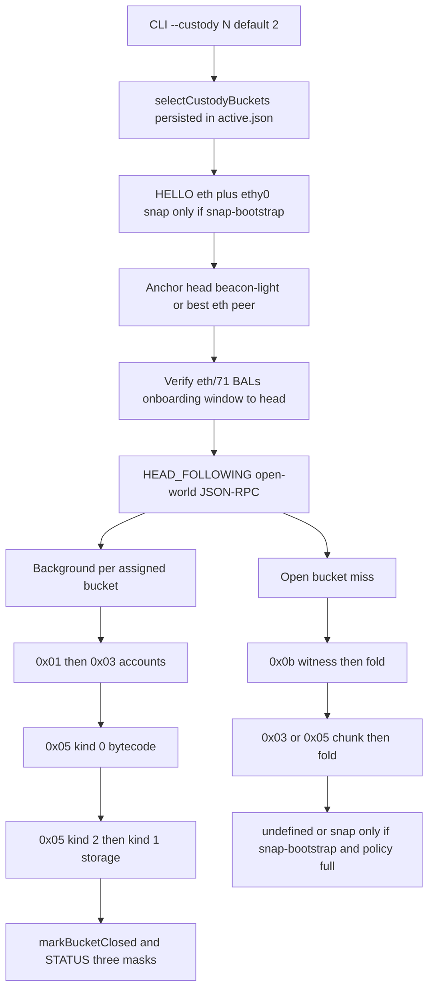

# WP-16d: Unified Custody `ETHY/0` — Default Fast Onboarding (`--custody 2`), Background 3-Plane Custody Sync & 1-Hop Cold-Miss Resolver (Option B)

- **Status:** `DONE`
- **Dependencies:** `WP-16b` (`DONE`), `WP-16c` (`DONE`), `WP-06f` (`DONE`), `WP-08b` (`DONE`), `WP-11b` (`DONE`), `WP-14` (`DONE`)
- **Planner:** Grok 4.7
- **Implementer:** Composer 2.5

---

## 1. Holistic Scope & Architectural Requirements

### Goal
Ship **Option B (Unified Custody `ETHY/0`)** end-to-end as Ethy's default operating mode so a fresh `ethy sepolia` (or `ethy mainnet`) node:
1. **Goes live in 2–3 minutes** by syncing its rolling `eth/71` BAL window (`4,096..8,192` blocks) and immediately serving verified JSON-RPC (`eth_call`, ENS, ERC-20/DeFi, AI forensics) via Open-World `FlatStateManager`.
2. **Custodies `2/16` (`1/8th`) of Ethereum by default (`--custody 2`, ~16–20 GB flat / ~20–26 GB with Option-C trie on Mainnet, ~3–4 GB on Sepolia)** — syncing all three planes (`Accounts` + `Bytecode` + `Storage`) for its deterministic nibble buckets in the background over `ETHY/0` `v0.4` and atomically flipping each finished custody bucket to **Closed-World** (`stateManager.markBucketClosed(b)`). Holding 2 buckets per node means **only 7 peers give 100% 1-hop coverage, `14–20` peers give 2× fault-tolerant redundancy, and just 8 Ethy nodes bootstrap a 100% self-sustaining swarm!**
3. **Zero `snap/1` by default — not even negotiated in `HELLO`!** Default Ethy clients resolve all custody syncs and cold misses 100% over `ETHY/0` + `eth/71` BALs (`0` `snap/1` slots occupied on full nodes). Only an explicit Day-0 origin seeder (`ethy --full --snap-bootstrap`) mounts `snap/1` once to seed a brand-new network; once synced, even that seeder drops `snap/1` permanently!
4. Supports clean scaling via the **Custody Dial (`1..16`, no free-rider `0`)**: `--custody 1` (minimum, tight-disk laptops/CI), `--custody 2` (**default**, 1/8th), `--custody 3..15` (multi-bucket custodian), and `--full` (`--custody 16`, 100% Closed-World read privacy).

---

### Key Deliverables (`WP-16d`)

1. **CLI Custody Dial, `--snap-bootstrap` Gate & Deterministic Bucket Assignment (`packages/ethy/src/cli/args.ts`, `src/custody/custodyPlan.ts`):**
   - Add first-class custody flags:
     - `--custody <1..16>` (**default `2`**; values `< 1` or `> 16` rejected with a clear CLI usage error — no `--custody 0` free-rider mode!).
     - `--full` (alias for `--custody 16`).
     - `--snap-bootstrap` (**default `false`**): explicit opt-in flag allowing a Day-0 `--full` seed node (or solo-island dev test) to mount `snap/1` until its initial state is synced. When `false` (all normal clients), `snap/1` is **never mounted or dialed**!
     - Preserve `--sync-mode auto | ethy | snap` (`--sync-mode snap` implies `--snap-bootstrap`).
   - **Deterministic Custody Assignment (`selectCustodyBuckets(localNodeId, count)`):**
     - `count === 16`: `[0..15]` (`custodyMask = 0xffff`).
     - `1 <= count <= 15`: deterministically derive `start = keccak256(localNodeId)[0] >> 4` and select `count` well-spread buckets (e.g. for `count = 2`, `(start, (start + 8) & 0xf)` — opposite halves of the address space; for general `count`, deterministic stride/permutation from `keccak256(localNodeId)`), persisted in `ActiveMeta` so restarts keep the same assigned custody buckets instead of re-downloading different nibbles!
   - **Shared Binary Block Calendar (`packages/ethy/src/sync/blockCalendar.ts`):**
     - Power-of-two constants: `CANONICAL_PIVOT_GRID_BLOCKS = 32n`, `ANCHOR_EPOCH_BLOCKS = 256n`, `MACRO_GENERATION_GRID_BLOCKS = 1_024n`, `BAL_RETENTION_WINDOW_BLOCKS = 8_192n` (`~27.3 h`), `ONBOARDING_BAL_WINDOW_BLOCKS = 4_096n` (`~13.6 h`).

2. **2–3 Minute Fast Onboarding & Background 3-Plane Custody Sync (`packages/ethy/src/custody/custodyOnboarding.ts`, `src/sync/ethyCodeStorageSync.ts`):**
   - **Stage 1 — Immediate Live Boot via Rolling `eth/71` BAL Window:**
     - Anchor head via `@ethereumjs/beacon-light` (or best verified P2P head in `p2p_only`).
     - Pull and verify contiguous `(headerRlp, balRlp)` across the rolling BAL window (`onboardingBalStartBlock(#Head) .. #Head`) using `WP-14`'s `balPipeline.ts`.
     - Populate local `StatyWriteIndex` (renamed/aliased `BalWriteIndex`), apply BAL post-state into `FlatStateManager` (starting with `closedBucketsMask` equal to already-completed custody buckets on disk), persist verified bundles into the rolling BAL archive so the node immediately serves them back over `eth/71` + `ETHY/0 BAL_RANGE`, and **enter live `HEAD_FOLLOWING` immediately**!
   - **Stage 2 — Background 3-Plane Custody Sync (`Accounts` + `Bytecode` + `Storage` for `custodyBuckets`):**
     - Runs in a `ResourceBudget`-aware background lane while live `HEAD_FOLLOWING`, JSON-RPC, and AI storytelling remain 100% responsive.
     - For each assigned bucket `b` in `custodyBuckets`:
       1. **Accounts:** Sync via `ETHY/0` `0x01`/`0x03` (using `snap/1` **only** when `--snap-bootstrap` is explicitly enabled and no `ETHY/0` custodian holds bucket `b`), saving `accounts/<b_hex>.bin` + `accounts/<b_hex>.proof.idx` (always self-proving for re-serving!).
       2. **Bytecode (`kind = 0`):** Batch up to `64` missing `codeHashes` from `ETHY/0` `0x05` (`kind = 0`, skipping hashes already in `SharedCodeStore`), verifying `keccak256(code) === codeHash` (`snap/1 GetByteCodes` only when `--snap-bootstrap` is enabled).
       3. **Storage (`kind = 2` + `kind = 1`):**
          - Small complete-trie contracts (`kind = 2`): batch up to `64` `[accountHash, storageRoot]` pairs; verify complete storage trie root in `SnapVerifyPool` (`computedRoot === storageRoot`, zero sidecar bytes); persist to `storage/<b_hex>.bin`.
          - Large multi-chunk contracts (`kind = 1`): cursor-stream `originSlotHash` → `lastSlotHash + 1`, verify `verifyMerkleRangeProof`, replay verified BALs `(chunkBlockNumber + 1 .. #Head)`, persist 64B slab + `storage/<b_hex>.proof.idx`.
          - Only when `--snap-bootstrap` is explicitly set: fall back to `snap/1` (`SnapCodeAndStorageSynchronizer`) if `ETHY/0` peers are `v0.2` accounts-only (`storageBucketsBitmask === 0`).
       4. **Atomic Closed-World Flip:** Once all 3 planes for bucket `b` are verified and BAL-replayed to `#Head`, call `stateManager.markBucketClosed(b)` and emit updated `ETHY/0 STATUS` setting `(1 << b)` across `bucketsBitmask`, `storageBucketsBitmask`, and `codeBucketsBitmask`!
   - **Laptop-Sleep / Restart Resume:**
     - On restart, reload completed custody buckets (immediately closed!) and `BalWriteIndex` checkpoint, catch up missed `eth/71` BALs (`lastVerifiedBlock + 1 .. #Head`) to stay live, and resume any incomplete custody bucket in the background.

3. **1-Hop Custody Cold-Miss Resolver (`packages/ethy/src/custody/custodyStateResolver.ts`):**
   - Wires directly into `FlatStateManager`'s `WP-16b` open-world miss hooks (`resolveAccountMiss`, `resolveStorageMiss`, `resolveCodeMiss`), with a `10–25 ms` micro-batch coalescing window and strict policy enforcement (`'full' | 'swarm-only' | 'local-only'`):
   - **Account & Storage Resolution Escalation Ladder (Bucket `b = accountHash[0] >> 4`):**
     1. **Step 1 — `ETHY/0` 1-Hop State Witness (`0x0b GET_STATE_WITNESS`):**
        - Route to connected `ETHY/0` peers covering bucket `b` (preferring peers with `trieBucketsBitmask & (1 << b)` once Option C is active, then any peer holding bucket `b` or cached witnesses).
        - Verify returned `0x0c STATE_WITNESS` via `verifyStatyMultiProof`, fold local verified BALs `(anchorBlock + 1 .. #Head)` via `foldWitnessToHead`, commit account/slots/proven-empty tombstones into `FlatStateManager`, and cache verified witness in `EthyWitnessStore` for P2P re-serving.
     2. **Step 2 — `ETHY/0` 1-Hop Proven Custody Chunk (Option B Zero-`snap/1` Cold Miss!):**
        - For keys still unresolved after Step 1 (e.g. custodian holds flat slabs without a live subtree trie yet):
          - **Account miss:** Send targeted `0x03 GET_PROVEN_ACCOUNT_CHUNK(bucket = b, originHash = accountHash)` to a bucket-`b` custodian whose `basePivotBlock >= localBalEarliestBlock`. Verify `verifyMerkleRangeProof(chunkStateRoot, origin, last, slab136B, proofNodesRlp)`.
            - If `accountHash` is in the chunk → fold local BALs `(chunkBlockNumber + 1 .. #Head)` and commit!
            - If `origin <= accountHash <= last` and `accountHash` is **absent** from the sorted chunk (or `accountHash < origin` on the first chunk / `accountHash > last` with `hasRight === 0`) → **cryptographically proven non-existent at `chunkBlockNumber`**! Check `BalWriteIndex`: if untouched in BALs since `chunkBlockNumber`, commit a **Proven-Empty Tombstone**!
            - Opportunistically warm hot neighbor accounts from the verified chunk into cache as well!
          - **Storage miss (after account's `storageRoot` is known):**
            - If `storageRoot === KECCAK256_RLP` → immediately commit Proven-Empty Tombstone (0 network calls!).
            - Otherwise query a custodian with `storageBucketsBitmask & (1 << b)` via `0x05 GET_PROVEN_STORAGE_OR_CODE` (`kind = 2` for complete small-contract trie, falling back to `kind = 1` chunk covering `slotHash`), verify Merkle root/range proof, fold local BALs `(chunkBlockNumber + 1 .. #Head)`, and commit value or proven-empty tombstone!
     3. **Step 3 — Explicit `--snap-bootstrap` Fallback ONLY (`snapBootstrapEnabled && policy === 'full'`):**
        - **Disabled by default (`0` `snap/1` calls on all normal clients!).** If no `ETHY/0` custodian covers bucket `b` on a default client, return `undefined` cleanly so `FlatStateManager` throws `StateMissUnavailableError` (`-32000` honest JSON-RPC error, never fabricating a false zero!).
        - Only when `--snap-bootstrap` was explicitly passed AND `policy === 'full'` (e.g. a solo Day-0 origin seeder before its own sync completes): fetch a single-key `snap/1` proof, verify, fold local BALs, commit to `FlatStateManager`, and persist into local `EthyWitnessStore`.
   - **Code Resolution (`resolveCodeMiss`):**
     - Check `SharedCodeStore` → query `ETHY/0` `0x05` (`kind = 0`) from bucket-`b` / code-advertising peers → verify `keccak256(code) === codeHash` → persist to `SharedCodeStore` (`snap/1 GetByteCodes` only if `snapBootstrapEnabled && policy === 'full'`).

4. **End-to-End Offline Loopback & Transition Tests (`packages/ethy/test/custodyEthySync.spec.ts`):**
   - **Zero-`snap/1` 1-Hop Cold-Miss Loopback:** Custodian Node A holds verified bucket `0x0` (accounts + code + small `kind = 2` contract + large multi-chunk `kind = 1` contract) over `ETHY/0` `v0.4`; Joiner Node B (`--custody 1` on bucket `0x1`, **zero `snap/1` peers**) boots from rolling BALs and executes cold `eth_getBalance`, `eth_getStorageAt` (both present and proven-empty non-existent keys!), `eth_getCode`, and `eth_call` targeting bucket `0x0` — asserting **100% success, `0` `snap/1` calls**, and verified BAL folding across post-pivot mutations!
   - **Policy Isolation Test:** Confirm a `'swarm-only'` miss on an uncovered bucket throws `StateMissUnavailableError` without touching `snap/1`, while a `'full'` miss on the same key resolves cleanly.
   - **Hybrid `--full` (`--custody 16`) Open-World → Closed-World Flip Test:** Continuously run `eth_call` while buckets finish background sync and flip `closedBucketsMask` to `0xffff`, asserting zero failed RPC calls and zero outbound network queries once closed.
   - **`v0.2` Peer Interop Test:** Confirm `v0.4` joiner cleanly handles a `v0.2` 9-tuple accounts-only peer without disconnecting or stalling.

---

### Acceptance Criteria (`WP-16d`)
- [x] `ethy` defaults to `--custody 2` (1/8th of Ethereum; live in minutes via rolling `eth/71` BALs + background 3-plane custody sync); `--custody 1..16` and `--full` (`16`) work cleanly, and `--custody 0` is rejected.
- [x] Open-World cold misses resolve in 1 hop over `ETHY/0` (`0x0b` witness → `0x03`/`0x05` targeted custody chunk + BAL fold) with **zero `snap/1` calls** when a bucket custodian is connected.
- [x] Unresolved misses throw `StateMissUnavailableError`; `'swarm-only'` never calls `snap/1`; completed custody buckets flip atomically to Closed-World and advertise honest per-plane `ETHY/0 STATUS` bitmasks.
- [x] `npm run tsc`, `npm test`, and `npm run spellcheck` pass in `packages/ethy`.

---

## 2. Concrete Implementation Plan (Planner — Grok 4.7)

Wire contract source of truth: [`protocols/devp2p/ETHY-0-SPEC.md`](../../../../protocols/devp2p/ETHY-0-SPEC.md) `v0.4`. Message codes, serve path, PEX, and mask-0 reciprocity are **DONE** in `@ethereumjs/devp2p` (**WP-16c**). Open-world hooks, tombstones, and `StateMissUnavailableError` are **DONE** on `FlatStateManager` (**WP-16b**). Crypto helpers `verifyStatyMultiProof`, `foldWitnessToHead`, and `StatyWriteIndex` live under `packages/ethy/src/staty/` (tests only today).

**Out of scope (later WPs):** New devp2p message codes or `BinaryPathMPT` (**WP-16e**); live subtree tries / client `0x0d`/`0x0e` (**WP-16f**); Machine cockpit & swarm gates (**WP-16g**); client-wide RPC/ENS UX (**WP-16h**). No new runtime dependencies.

### 2.1 Design locks

| Topic | Rule |
| --- | --- |
| Default `HELLO` | `eth/69`–`eth/72` + `ethy/0` only. `snap/1` mounted only when `--snap-bootstrap` (or `--sync-mode snap`, which implies it). `--sync-mode ethy` never mounts snap. `--sync-mode auto` (default) is ETHY-only. |
| Honest STATUS | `bucketsBitmask`, `storageBucketsBitmask`, and `codeBucketsBitmask` gain bit `b` together only in the atomic three-plane closed-world flip. Fresh node stays mask `0` until the first bucket finishes. Resolver treats empty `0x0c` as “try step 2”, not a stall (mask-0 witness throttle is server-side in devp2p). |
| Live before custody | After onboarding BAL window, enter existing `HEAD_FOLLOWING`; JSON-RPC stays up while background custody runs. No new Machine phase name — `spine.custodyBackgroundActive` only. |
| Closed-world mask | `createEthyNode` passes `closedBucketsMask` from disk (`0` fresh); not statemanager default `0xffff`. Completed buckets re-close on restart. |
| One account synchronizer | Extend `ethySwarmSync.ts` with optional `buckets: number[]`; no second account-chunk downloader. Code/storage = new `ethyCodeStorageSync.ts`. |
| Block calendar | Single module `blockCalendar.ts` owns grid constants; re-export existing `PIVOT_STEP_BLOCKS` / `MAX_SERVABLE_BAL_TAIL_BLOCKS` names so call sites do not duplicate `32` / `8192`. |
| Peer faults | Timeout or bad proof rests **peer**, bucket plane returns `pending` (Architecture Law 1). Sole custodian: no long `peerRestUntil` on transient timeout. |
| Resolver contract | Return `Uint8Array` → commit; `'empty'` → `FlatStateManager` tombstone; `undefined` → `StateMissUnavailableError`. Resolver does not call `markAccountEmpty` directly. |

### 2.2 Boot flow

### 2.3 CLI & custody plan (`src/cli/`, `src/custody/custodyPlan.ts`, `snapStore.ts`)

- `args.ts`: `--custody <1..16>` default `2`; reject `<1`, `>16`, and `0`. `--full` → `16`; usage error if both `--full` and explicit `--custody`. `--snap-bootstrap` default `false`; `--sync-mode snap` forces it. Update usage string for custody-first defaults.
- `selectCustodyBuckets(nodeId, count)`: `count === 16` → `[0..15]`; else `start = keccak256(nodeId)[0] >> 4`, bucket `i` = `(start + round(i * 16 / count)) & 0xf`, walk `+1` on collision; `count === 2` = `(start, (start + 8) & 0xf)`.
- `loadOrAssignCustody(activeMeta, nodeId, count)`: persist assignment when `custodyNodeId` matches; recompute on id change.
- `ActiveMeta` (`snapStore.ts`): `custodyCount`, `custodyNodeId`, `custodyBuckets`, `custodyPlanes` per bucket `{ accounts, code, storage }`; reload finished planes as closed.

### 2.4 Onboarding & background sync (`custodyOnboarding.ts`, `blockCalendar.ts`, sync/)

- `blockCalendar.ts`: `CANONICAL_PIVOT_GRID_BLOCKS = 32n`, `ANCHOR_EPOCH_BLOCKS = 256n`, `MACRO_GENERATION_GRID_BLOCKS = 1024n`, `BAL_RETENTION_WINDOW_BLOCKS = 8192n`, `ONBOARDING_BAL_WINDOW_BLOCKS = 4096n`; re-export from `balSync.ts` / `balRetentionPolicy.ts`.
- **Stage 1** (`custodyOnboarding.ts`): BAL pipeline `head - 4096 .. head` (clamp genesis); `StatyWriteIndex.ingestVerifiedBal` per block; `consumeBAL` with `closedBucketsMask` from disk; tail archive; transition `HEAD_FOLLOWING`. Restart: close completed buckets, catch up `lastVerifiedBlock + 1 .. head`, resume incomplete bucket.
- **Stage 2**: `ResourceBudget`-aware lane. Per bucket: accounts via extended `EthySwarmSynchronizer` (`0x01`/`0x03`, `putEthyAccountChunk`); `ethyCodeStorageSync.ts` for `0x05` kind 0/1/2 with verify + BAL fold; snap fallback only when `snapBootstrapEnabled` and no ETHY peer for plane (v0.2 → storage/code mask `0`, no disconnect).
- **Atomic flip**: all three planes + BAL at head → `markBucketClosed(b)` → `refreshEthyWorkerAdvertisement` with all three STATUS masks.

### 2.5 Coordinator, capabilities, advertisement

- `machineOrchestrator.ts` `bootNetworkProfile(syncMode, snapBootstrap)`: omit `snap1` unless bootstrap or `sync-mode snap`; `reconcileMachine` must not re-add snap on default client.
- `peerCoordinator.ts`: capability list follows profile; after pivot, start custody onboarding (not 16-bucket snap gate); `ensureSnapSync` only when snap-bootstrap; `setNetworkProfile({ desiredEthyBucketsMask })` = OR of assigned buckets; ETHY handler routes `0x05`/`0x06` and `0x0b`/`0x0c` to code/storage sync + resolver (extend beyond manifest/chunk/BAL-only notes).
- `ethyAdvertise.ts`: set `storageBucketsBitmask` and `codeBucketsBitmask` equal to closed custody mask; omit `trieBucketsBitmask` until **WP-16f**.
- `spine/types.ts`: `custodyBuckets`, `closedBucketsMask`, `custodyBackgroundActive`; treat `ethyBucketsBitmask` as closed mask, not legacy “all snap buckets done”.
- `createEthyNode.ts`: `closedBucketsMask` from store; wire `resolveAccountMiss` / `resolveStorageMiss` / `resolveCodeMiss` to `custodyStateResolver.ts` (construct resolver with peer-send closure filled by coordinator).

### 2.6 1-hop resolver (`custodyStateResolver.ts`)

- Micro-batch 10–25 ms for distinct keys (manager coalesces duplicate keys). One `0x0b` per batch within devp2p witness caps.
- **Ladder:** (1) Pick peer for bucket `b = accountHash[0] >> 4` (prefer `trieBucketsBitmask` when nonzero); verify `0x0c` via `verifyStatyMultiProof`; `foldWitnessToHead(anchor+1..head)`; `putEthyWitness`. (2) `0x03` targeted account chunk + Merkle verify + fold; proven-absent via chunk bounds + `StatyWriteIndex`; storage `KECCAK256_RLP` → `'empty'`; else `0x05` kind 2 then 1. (3) Snap only if `snapBootstrapEnabled && policy === 'full'`. `swarm-only` never snap.
- **Code:** `SharedCodeStore` → `0x05` kind 0 → keccak verify → persist.
- In-flight map keyed by request id; timeout → rest peer, try alternate, then `undefined`.

### 2.7 Tests

| File | Coverage |
| --- | --- |
| `test/custodyPlan.spec.ts` | Bucket selection spread; CLI rejects `0`/`17`/`--full`+`--custody`; persistence vs node-id change |
| `test/custodyStateResolver.spec.ts` | Witness/chunk/tombstone/code-fail; policies; snap guard |
| `test/custodyEthySync.spec.ts` | Zero-snap loopback (pattern `ethySwarmLoopback.spec.ts` + devp2p `ethy-custody-swarm.spec.ts`); policy isolation; full flip; v0.2 interop |
| Existing coordinator specs | Pass `snapBootstrap` where legacy assumes always-on `snap1`; assert default profile omits `snap1` |

### 2.8 Finish gates (implementer)

`packages/ethy`: `npm run tsc`, `npm test`, `npm run spellcheck`. No `packages/devp2p` change expected; upstream fixes in a separate commit + **Upstream Library Touch Queue** in `PROGRESS.md`.

### Design refinements (planner)

1. Reuse `EthySwarmSynchronizer` with bucket filter instead of a parallel account synchronizer.
2. Stay on `HEAD_FOLLOWING` after BAL window — no new Machine phase strings in this WP.
3. Never set STATUS plane bits before the atomic three-plane flip (mask-0 throttle already limits dishonest witness serve).
4. `blockCalendar.ts` aliases existing `32` / `8192` constants rather than forking literals.

---

## 3. Implementation Notes & Deviations (Implementer — Composer 2.5)

**Tranche 1:** CLI `--custody` / `--full` / `--snap-bootstrap`; `custodyPlan` + `snapStore` persistence; coordinator custody bucket assign + filtered `EthySwarmSynchronizer`; default `HELLO` without `snap/1`; `closedBucketsMask` from disk; resolver/code-sync scaffolds; `custodyPlan` tests.

**Tranche 2:** `custodyOnboarding.ts` BAL-window pivot + `beginCustodyBalOnboarding`; fast path skips default snap sync and full ethy swarm anchor; `HEAD_FOLLOWING` triggers background `EthySwarmSynchronizer` (`custodyBuckets`, `backgroundMode`); `StatyWriteIndex` on applied BALs; `CustodyStateResolver` wired via `custodyMissDelegate` + ETHY `0x03`/`0x05`/`0x0c` routing; `desiredEthyBucketsMask` on network profile; tests `custodyOnboarding` + `custodyStateResolver`.

**Tranche 3:** Resolver returns `BINARY_ACCOUNT_SIZE` slabs; witness path uses `foldWitnessToHead` + `buildWitnessFoldContext`; `noteCustodyPlaneComplete` atomic three-mask STATUS on accounts+code+storage + head; accounts background marks plane on bucket done.

**Tranche 4:** `resolveStorageMiss` kind-1 ladder + `verifyProvenStorageKind1Job` + write-index proven-empty; code miss persists via `snapStore.appendCode`; `EthyCodeStorageSynchronizer` verifies `kind=0` and marks **code** plane; `custodyStorageCodec` + focused `custodyEthySync` tests.

**Tranche 5:** `EthyCodeStorageSynchronizer.noteAccounts` + kind-0/2 scheduling; `verifyProvenStorageKind2Slab`; storage plane flip when bucket queue drains; coordinator wires background ingest + `getPeers`; `custodyPeerPick.ts`.

**Tranche 6:** Background storage **kind-1** crawl after kind-2 miss (chunked `originSlotHash` advance); `custodyZeroSnapPolicy.spec.ts` (no `snap/1` profile + kind-2→kind-1 ladder).

**Tranche 7:** Vitest workspace aliases (`@ethereumjs/statemanager` / `@ethereumjs/devp2p` `src`); custody fast-path onboarding anchors from dial peer `ETHY STATUS`; `custodyFastOnboard` override for legacy swarm loopback; persisted `node-key.txt` honored in `inProcess` tests; `custodyEthyLoopback.spec.ts` green (zero `snap/1`, assigned buckets only).

**Tranche 8:** `CustodyStateResolver` witness micro-batch (10–25 ms, default 15 ms) with one `GET_STATE_WITNESS` per peer/bucket lane; `local-only` policy guards; policy + batch coverage in `custodyStateResolver.spec.ts`.

**Tranche 9:** `custodyPolicyIsolation.spec.ts` — `FlatStateManager` + wired resolver: `swarm-only` / `local-only` → `StateMissUnavailableError`, `full` resolves binary account, default `bootNetworkProfile` omits `snap/1`. `custodyEthyV02Interop.spec.ts` — legacy accounts-only STATUS (no storage/code masks) does not emit `GET_PROVEN_STORAGE_OR_CODE`; v0.4 storage peer still serves kind-2 when mixed.

**Tranche 10:** Fix `tryAccountChunk` `PROVEN_ACCOUNT_CHUNK` tuple decode (`chunkStateRoot` field 5, not 6 — matches `parseProvenAccountChunk` / `ethyServer`). `custodyColdMissLoopback.spec.ts` — seeded pivot loopback: witness ladder then `0x03` chunk, `eth_getBalance`, zero `snap/1`; closed-world cache stops extra ETHY after `markBucketClosed`.

**Tranche 11 (DONE — §4 E2E):** `custodySection4.spec.ts` + `custodyLoopbackHarness.ts`: zero-`snap/1` balance/code/storage kind-1 + `eth_call` loopback; BAL fold past pivot (`buildWitnessFoldContext` includes pivot in `localBalEarliestBlock`); hybrid closed-world `eth_call`. Resolver: `parseProvenCodePairs` wire list form, `ethyWireKind` on chunk/`hasRight`, account chunk BAL fold, storage-root/slot resolver caches. `syntheticPeer` contract storage trie aligns ETHY keccak + 32-byte slot keys. `custodyStorageKind2.spec.ts` kind-1 verify helper. **WP-16d** → **`DONE`** (client scope; **WP-16g** owns PEX / Machine gates).

**Review Hardening (D-148):** Fixed `SyntheticSnapPeer.buildStorageRangesReply` 32-byte slot hash mismatch (restoring `wasmCrypto.spec.ts`); routed `PROVEN_ACCOUNT_CHUNK` (`0x04`) to `custodyResolver` in `peerCoordinator.ts`; eliminated S0/S1 false-zero fabrication on omitted/unverified `STATE_WITNESS` keys; enforced `anchorBlock = group[0]` + verified `stateRootAt(anchorBlock)` / `chunkStateRoot` + `!folded.ok` rejection + `client.putEthyWitness(...)` cache-back; stopped `buildWitnessFoldContext.stateRootAt` from returning `pivotStateRoot` for non-pivot `balWindow` blocks; removed stale unbounded `storageSlotCache` and added BAL-aware `storageRootByAccount` invalidation + right-tail exclusion; added cross-bucket `pickEthyCodeCustodians` fallback and `trieBucketsBitmask` witness preference; gated `EthyCodeStorageSynchronizer` plane completion behind `waitForAccountsFinish` / `markAccountsFinished(bucket)` and removed duplicate `kind=2` re-sends after `kind=1` promotion; enforced strict integer parsing on `--custody`. Closed 3-plane disk re-serving gaps: aligned `SnapPivotStore` bytecode writes to `SharedCodeDisk` `<networkDir>/code/<xx>/<rest62>` layout, added disk-backed proven storage chunks (`EthyStorageStore.writeDiskComplete` / `writeDiskChunk` + lazy LRU reader under `<pivotDir>/storage-chunks/`), wired `setSharedCodeDir` / `setEthyStorageDir` across startup and pivot rotations, and verified 2-hop disk-only re-serving (`Node A → Node B → Node C`) across code + `kind=2` + `kind=1` storage.

**Still open (other WPs):** PEX redundancy and Machine integration — **WP-16g** only, not WP-16d.
