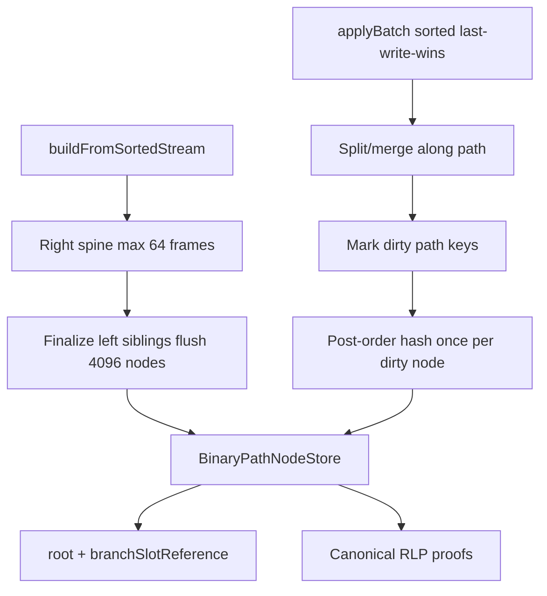

# WP-16e: `@ethereumjs/mpt` — Path-Keyed `BinaryPathMPT` Strain (Packed Binary Branch Nodes, `O(depth)` Streaming Builder, Reverse-Diff Anchor Snapshots & Proof Generator)

- **Status:** `PLANNED`
- **Dependencies:** `WP-04i` (`DONE`), `WP-04j` (`DONE`)
- **Planner:** Grok 4.7
- **Implementer:** Composer 2.5

---

## 1. Holistic Scope & Architectural Requirements

### Goal
Add a clean, opt-in, **Path-Based Binary Merkle Patricia Trie (`BinaryPathMPT`)** strain directly inside **`@ethereumjs/mpt`** (separate upstream commit per **D-008**; **100% additive**, zero breaking changes to classic `MerklePatriciaTrie`!).

Classic hash-keyed `MerklePatriciaTrie` (`packages/mpt/src/mpt.ts`) stores nodes by `keccak256(nodeRlp)` and allocates JS `BranchMPTNode`/`LeafMPTNode` objects and 64-element `number[]` nibble arrays per key. At Mainnet `1/16th` custody scale (`~18.75M` accounts + `~94M` storage slots per bucket), hash-keyed node DBs suffer from unbounded orphan growth (or pruning conflicts with anchor snapshots), V8 heap pressure, and duplicate leaf storage.

**`BinaryPathMPT`** brings Geth path-based / Reth trie ergonomics to pure TypeScript (`@ethereumjs/mpt`, pure-JS default with caller-injected `keccak256` per `security.mdc` S3 — zero WASM embedded in `@ethereumjs/mpt`!):
1. **Path-Keyed In-Place Overwrites (Zero Pruning Forever):** Interior nodes are keyed by their compact nibble path rather than `keccak256(nodeRlp)`. Updating a key overwrites `6–8` path entries in place — zero orphan nodes, zero garbage collection.
2. **Packed Binary Node Format (Zero JS Object / RLP Churn):** Compact binary branch/extension/leaf layout (`uint16 childMask` + packed 32B hashes or inline `< 32B` RLP bytes) that encodes to canonical Ethereum RLP **only** when hashing a dirty node or emitting EIP-1186 / range proof nodes.
3. **`O(depth)` RAM Streaming Builder from Sorted Key-Value Streams:** Builds a multi-million-key trie (or `1/16th` subtree trie rooted at high nibble `b`) in a single left-to-right streaming pass over sorted `(keyHash32, valueRlp)` rows while holding only `<= 64` stack frames in RAM.
4. **Zero-Duplicate Flat-Backed Leaf Mode (Optional):** Supports plugging in an external flat leaf lookup/iterator (e.g. Ethy's sorted `accounts/<b_hex>.bin` / `storage/<b_hex>.bin` or `FlatStateManager`) so interior branch nodes persist without duplicating millions of leaf payloads on disk.
5. **Lock-Free Reverse-Diff Anchor Snapshots (`< 100 KB / block`):** Captures immutable historical anchor views (`captureAnchor(anchorId)`, bounded ring e.g. `maxAnchors = 4`) by recording only the `~150` overwritten `(path -> previousNodeBytes)` entries per block — enabling `< 1 ms` proof generation at anchor `#A` while live BAL updates advance `#Head` concurrently!

---

### Key Deliverables (`WP-16e`)

1. **Compact Path Key & Packed Binary Node Codec (`packages/mpt/src/binaryPath/pathKey.ts`, `nodeCodec.ts`):**
   - **Compact Nibble Path Encoding (`Uint8Array` or packed binary key):** Encodes nibble paths of length `0..64` cleanly without allocating `number[]` arrays (e.g. `[lengthByte, ...packedNibbles]` — `<= 33` bytes max, typically `1–5` bytes for interior branch nodes!).
   - **Packed Binary Node Layout:**
     - **Branch Node:** `[tag = 0x01, uint16BE(childMask), uint16BE(inlineMask), ...childEntries, optionalValueBytes]` where each non-inline child is a fixed 32-byte `keccak256` hash and each inline child (`< 32` bytes RLP) is length-prefixed `[len: u8, ...rawRlp]`.
     - **Extension Node:** `[tag = 0x02, pathLen: u8, ...packedPathNibbles, childIsInline: u8, ...childHashOrInlineRlp]`.
     - **Leaf Node:** `[tag = 0x03, pathLen: u8, ...packedPathNibbles, ...valueRlp]` (or omitted from interior store when backed by external flat leaf storage).
   - **Canonical Ethereum RLP Serializer & Hasher (`encodeNodeToRlp`, `hashNode`):** Produces the **exact** canonical Ethereum MPT RLP encoding (17-element branch list, 2-element hex-prefix extension/leaf list, inline `< 32B` child rule) using caller-supplied `keccak256` (defaulting to `@noble/hashes/sha3.js` `keccak_256`).

2. **Pluggable Path-Node Store Seam (`packages/mpt/src/binaryPath/store.ts`):**
   - Minimal synchronous-or-async `BinaryPathNodeStore` interface (`getNode(pathKey)`, `putNode(pathKey, bytes)`, `deleteNode(pathKey)`, `applyBatch(ops)`) with:
     - Built-in fast `InMemoryBinaryPathStore` (zero deps, used for tests, small contract storage tries, and caching).
     - Clean byte-oriented persistence contract so `@ethereumjs/ethy` (`WP-16f`) can plug in a flat disk-backed / memory-mapped / chunked binary store with an LRU hot cache.
   - Optional `ExternalLeafReader` seam (`getLeafValue(keyHash32) => Uint8Array | undefined | Promise<Uint8Array | undefined>`) allowing interior-only persistence when leaves already reside in flat slabs.

3. **`BinaryPathMPT` Core Engine (`packages/mpt/src/binaryPath/binaryPathMPT.ts`):**
   - **Options (`BinaryPathMPTOpts`):**
     - `store?: BinaryPathNodeStore` (defaults to `InMemoryBinaryPathStore`)
     - `keccak256?: (data: Uint8Array) => Uint8Array` (defaults to `keccak_256`; Ethy injects WASM `ethyKeccak256` per `security.mdc` S3)
     - `prefixNibbles?: Uint8Array` (optional fixed root prefix — e.g. single nibble `[b]` for a `1/16th` custody bucket subtree whose `root()` returns `h_b` directly!)
     - `maxAnchorSnapshots?: number` (default `4`)
   - **Core Operations:**
     - `root(): Uint8Array` — returns current 32-byte root hash (`EMPTY_TRIE_ROOT` if empty; or `h_b` when scoped to prefix `[b]`).
     - `get(keyHash32: Uint8Array): Promise<Uint8Array | null>` — looks up canonical leaf value.
     - `put(keyHash32: Uint8Array, valueRlp: Uint8Array): Promise<void>` & `del(keyHash32: Uint8Array): Promise<void>` — in-place path updates (splitting/merging extensions & branches with exact Ethereum MPT semantics, including single-child branch collapse on `del`!).
     - `applyBatch(mutations: ReadonlyArray<{ key: Uint8Array; value: Uint8Array | null }>): Promise<Uint8Array>` — sorts & deduplicates a block's mutations (e.g. a BAL's `1/16th` writes), applies all updates, and re-hashes every dirty ancestor node **at most once** per block!
   - **Streaming Sorted-Slab Builder (`BinaryPathMPT.buildFromSortedStream`):**
     - Consumes an `Iterable` / `AsyncIterable` of strictly ascending `(keyHash32, valueRlp)` entries (accepting zero-copy views into `136B` account slabs or `64B` storage slabs!).
     - Maintains an `O(depth)` active path stack (`<= 64` frames), emits completed interior nodes straight to `store.applyBatch(...)` in bounded chunks (`e.g. 4,096` nodes/flush), and yields the exact final root hash (`root` or `h_b`) with flat RAM usage regardless of whether the stream has `1,000` or `20,000,000` leaves!

4. **Reverse-Diff Anchor Snapshots & Proof / Boundary-Range Generation (`packages/mpt/src/binaryPath/snapshots.ts`, `proofs.ts`):**
   - **Lock-Free Reverse-Diff Anchors:**
     - `captureAnchor(anchorId: string | bigint): Uint8Array` — marks the current root as an immutable snapshot anchor; subsequent `put` / `del` / `applyBatch` calls record only the first overwritten `(pathKey -> previousBytes | null)` per active anchor before mutating the live store, evicting the oldest anchor when `activeAnchors.size > maxAnchorSnapshots`.
     - `releaseAnchor(anchorId)` — frees diff memory immediately.
   - **EIP-1186 Single-Key & Multi-Key Proof Generator (`createProof(keyHash32, anchorId?)`, `createMultiProof(keys, anchorId?)`):**
     - Walks the path (at live head or historical `anchorId` via reverse-diff overlay), encodes each visited binary node to canonical Ethereum MPT RLP, deduplicates nodes across `keys`, and returns `Uint8Array[]` (`proofNodes[]`) directly verifiable by `verifyMerkleProof` / `verifyStatyMultiProof`!
     - Works identically for both **inclusion** and **exclusion** (non-existent key) proofs!
   - **Range Boundary Proof Generator (`createRangeBoundaryProof(originHash32, lastHash32, anchorId?)`):**
     - Emits the exact deduplicated left (`originHash32`) + right (`lastHash32`) boundary `proofNodes[]` directly verifiable by `@ethereumjs/mpt`'s `verifyMerkleRangeProof` — enabling `WP-16f` custodians to export brand-new self-proving `ETHY/0` chunks with **zero `snap/1`**!

5. **Public Exports, API Snapshot & Comprehensive Oracle / Perf Tests:**
   - Export `BinaryPathMPT`, `createBinaryPathMPT`, `InMemoryBinaryPathStore`, and types cleanly from `packages/mpt/src/index.ts`.
   - Refresh `config/public-api-snapshots/mpt.json` (`node --test scripts/public-api-snapshot.spec.mjs` must pass `17/17`).
   - **`packages/mpt/test/binaryPath/binaryPathMPT.spec.ts`:**
     - **Bit-for-Bit Consensus Oracle Test:** Compare `BinaryPathMPT` (both incremental `put`/`del`/`applyBatch` AND `buildFromSortedStream`) against classic `MerklePatriciaTrie` (`useKeyHashing: false`) across:
       - Empty trie, 1-key trie, 2-key shared-prefix extension splits, branch collapses on `del`, inline `< 32B` child nodes, and `2,000+` random 32-byte keys with `50` rounds of mixed `put` + overwrite + `del`!
       - Assert `equalsBytes(binaryTrie.root(), classicTrie.root())` after **every single round**!
     - **16-Way Subtree Split Oracle Test:** Split a `2,000`-key world trie into `16` independent `BinaryPathMPT` instances with `prefixNibbles = [0x0]..[0xf]` and assert `keccak256(RLP([h_0..h_f, 0x])) === classicFullTrie.root()` across 30 rounds of mutations!
     - **Proof & Range-Proof Interop Tests:** Verify every `createProof` (present + missing keys), `createMultiProof`, and `createRangeBoundaryProof` (at both live head AND captured historical `anchorId` after subsequent mutations!) passes classic `@ethereumjs/mpt` `verifyMerkleProof` and `verifyMerkleRangeProof`!
     - **Streaming Build Performance & Hash-Count Ratio Gate:** Build a `10,000`-key sorted trie via `BinaryPathMPT.buildFromSortedStream` vs classic `MerklePatriciaTrie` (`put` loop) and assert clean speed + hash-count efficiency in `< 2s` CI runtime.

---

### Acceptance Criteria (`WP-16e`)
- [ ] `BinaryPathMPT` lands in a clean, **100% additive upstream `@ethereumjs/mpt` commit (D-008)** with zero breaking changes to classic `MerklePatriciaTrie` and zero new runtime dependencies (pure-JS default, injectable `keccak256` per `security.mdc` S3).
- [ ] Matches classic `MerklePatriciaTrie` bit-for-bit on root hashes, `16`-way `[h_0..h_f]` subtree roots, EIP-1186 inclusion/exclusion proofs, and `verifyMerkleRangeProof` boundary proofs — including at historical reverse-diff anchors after subsequent live mutations.
- [ ] `buildFromSortedStream` builds sorted key-value streams in `O(depth)` stack RAM with batch flushes.
- [ ] `config/public-api-snapshots/mpt.json` is updated and `scripts/public-api-snapshot.spec.mjs` (`17/17`), `packages/mpt` `tsc`, `npm test`, and `cspell` all pass.

---

## 2. Concrete Implementation Plan (Planner — Grok 4.7)

Classic consensus oracle: [`MerklePatriciaTrie`](../../../mpt/src/mpt.ts) with `useKeyHashing: false`. Node RLP and the inline-under-32 rule already live in `_formatNode` / `BranchMPTNode.serialize` / `LeafMPTNode.serialize`. Sorted insert pattern to mirror: `putSortedLeaves` + `_commitStackSuffix`. **Do not modify** classic trie code paths.

**Out of scope:** Ethy `BucketSubtreeTrie`, disk path store, `0x0d`/`0x0e` wire serving (**WP-16f**). No new `package.json` dependencies; no WASM inside `@ethereumjs/mpt`.

### 2.1 Design locks

| Topic | Rule |
| --- | --- |
| Trie model | 16-way Ethereum Patricia (branches + extension/leaf compression). Packed binary is an **internal codec**; only `encodeNodeToRlp` output is consensus. |
| Keys | `0..32` byte keys (≤64 nibbles). Callers pass 32-byte account/storage hashes. Hot-path nibble access via packed bytes (`nibbleAt`), not `number[]` / `bytesToNibbles` on every step. |
| `root()` | Always 32 bytes. Empty trie: `keccak(RLP(''))` with injected hasher (same as `EMPTY_TRIE_ROOT`). Nonempty root: hash canonical root-node RLP even when `< 32` bytes (classic `topLevel` rule in `_formatNode`). |
| `branchSlotReference()` | Bytes placed in a parent **branch list** slot (WP-16f `RLP([h_0..h_f, 0x])`). **Empty trie:** `new Uint8Array(0)` (empty slot), never `EMPTY_TRIE_ROOT`. **Occupied, RLP &lt; 32:** inlined raw node (classic non-root `_formatNode`). **Otherwise:** 32-byte `root()` hash. Never pass raw short RLP into `RLP.encode` as if it were a hash byte string. Oracle tests use ≥2k keys so every bucket is occupied; assert `branchSlotReference() === root()` per bucket. |
| `prefixNibbles` | Optional fixed prefix (e.g. `[b]` for 1/16 custody). Store path keys are **relative** to prefix. `get` / `put` / `del` accept full keys; throw if prefix mismatch. `root()` is `h_b`. |
| Proofs | `createProof` returns canonical node RLP, **root node first** (same contract as `createMerkleProof` / `createMPTFromProof`). Unprefixed: `verifyMerkleProof(key, proof, { root, useKeyHashing: false })`. Prefixed subtree: proof is tail under `h_b`; full-key verify (WP-16f) **prepends** parent branch RLP — lock with one prefixed interop test now. |
| Leaves | Default: leaf records (`tag 0x03`) in path store. Optional `leaves: { get, put?, del? }`. Read-only `leaves` without `put` → mutations throw. External leaves: interior-only persistence; missing child hash + `leaves.get` must reconstruct leaf whose `keccak(leafRlp)` matches. `buildFromSortedStream` + `leaves` set: skip writing leaf bodies. **Copy** retained bytes; never pin slab views in long-lived maps (`binary-and-scale.mdc`). |
| Store | `BinaryPathNodeStore` is async (`Promise`). `InMemoryBinaryPathStore`: 256-way shard map on `pathKey[1] ?? 0` (byte 0 is nibble length — do **not** shard on byte 0). WP-16f plugs disk/LRU here. |
| Anchors | `captureAnchor(id)` records `root` + empty diff map. First overwrite of each `pathKey` while anchor live copies prior bytes (or tombstone) into that anchor only; later overwrites skip. `releaseAnchor` frees diff. Ring: `maxAnchorSnapshots` (default `4`), drop oldest by capture order. Historical reads overlay diff on live store; no trie clone, no lock. |
| Hasher | Default `@noble/hashes/sha3.js` `keccak_256`. `opts.keccak256` for **node** hashing only (Ethy WASM injects at boundary per `security.mdc` S3). |

### 2.2 Packed record layout

**Path key:** `[nibbleLength: u8, packedNibbles…]` (odd length: pad low nibble `0`). Max 33 bytes. Owned copy on store.

**Stored record:** `body || keccak256(canonicalRlp)` (32-byte trailer). Trailer lets dirty parents read clean child hashes without re-encoding.

| Tag | Body |
| --- | --- |
| `0x01` branch | `uint16BE childMask`, `uint16BE inlineMask`, children in nibble order 0..15: inline = `u8 len` + canonical child RLP; else 32-byte hash; trailing bytes = branch value (empty = none) |
| `0x02` extension | `pathLen u8`, packed path, `childIsInline u8`, inline RLP or 32-byte hash |
| `0x03` leaf | `pathLen u8`, packed path, value RLP bytes (omit from store when external `leaves` owns payload) |

`encodeNodeToRlp` builds branch 17-list / extension-or-leaf 2-list with hex-prefix via existing semantics (`addHexPrefix`, inline child raw arrays). `hashNode = keccak(encodeNodeToRlp(body))`.

### 2.3 File tree (`packages/mpt/src/binaryPath/`)

| File | Responsibility |
| --- | --- |
| `pathKey.ts` | Pack/unpack path keys; `nibbleAt(key, i)`; lex sort helper for batches |
| `nodeCodec.ts` | Decode/encode packed bodies; `encodeNodeToRlp`, `hashNode` |
| `store.ts` | `BinaryPathNodeStore`, `BinaryPathBatchOp`, `InMemoryBinaryPathStore` |
| `binaryPathMPT.ts` | `createBinaryPathMPT`, `get`/`put`/`del`/`applyBatch`, `buildFromSortedStream`, `root`, `branchSlotReference` |
| `snapshots.ts` | Anchor ring, diff overlay on read, `captureAnchor` / `releaseAnchor` |
| `proofs.ts` | `createProof`, `createMultiProof`, `createRangeBoundaryProof` |
| `index.ts` | Barrel re-exported from `packages/mpt/src/index.ts` |

**Mutations** mirror `_stageNodeUpdate` / `_deleteNode`: match-leaf update, branch insert, extension/leaf split, terminal branch value, single-child branch collapse → extension or lengthened leaf, empty trie on delete. No `BranchMPTNode` instances on write path.

**`applyBatch`:** sort keys unsigned lex, last-write-wins; `null`/empty value = delete; one bottom-up hash pass; return `root()`.

**`buildFromSortedStream`:** strict ascending keys; reject duplicates; `O(depth)` spine; on key divergence finalize suffix like `_commitStackSuffix`; hash each completed node once; flush store batches every 4096 nodes; return built trie (or final `root()`).

### 2.4 Proofs

- `createProof(key, anchorId?)` — inclusion/exclusion; walk live or anchor overlay; dedupe not required for single key; output order root → leaf path.
- `createMultiProof(keys, anchorId?)` — sorted keys; dedupe nodes by `keccak(rlp)`; root stays first.
- `createRangeBoundaryProof(origin, last, anchorId?)` — merged boundary nodes for `verifyMerkleRangeProof(root, origin, last, keys, values, proof, keccak256)`.

### 2.5 Public API & implementer gates

- Export `BinaryPathMPT`, `createBinaryPathMPT`, `InMemoryBinaryPathStore`, option/store/leaf types from `packages/mpt/src/index.ts` (JSDoc per `api-docs.mdc`).
- `packages/mpt/CHANGELOG.md` Unreleased bullet; regenerate `config/public-api-snapshots/mpt.json`.
- **Tests:** `packages/mpt/test/binaryPath/binaryPathMPT.spec.ts` (Node + browser; no `node:fs`):
  - Codec vs classic `serialize()` (branch, extension, leaf, inline child).
  - Root oracle vs classic after every step: empty, 1-key, shared-prefix, delete collapse, inline child; then 2k random 32-byte keys × 50 rounds put/overwrite/del — incremental **and** `buildFromSortedStream`.
  - 16× `prefixNibbles = [0x0]..[0xf]`, 2k keys (all nibbles), 30 mutation rounds; `keccak(RLP([h_0..h_f, 0x])) === classicFull.root()`.
  - `verifyMerkleProof`, `createMultiProof`, `verifyMerkleRangeProof` at live head and at `anchorId` after later mutations; one prefixed case with prepended parent branch RLP.
  - 10k-key stream build `< 2s`; counting hasher shows ~one hash per node vs classic put loop.

**Gates:** `node --test scripts/public-api-snapshot.spec.mjs`, `cd packages/mpt && npm run tsc && npm test`, root spellcheck on touched files.

**Commit discipline:** one **D-008** upstream commit (`packages/mpt` + `mpt.json` snapshot only), separate from ethy doc commits.

### 2.6 Design refinements (planner)

1. **`branchSlotReference()`** — explicit API for WP-16f root-branch assembly; distinguishes empty slot, inline node, and hash reference (classic `_formatNode` trichotomy).
2. **Prefixed proof tail** — subtree proofs omit byte-aligned prefix nibbles; WP-16f prepends `RootNode(#A)` branch child slot; one test prevents drift.
3. **In-memory shard key** — use `pathKey[1]` not `pathKey[0]` for 256-way sharding (length byte is always index 0).
4. **External leaf store** — optional seam keeps interior nodes on disk without duplicating flat slabs; mutations require `put`/`del` on `leaves` when enabled.

---

## 3. Implementation Notes & Deviations (Implementer — Composer 2.5)

*(To be filled out by Composer 2.5 upon completion.)*
