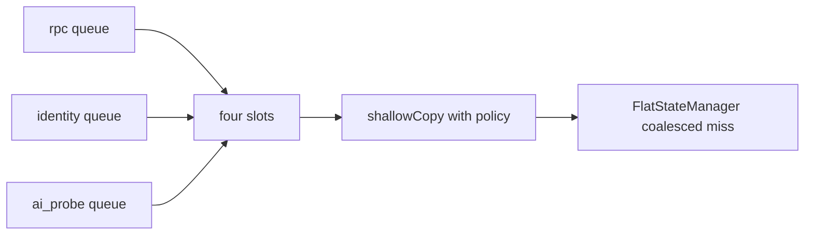

# WP-16h: Ethy Client-Wide Custody Leverage — Priority Concurrent EVM Sandbox, False-Zero-Safe JSON-RPC & Tx Broadcast, Live ENS & Zero-Leech AI Forensics, Mode-Aware Gating & Onboarding UX

- **Status:** `DONE`
- **Dependencies:** `WP-16b` (`DONE`), `WP-16c`–`WP-16g` (`DONE`), `WP-08b` (`DONE`), `WP-15` (`DONE`)
- **Planner:** Grok 4.7
- **Implementer:** Composer 2.5

---

## 1. Holistic Scope & Architectural Requirements

### Goal
Audit and upgrade every client subsystem built under the legacy *"wait for all 16 SNAP buckets before state is usable"* assumption so the **entire Ethy product** — JSON-RPC & MetaMask tx sending, EVM Sandbox, Live ENS (`IdentityResolver`), AI Contract Forensics & Storyteller, Start Page / Plaza UX, and persistent config — fully harvests the speed, 1-hop custody completeness, and safety invariants of **Unified Custody `ETHY/0`**.

---

### Concrete Architectural Gaps Addressed (`WP-16h`)

Audit of the live Ethy codebase identified six concrete subsystems that would otherwise stall, silently lie, leech `snap/1`, or lock out commands under Custody `ETHY/0`:

1. **Single Serial EVM Sandbox Queue (`src/evm/queue.ts`):**
   - Currently one global FIFO promise chain serializes all `eth_call`, `eth_estimateGas`, `IdentityResolver`, and AI `ContractDossierProbes` calls.
   - Under Open-World Custody mode, a single cold-miss `eth_call` waiting `50–250 ms` on a 1-hop `ETHY/0` witness/chunk blocks hot MetaMask calls, prevents concurrent witness coalescing, and blows past AI probe budgets (`PROBE_BUDGET_MS = 100`).
2. **False-Zero Danger in JSON-RPC & Tx Validation (`src/rpc/methods.ts`, `src/txpool/validate.ts`):**
   - `eth_getBalance` / `eth_getTransactionCount` / `validateRawTransaction` currently treat `account === undefined` as `0n`. In Open-World buckets (the 14 remote buckets under default `--custody 2`), an unresolved network timeout MUST NOT fabricate a `0 ETH` balance or `nonce = 0`!
3. **Synchronous ENS Registry Gate (`src/contracts/identityResolver.ts`):**
   - `hasLocalEnsRegistry()` synchronously checks RAM/disk only, missing the chance to warm the ENS Registry + Reverse Registrar in 1 hop from their bucket custodians immediately on boot and unlock live `.eth` resolution within minutes.
4. **Background AI `snap/1` Leeching Risk (`src/contracts/contractDossierProbes.ts`, `src/ai/investigationTools.ts`):**
   - Without policy isolation, autonomous background AI forensics probing random newly-seen contracts could trigger Day-1 `snap/1` fallback on uncovered buckets — violating our anti-leeching P2P citizenship invariant.
5. **16-Bucket SNAP Lockouts in Command Gating & Capability Derivation (`src/domains/commandAvailability.ts`, `src/spine/createSpine.ts`):**
   - `/account` checks `snapBucketsDoneCount === 16`, `/range` and `/sample` assume 16-bucket SNAP journals, and `deriveStateCapability` only models `SNAP_SYNCING` / `BAL_CATCHUP`.
6. **Start Page, Plaza Privacy Districts & Persistent Custody Config (`StartPageUIComponent.ts`, `LiveHeadPlazaUIComponent.ts`, `persist/userConfig.ts`):**
   - Start page and Plaza do not yet surface fast 2-stage Custody onboarding (`Rolling BALs → Live + Background Custody`), per-district Closed-World vs 1-Hop Swarm lights, or saved `custodyCount` preferences.

---

### Key Deliverables (`WP-16h`)

1. **Priority Concurrent EVM Sandbox Pool (`packages/ethy/src/evm/queue.ts`, `evm/sandbox.ts`):**
   - Replace the single serial FIFO `enqueueSandbox` with a bounded concurrent scheduler (`maxConcurrent = 4`) supporting **3 priority lanes**:
     - `'rpc'` (highest — user JSON-RPC `eth_call`, `eth_estimateGas`, `eth_createAccessList`, `/simulate`; `resolutionPolicy: 'full'`, default timeout `5,000 ms`).
     - `'identity'` (medium — `IdentityResolver` ENS / `name()` / `symbol()`; `resolutionPolicy: 'swarm-only'` for background block hooks, `'full'` for explicit `/contract` or `/account` user commands; timeout `1,500 ms`).
     - `'ai_probe'` (lowest — `ContractDossierProbes` & autonomous AI investigation tools; **`resolutionPolicy: 'swarm-only'` ALWAYS** — resolves via 1-hop `ETHY/0` custodians freely, **NEVER** touches `snap/1`!; timeout `600 ms` per call, `1,200 ms` dossier probe budget).
   - Concurrent execution naturally feeds `CustodyStateResolver`'s `10–25 ms` coalescing window when MetaMask batches parallel `eth_getBalance` + `eth_call` + `eth_estimateGas` requests.

2. **False-Zero-Safe JSON-RPC, End-to-End Tx Broadcast & `ethy_custodyStatus` (`packages/ethy/src/rpc/methods.ts`, `txpool/validate.ts`, `tools/rpcTools.ts`):**
   - Catch `StateMissUnavailableError` across `eth_getBalance`, `eth_getTransactionCount`, `eth_getCode`, `eth_getStorageAt`, `eth_call`, `eth_estimateGas`, `eth_createAccessList`, and `eth_sendRawTransaction` → return an explicit, honest JSON-RPC error (`code: -32000`, `message: "State witness unavailable for open-world key; retry"`). **Never fabricate `0x0` on an unresolved miss.**
   - Verify end-to-end wallet / MetaMask transaction workflow under default `--custody 2`:
     - Cold wallet `eth_getBalance` + `eth_getTransactionCount` → 1-hop `ETHY/0` witness/chunk from the wallet's bucket custodian.
     - Active ERC-20 / DEX `eth_estimateGas` → hot contract local + 1-hop verified `balances[sender]` witness.
     - `eth_sendRawTransaction` → verified sender balance/nonce + P2P `eth/71` broadcast + receipt in 64-block window.
   - Add **`ethy_custodyStatus`** JSON-RPC method and extend **`ethy_status`** with `custodyCount` (`1..16`), `custodyBucketsMask`, `closedBucketsMask`, `trieBucketsMask`, `swarmReachableBucketsMask`, `privateBucketsCount` (`0..16`), `balHorizon`, and `resolutionStats` (for external wallets, dashboards, and MCP consumers).
   - Update `/rpc` method status matrix (`tools/rpcTools.ts`) so `Head State`, `EVM Sandbox`, and `Tx Broadcast` show `● active` immediately upon entering live `HEAD_FOLLOWING` (not waiting for 16 SNAP buckets).

3. **Live ENS Unlock, Zero-Leech Contract Forensics & Provenance Badges (`packages/ethy/src/contracts/identityResolver.ts`, `contractDossierProbes.ts`, `tools/contractTools.ts`, `tools/headTools.ts`):**
   - **ENS Bootstrap (`IdentityResolver`):**
     - Add one-time async `warmEnsBootstrap()` upon entering `HEAD_FOLLOWING` (fetching ENS Registry + Reverse Registrar account & code in 1 hop from their `ETHY/0` bucket custodians → cached once for the whole session!).
     - Update `hasLocalEnsRegistry()` to reflect warmed `SharedCodeStore` accurately; resolve active tokens and forward-verified `.eth` reverse names cleanly on both Sepolia and Mainnet.
   - **Zero-Leech Deep Contract Forensics:**
     - Pass `lane: 'ai_probe'` (`resolutionPolicy: 'swarm-only'`) from `ContractDossierProbes` and autonomous `ChainDetective` tools; raise `PROBE_BUDGET_MS` to `400 ms` total so contracts resolve via local custody or 1-hop `ETHY/0` peers while uncovered buckets fail gracefully without ever touching `snap/1`.
   - **Honest Provenance Badges in `/account` & `/contract`:**
     - Surface exact source provenance (`Local Custody 🔒`, `Local BAL`, `Proven-Empty`, `ETHY 1-Hop Proof`, `ETHY 1-Hop Chunk`, or `SNAP Bootstrap`) so developers and operators can inspect exactly how every answer was cryptographically verified.

4. **Mode-Aware Command Gating, Start Page, Plaza 16-District Lights & Persistent Config (`packages/ethy/src/domains/commandAvailability.ts`, `spine/createSpine.ts`, `tui/`, `persist/userConfig.ts`):**
   - **Command Gating:** Unlock `/account`, `/contract`, `/simulate`, and `/rpc` as soon as `HEAD_FOLLOWING` is active (regardless of whether `closedBucketsMask` is `1/16` or `16/16`), and keep `/range` / `/sample` clearly scoped to locally closed custody buckets.
   - **Start Page (`StartPageUIComponent.ts`):** Replace legacy *"waiting for 16 SNAP buckets"* copy with crisp 2-stage Custody onboarding (`Rolling BALs → ★ Live + Background 2/16 Custody`), showing live custody bucket progress and 1-hop swarm coverage.
   - **Ethereum Plaza 16-District Custody & Privacy Lights (`LiveHeadPlazaUIComponent.ts`):** Visually distinguish each of the 16 nibble districts (`0x0..0xf`) between **Local Closed-World (`●` Private + Trie)**, **1-Hop Swarm Reachable (`◐`)**, and **Uncovered (`○`)**, so `--full` users watch all 16 districts lock into private local custody in real time.
   - **Persistent Custody Preference (`persist/userConfig.ts`):** Persist optional `custodyCount?: number` (`1..16`, rejecting `< 1`) in `<dataDir>/config.json` with clean CLI override precedence (`--full` / `--custody <N>` > `config.json` > default `2`).

5. **Comprehensive Client-Wide Regression Suite (`packages/ethy/test/custodyClientLeverage.spec.ts`):**
   - Concurrent sandbox priority test: 1 slow cold `'ai_probe'` miss does not block a concurrent hot `'rpc'` `eth_call`; `'ai_probe'` strictly receives `resolutionPolicy: 'swarm-only'`.
   - False-zero safety test: unresolved Open-World misses return JSON-RPC error `-32000` across `eth_getBalance`, `eth_getTransactionCount`, `eth_getStorageAt`, `eth_call`, and `eth_sendRawTransaction` (never `0x0`), while Closed-World buckets and proven-empty tombstones return `0x0` cleanly.
   - `ethy_custodyStatus` + `ethy_status` schema test, ENS warm-up test, mode-aware command availability test (`custody 1` live unlocks `/account`, `/contract`, `/simulate`), and `config.json` `custodyCount` precedence test.

---

### Acceptance Criteria (`WP-16h`)
- [x] Bounded concurrent EVM sandbox (`rpc > identity > ai_probe`) eliminates head-of-line blocking and locks autonomous AI probes to `'swarm-only'` (`0` `snap/1` leeching).
- [x] JSON-RPC and tx validation never fabricate `0x0` on unresolved Open-World misses (`-32000` honest error); `ethy_custodyStatus` exposes accurate custody/privacy/1-hop telemetry.
- [x] ENS bootstrap warms in 1 hop over `ETHY/0`, `/account` + `/contract` display honest provenance badges, and Start Page / Plaza / command gating reflect Unified Custody `ETHY/0` cleanly.
- [x] `npm run tsc`, `npm test`, and `npm run spellcheck` pass in `packages/ethy`.

---

## 2. Concrete Implementation Plan (Planner — Grok 4.7)

Dependencies **WP-16b**–**WP-16g**, **WP-08b**, **WP-15** are **DONE**. No new runtime dependencies. No new DevP2P message codes. No upstream package edits required for core behavior: `StateMissUnavailableError` and `shallowCopy({ resolutionPolicy })` already ship on `FlatStateManager` (**WP-16b**).

### 2.1 Baseline (what the audit still gets wrong)

| Area | Today | WP-16h delta |
| --- | --- | --- |
| **EVM queue** | Single FIFO `tail` in `queue.ts`; `sandbox.ts` always `shallowCopy()` with default policy `'full'` | Bounded pool `maxConcurrent = 4`, lanes `rpc > identity > ai_probe`, per-job `resolutionPolicy` + timeout |
| **JSON-RPC / tx** | `methods.ts` maps throws to `-32602`; `acc?.balance ?? 0n` fabricates zero; `validate.ts` same | `StateMissUnavailableError` → `-32000` honest message; never `0x0` on open-world miss |
| **ENS** | `hasLocalEnsRegistry()` sync RAM/disk only | One-shot `warmEnsBootstrap()` on `HEAD_FOLLOWING`, identity lane `'swarm-only'` |
| **AI probes** | `PROBE_BUDGET_MS = 100`; dossier + detective use same `'full'` sandbox as RPC | `ai_probe` lane `'swarm-only'` always; dossier budget **`1_200` ms** (**D-152**) |
| **Command gating** | `/account` needs `snapBucketsDoneCount === 16` | Head-following unlock; `/range`/`/sample` scoped to `closedBucketsMask` |
| **RPC status matrix** | Head State / EVM active only with accounts or lag ≤ 2 | `● active` on `HEAD_FOLLOWING` |
| **Start / Plaza** | Crystal banner; Plaza heat only | Custody onboarding line; `●`/`◐`/`○` per nibble district |
| **Config** | AI-only `config.json`; CLI never reads saved `custodyCount` | Persist `custodyCount` with precedence (**D-152**) |
| **Provenance** | Aggregate `spine.custodyResolve` counters only | LRU per account-hash + `/account` / `/contract` `Source` row |

### 2.2 Design locks (**D-152**)

**Scheduler.** Replace FIFO with bounded pool (`maxConcurrent = 4`), three lanes, highest first: `rpc` > `identity` > `ai_probe`. A freed slot always drains the highest-priority non-empty queue. Running work is not cancelled. On caller timeout, reject the client promise immediately; the slot stays occupied until the underlying EVM promise settles (**D-152** — real cap remains four concurrent jobs). Each job uses its own `shallowCopy({ resolutionPolicy })`. Root miss coalescing stays the resolver in-flight `Map` (existing 10–25 ms witness batch window).

| Lane | Callers | `resolutionPolicy` | Timeout |
| --- | --- | --- | --- |
| `rpc` | `eth_call`, `eth_estimateGas`, `eth_createAccessList`, `/simulate` | `'full'` | `5_000` ms |
| `identity` | `IdentityResolver` background / `resolveNow` | `'swarm-only'` | `1_500` ms |
| `identity` | Explicit user `/account` / `/contract` identity (opt `userFacing: true`) | `'full'` | `1_500` ms |
| `ai_probe` | `ContractDossierProbes`, `probeContractViewLive` | `'swarm-only'` always | `600` ms per call |

**Dossier budget.** Lock wall clock at **`PROBE_BUDGET_MS = 1_200`** (**D-152** — coordinator text had conflicting `400` vs `1_200`; `400` cannot cover one `600` ms probe). Uncovered buckets miss gracefully; never `snap/1`.

**False zero.** Map `StateMissUnavailableError` to `{ code: -32000, message: "State witness unavailable for open-world key; retry" }` on `eth_getBalance`, `eth_getTransactionCount`, `eth_getCode`, `eth_getStorageAt`, `eth_call`, `eth_estimateGas`, `eth_createAccessList`, `eth_sendRawTransaction`. Do not remap to `-32602`. Closed-world bucket hits and proven-empty tombstones still return `0x0` / `'0x'`. Sandbox timeouts: `-32000` with `EVM sandbox timed out`.

**ENS warm-up.** One-shot `warmEnsBootstrap()` when phase becomes `HEAD_FOLLOWING` (hook in `peerCoordinator.ts` custody flip, not TUI). Chains `1` and `11155111` only. Async `getAccount` + `getCode` on registry `ENS_REGISTRY_MAINNET` and reverse registrar `0x084b1c3c81545d370f3634392de611caabff8148` via identity lane `'swarm-only'`. Session flag drives `hasLocalEnsRegistry()` after warm-up.

**Provenance badges.** Extend `noteCustodyResolve` with 256-entry LRU keyed by account-hash hex: `Local Custody`, `Local BAL`, `Proven-Empty`, `ETHY 1-Hop Proof`, `ETHY 1-Hop Chunk`, `SNAP Bootstrap`. Export `provenanceLabel(accountHash)`. `/account` and `/contract` add `Source` row; sync `getAccountByHash` miss stays `Not in flat store`.

**Command gating.** `/account`, `/contract`, `/simulate`: `ready` when `phase === 'HEAD_FOLLOWING'` (demo clock with blocks included). `/range`, `/sample`: `ready` when `closedBucketsMask !== 0` or legacy snap complete; filter rows to closed nibbles in `range.ts`. `/rpc` unchanged. `rpcTools` Head State, EVM Sandbox, Tx Broadcast: `● active` on `HEAD_FOLLOWING` or `demoClock`.

**Plaza / Start.** Start page: one custody line under crystal (`Rolling BALs` during `custodyBalOnboarding`, then `★ Live + Background N/16 Custody`, `hopBuckets/16` when live). Plaza neighborhood: keep heat spark; add `●` closed, `◐` swarm-reachable (`closed | ~uncovered`), `○` uncovered.

**Config precedence (**D-152**).** Optional `custodyCount` on `EthyUserConfig` (`1..16`; ignore invalid). Resolve: `--full` / explicit `--custody` > `config.json` > default `2`. Persist on explicit CLI when not `--no-save`. Extend read/write so custody and `ai` blocks do not clobber each other.

### 2.3 File-by-file

#### 1. `src/evm/queue.ts`

Export `SandboxLane`, lane priority, `enqueueSandbox(work, opts?)` with defaults `lane: 'rpc'`, `resolutionPolicy: 'full'`, `timeoutMs: 5_000` for backward compatibility.

#### 2. `src/evm/sandbox.ts`

`prepareOverlay(root, override, policy)`. Thread lane + policy + timeout into all run methods. Map `StateMissUnavailableError` and timeout to `-32000` inside the job.

#### 3. `src/rpc/methods.ts`

Shared `stateMissRpcError(e)` for account reads. Add `ethy_custodyStatus`; extend `ethy_status` with custody object (`custodyCount`, masks, `privateBucketsCount`, `balHorizon`, `resolutionStats`).

#### 4. `src/txpool/validate.ts`

Catch `StateMissUnavailableError` around `getAccount(sender)` → `-32000` before nonce/balance checks.

#### 5. `src/tools/rpcTools.ts`

`HEAD_FOLLOWING` activates head state, EVM, tx broadcast groups; list `ethy_custodyStatus` under Ethy Native.

#### 6. `src/contracts/identityResolver.ts`

`warmEnsBootstrap()`, session flag, lane opts on internal `eth_call`s; `resolveNow` / `onBlock` → `'swarm-only'`; `userFacing` → `'full'`.

#### 7. `src/contracts/contractDossierProbes.ts` + `src/ai/investigationTools.ts`

`PROBE_BUDGET_MS = 1_200`; probes call sandbox with `ai_probe` + `'swarm-only'`.

#### 8. `src/custody/custodyStateResolver.ts`

LRU provenance beside counters.

#### 9. `src/tools/headTools.ts`, `contractTools.ts`

`Source` provenance row.

#### 10. `src/domains/commandAvailability.ts`, `tools/range.ts`, `ai/deterministicEngine.ts`

Mode-aware gating; closed-nibble filter on range/sample.

#### 11. `src/spine/createSpine.ts`

Custody-aware state capability label (`Rolling BALs` during onboarding).

#### 12. `src/tui/components/StartPageUIComponent.ts`, `LiveHeadPlazaUIComponent.ts`

Onboarding line; district custody glyphs.

#### 13. `src/persist/userConfig.ts`, `cli/main.ts`

`custodyCount` parse, resolve, merge write with `ai`.

#### 14. `src/net/peerCoordinator.ts`

Invoke `warmEnsBootstrap()` once on custody head flip (wire `IdentityResolver` ref).

### 2.4 Tests & gates

| Suite | File |
| --- | --- |
| Client-wide leverage | `test/custodyClientLeverage.spec.ts` (new) |
| Adjust regressions | specs that assumed 16-bucket `/account` or false-zero RPC |

**Cases:** concurrent priority (slow `ai_probe` does not block `rpc`); false-zero vs tombstone/closed bucket; `ethy_custodyStatus` schema; ENS warm-up `'swarm-only'`; command availability at `HEAD_FOLLOWING` + partial custody; `config.json` precedence.

Finish: `npm run tsc`, `npm test`, `npm run spellcheck` in `packages/ethy`.

### 2.5 Commit split (implementer)

1. EVM pool + sandbox policy lanes.
2. RPC false-zero + `ethy_custodyStatus` + tx validate.
3. ENS warm-up + AI zero-leech probes.
4. Provenance + command gating + range filter.
5. TUI Start/Plaza + config persistence.
6. `custodyClientLeverage.spec.ts` + test fixes.

**Out of scope:** New message codes, `BinaryPathMPT`, WP-11 scenario edits, live MetaMask soak (covered by RPC + `custodyColdMissLoopback.spec.ts`).

---

## 3. Implementation Notes & Deviations (Implementer — Composer 2.5)

Shipped in one branch pass (**D-153**): `evm/queue.ts` bounded pool; sandbox lane opts; RPC/tx false-zero + `ethy_custodyStatus`; identity `warmEnsBootstrap` on head flip; dossier `PROBE_BUDGET_MS = 1_200` + `ai_probe` lane; provenance LRU + `/account`/`/contract` Source row; head-following command gating; closed-bucket `/range` filter; Start/Plaza custody UX; `config.json` `custodyCount` merge-write; `test/custodyClientLeverage.spec.ts` (+ **583** tests, tsc, spellcheck). No upstream package edits.
